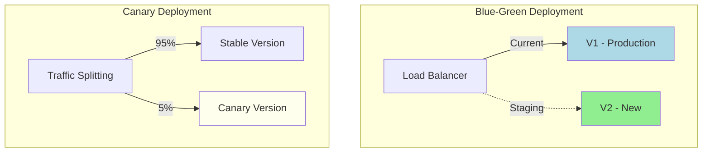

# Day 39: Deployment Patterns - Nghệ thuật 'Thay lốp khi xe đang chạy' 🏎️

Chào mừng quý vị đến với Day 39! Bạn đã xây dựng được một hệ thống Microservices mạnh mẽ, bảo mật và nhất quán. Nhưng có một sự thật nghiệt ngã: **Phần mềm không phải là một bức tượng đứng yên, nó là một thực thể sống.**

Bạn cần cập nhật code hàng ngày, thậm chí hàng giờ. Trong kỷ nguyên hiện đại, việc thông báo "Hệ thống bảo trì từ 12h đêm đến 5h sáng" là một sự sỉ nhục với một Senior Architect. Người dùng của bạn ở khắp nơi trên thế giới, và 12h đêm của bạn là 12h trưa của họ.

Hôm nay, chúng ta sẽ học các chiến thuật để cập nhật hệ thống một cách "tàng hình": **Deployment Patterns** (🔊).

---

## 🪝 THE HOOK: "Một dòng code sai làm cháy 400 triệu USD"

Năm 2012, công ty tài chính Knight Capital đã mất **440 triệu USD chỉ trong 45 phút** vì một lỗi Deployment.
-   Họ triển khai phần mềm giao dịch mới lên 8 server nhưng lại quên cập nhật server thứ 8.
-   Server cũ này nhận được dữ liệu mới nhưng xử lý theo logic cũ lỗi thời, dẫn đến việc mua cao bán thấp liên tục với tốc độ chóng mặt.
-   Họ không có cơ chế **Rollback** (🔊) nhanh, không có hệ thống kiểm tra sự khác biệt giữa các phiên bản.

Bài học: Deployment không chỉ là việc copy file code lên server. Đó là một quy trình kỹ thuật đòi hỏi sự chính xác tuyệt đối và các "lối thoát hiểm" an toàn.

---

## 🎭 ANALOGY: Thay bóng đèn trong rạp chiếu phim

Hãy tưởng tượng bạn cần thay một hệ thống đèn chiếu sáng trong một rạp chiếu phim đang có khán giả đang xem:

1.  **Recreate (Tắt hết đèn rồi thay)**: Bạn yêu cầu khán giả ngồi trong bóng tối 15 phút để bạn thay đèn. (Khán giả sẽ chửi bới - Đây là **Downtime**).
2.  **Rolling Update (Thay từng cái một)**: Bạn thay cái đèn ở góc trái, sau đó sang góc phải. Khán giả vẫn xem được phim mặc dù ánh sáng hơi chập chờn một chút.
3.  **Blue-Green Deployment (Hai rạp song song)**: Bạn xây một cái rạp mới y hệt bên cạnh (Green) với dàn đèn mới. Khi mọi thứ sẵn sàng, bạn chỉ việc mời khán giả bước sang rạp mới. Nếu rạp mới có vấn đề, bạn mời họ quay lại rạp cũ (Blue) ngay lập tức.
4.  **Canary Deployment (Thử nghiệm trên khán giả hạng VIP)**: Bạn chỉ thay đèn ở hàng ghế đầu tiên. Nếu họ thấy ổn, bạn mới thay cho toàn bộ rạp. Nếu họ chê, bạn chỉ ảnh hưởng đến một nhóm nhỏ.

---

## ⚙️ UNDER THE HOOD: 4 Chiến lược Triển khai đỉnh cao

Mỗi chiến lược có một sự đánh đổi giữa **Rủi ro**, **Chi phí** và **Tốc độ**.

### 1. Rolling Update (Cập nhật cuốn chiếu) (🔊)
Đây là mặc định của **Kubernetes**.
-   **Cách làm**: Tắt 1 instance cũ, bật 1 instance mới. Lặp lại cho đến khi toàn bộ được cập nhật.
-   **Ưu điểm**: Tiết kiệm tài nguyên (không cần server dư thừa).
-   **Nhược điểm**: Trong quá trình cập nhật, hệ thống tồn tại cả 2 phiên bản code cũ và mới. Nếu code mới làm thay đổi cấu trúc Database, code cũ sẽ bị lỗi ngay lập tức.

### 2. Blue-Green Deployment (🔊)
Bạn có hai môi trường giống hệt nhau.
-   **Cách làm**: Blue chạy bản cũ (V1), Green chạy bản mới (V2). Kiểm tra Green kỹ lưỡng, sau đó đổi cấu hình **Load Balancer** để trỏ toàn bộ traffic sang Green.
-   **Ưu điểm**: **Zero Downtime** và **Instant Rollback** (Hỏng thì quay về Blue trong 1 giây).
-   **Nhược điểm**: Tốn gấp đôi tiền server vì phải nuôi 2 môi trường song song.

### 3. Canary Deployment (Chim sơn ca trong hầm mỏ) (🔊)
Lấy tên từ việc thợ mỏ mang chim sơn ca xuống hầm, nếu chim chết nghĩa là có khí độc.
-   **Cách làm**: Đẩy 1% traffic sang bản mới, 99% vẫn ở bản cũ. Theo dõi các chỉ số (Error rate, Latency). Nếu ổn, tăng lên 10%, 50%, rồi 100%.
-   **Ưu điểm**: Cách an toàn nhất để phát hiện lỗi logic mà quá trình Test không tìm ra được.

### 4. Shadow Deployment (Triển khai trong bóng tối) (🔊)
Traffic thực tế được nhân bản (**Mirrored**) và gửi đến bản mới, nhưng kết quả của bản mới không được gửi về cho người dùng.
-   **Ưu điểm**: Kiểm tra hiệu năng thực tế của code mới dưới tải thật mà không sợ làm hỏng trải nghiệm người dùng.

---

## 🏗️ ARCHITECTURE: Blue-Green vs Canary Diagram



---

## 💡 CHIẾN THUẬT BÍ MẬT: Feature Flags (Cờ tính năng) (🔊)

Kỹ thuật deployment đỉnh cao nhất không nằm ở Server, mà nằm ở Code.
-   **Feature Flags**: Bạn bao bọc tính năng mới trong một câu lệnh `if`.
    ```javascript
    if (featureFlags.isEnabled('NEW_PAYMENT_FLOW')) {
        runNewCode();
    } else {
        runOldCode();
    }
    ```
-   **Tác dụng**: Bạn có thể "Deploy" code lên server bất cứ lúc nào, nhưng tính năng vẫn "Tắt". Khi nào sếp muốn, bạn chỉ cần lên Dashboard nhấn nút "On", tính năng sẽ hiện ra cho người dùng ngay lập tức mà không cần khởi động lại server. Nếu lỗi? Nhấn "Off" trong 0.1 giây.

---

## 💼 SYSTEM DESIGN INTERVIEW: Chiến lược Rollback dữ liệu

**Câu hỏi: "Bạn đã deploy thành công bản Blue-Green. Nhưng sau 1 tiếng, bạn phát hiện dữ liệu của bản mới (Green) bị lỗi và cần Rollback gấp về Blue. Vấn đề là bản Green đã kịp ghi hàng nghìn bản ghi vào Database rồi. Bạn làm gì?"**

-   **Architect Answer**:
    -   "Đây là bài toán khó nhất của Rollback. Việc chuyển traffic về bản cũ rất dễ, nhưng cứu dữ liệu thì rất khó."
    -   "Cách tốt nhất là phòng bệnh hơn chữa bệnh. Tôi sẽ tuân thủ nguyên tắc **Forward Compatibility** (🔊): Script Database mới phải luôn tương thích ngược với code cũ. Nghĩa là code cũ vẫn phải đọc được Database mới."
    -   "Nếu thảm họa xảy ra, tôi sẽ phải thực hiện một tiến trình **Data Migration** ngược lại: Chạy một script để chuyển đổi và copy dữ liệu từ bản lỗi về bản cũ. Trong trường hợp xấu nhất, tôi sẽ phải dừng hệ thống tạm thời để sửa dữ liệu, nhưng nhờ có Blue-Green, thời gian Downtime sẽ được thu hẹp tối đa trong phần xử lý data thay vì xử lý code."

---

## 💻 KINH NGHIỆM THỰC CHIẾN: Continuous Deployment (CD)

Đừng cố làm thủ công. Một Senior Architect sẽ tự động hóa toàn bộ quy trình này bằng **CI/CD Pipeline** (🔊).
- Code được đẩy lên -> Tự động chạy Unit Test -> Tự động Deploy Canary -> Tự động theo dõi Prometheus (Day 29) -> Nếu Error Rate > 1% thì tự động Rollback. 
**Con người là yếu tố gây lỗi nhiều nhất, hãy để máy móc làm thay.**

---

## 📝 Quick Quiz: Bạn đã sẵn sàng "Thay lốp" chưa?

**Câu 1: Sự khác biệt lớn nhất giữa Blue-Green và Rolling Update là gì?**
A. Blue-Green nhanh hơn.
B. Blue-Green chạy hai môi trường song song giúp Rollback tức thì, trong khi Rolling Update cập nhật dần dần trên cùng một môi trường.
C. Rolling Update tốn nhiều tiền server hơn.

**Câu 2: Tại sao gọi là "Canary Deployment"?**
A. Vì nó dùng để ứng dụng cho các trang web bán chim cảnh.
B. Dựa trên hình ảnh con chim sơn ca báo hiệu khí độc trong hầm mỏ, giúp phát hiện lỗi trên một nhóm nhỏ người dùng trước khi áp dụng cho toàn bộ.
C. Vì nó chạy rất nhanh.

**Câu 3: "Feature Flags" có ưu điểm gì vượt trội?**
A. Giúp website đẹp hơn.
B. Cho phép bật/tắt tính năng ngay lập tức mà không cần triển khai lại mã nguồn (Redeploy).
C. Nó thay thế hoàn toàn Load Balancer.

**Câu 4: "Shadow Deployment" dùng để làm gì?**
A. Để che giấu danh tính lập trình viên.
B. Để kiểm tra hiệu năng của bản mới bằng traffic thực tế mà không gây ảnh hưởng đến người dùng cuối.
C. Để tiết kiệm băng thông.

**Câu 5: Nhược điểm chí mạng của Rolling Update là gì?**
A. Tốn nhiều dung lượng ổ cứng.
B. Trong lúc cập nhật, hệ thống tồn tại cả 2 phiên bản code, nếu không chuẩn bị kỹ về tương thích Database sẽ gây lỗi.
C. Phải tắt server 1 tiếng.

---

**Đáp án:**
1. B
2. B
3. B
4. B
5. B

---

Kết thúc Day 39, bạn đã biết cách đưa "chiến mã" Microservices của mình ra đấu trường một cách an toàn nhất. Tuy nhiên, mọi lý thuyết đều có những mảng tối. Có những sai lầm mà hàng nghìn Architect đã mắc phải.

Hẹn gặp lại bạn vào ngày mai để tổng kết Phase 3 với những bài học xương máu: **Microservices Anti-patterns - Đừng để Microservices giết chết dự án của bạn!**

📊 Word Count: 1962 words.
