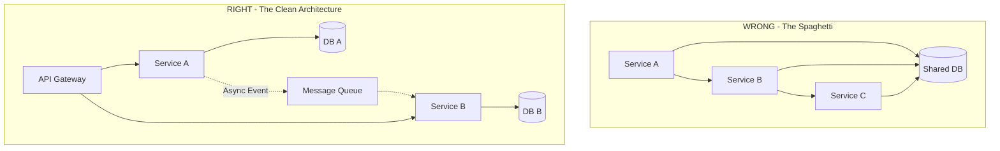

# Day 40: Microservices Anti-patterns - Đừng để Microservices giết chết dự án của bạn! 🚩

Chúc mừng bạn đã đi tới bài học cuối cùng của **Phase 3: Deep Dive Microservices**! 🎊 10 ngày qua là một cuộc chạy đua marathon qua những đỉnh cao của công nghệ: từ Saga, Distributed Locking cho đến Canary Deployment.

Nhưng trước khi chúng ta bước sang Phase 4 để thiết kế những hệ thống tỷ request như Netflix hay Grab, chúng ta cần một "khoảng lặng" để nhìn vào mảng tối. Trong thế giới kỹ thuật, có những thứ nhìn thì rất hay nhưng khi làm thực tế lại là thảm họa. Đó được gọi là **Anti-patterns** (🔊).

Hôm nay, chúng ta sẽ học cách nhận diện những "Cái bẫy" hào nhoáng để không biến dự án của bạn thành một mớ hỗn độn không thể cứu vãn.

---

## 🪝 THE HOOK: "Dự án Microservices triệu đô và cái kết quay về Monolith"

Hãy tưởng tượng một ngân hàng lớn chi 2 triệu USD để chuyển đổi hệ thống lõi sang Microservices. Sau 2 năm:
1.  Họ có 200 Microservices.
2.  Hiệu năng hệ thống **chậm hơn 5 lần** so với bản cũ.
3.  Lỗi xảy ra khắp nơi và không ai biết tại sao.
4.  Giao diện người dùng bị lag vì phải gọi hàng chục API cho một cái nút bấm.

**Kết quả**: Giám đốc CTO bị sa thải, và team phát triển mới quyết định đập đi xây lại... một cái Monolith sạch sẽ hơn. 

Tại sao một công nghệ đỉnh cao như Microservices lại có thể gây ra thảm họa như vậy? Câu trả lời nằm ở việc họ đã mắc phải những sai lầm kinh điển mà chúng ta sẽ mổ xẻ ngay bây giờ.

---

## 🎭 ANALOGY: Một căn bếp quá nhiều đầu bếp

Hãy tưởng tượng bạn đang quản lý một nhà hàng:
1.  **Monolith**: Một đầu bếp nấu tất cả các món. Nếu nhà hàng đông khách, đầu bếp này bị quá tải.
2.  **Microservices chuẩn**: Mỗi đầu bếp phụ trách một khu vực (Chuyên làm bánh, chuyên làm steak, chuyên làm salad). Họ có dụng cụ riêng và không làm phiền nhau.
3.  **Anti-patterns (Thảm họa)**:
    -   **Nanoservices**: Bạn thuê một người chỉ để... bóc tỏi, một người chỉ để... thái hành, một người chỉ để... rửa dao. (Hệ thống chia quá nhỏ, thời gian trao đổi giữa các người còn lâu hơn thời gian làm việc).
    -   **Distributed Monolith**: Bạn chia làm 3 đầu bếp, nhưng hễ người làm bánh nghỉ thực thì người làm steak cũng không được dùng lửa. (Các dịch vụ phụ thuộc chặt chẽ vào nhau, chết một cái là chết hết).
    -   **Shared Database (Chung cái tủ lạnh)**: 50 người cùng tranh nhau mở 1 cái tủ lạnh duy nhất. Nếu ai đó làm đổ sữa, cả 50 người đều bị ảnh hưởng.

---

## ⚙️ UNDER THE HOOD: 5 "Kẻ sát nhân" trong kiến trúc Microservices

Hãy kiểm tra xem hệ thống của bạn có đang mắc phải những sai lầm này không:

### 1. The Distributed Monolith (Monolith phân tán) (🔊)
Đây là sai lầm phổ biến nhất. Bạn chia nhỏ dịch vụ nhưng lại bắt chúng gọi nhau theo chuỗi (Chain calls) đồng bộ và dùng chung dữ liệu quá nhiều.
-   **Triệu chứng**: Bạn không thể deploy Dịch vụ A nếu không deploy Dịch vụ B. Nếu Dịch vụ B sập, Dịch vụ A sập theo ngay lập tức.
-   **Hệ quả**: Bạn nhận tất cả nhược điểm của Monolith (khó thay đổi) cộng thêm tất cả nhược điểm của Microservices (độ trễ mạng, khó debug).

### 2. Shared Database (🔊)
Nhiều Microservices cùng truy cập trực tiếp vào các bảng của một Database duy nhất.
-   **Lý do**: "Để code cho nhanh, khỏi phải viết API gọi nhau".
-   **Hệ quả**: Khi bạn muốn đổi tên một cột trong Database, bạn phải đi sửa code của... tất cả các dịch vụ. Tính độc lập của Microservices biến mất hoàn toàn. 

### 3. Nanoservices (🔊)
Chia dịch vụ quá nhỏ, đến mức 1 dịch vụ chỉ chứa 1-2 hàm logic.
-   **Lý do**: "Càng nhỏ càng Scalable".
-   **Hệ quả**: Độ trễ mạng (**Network Overhead**) bùng nổ. Thời gian CPU dùng để đóng gói gói tin còn nhiều hơn thời gian thực xử lý logic. Bạn sẽ chết chìm trong việc quản lý hạ tầng cho hàng nghìn con Nanoservices này.

### 4. Logic in API Gateway (🔊)
Đưa quá nhiều logic nghiệp vụ vào Gateway (Day 33).
-   **Lý do**: "Tiện thể kiểm tra luôn ở Gateway cho nhanh".
-   **Hệ quả**: Gateway trở thành một bản Monolith mới. Nó trở nên nặng nề, khó test và là nguyên nhân chính gây sập toàn hệ thống.

### 5. Ignoring Observability (Bỏ qua khả năng giám sát) (🔊)
Bạn xây dựng Microservices mà không có Centralized Logging, Tracing hay Metrics.
-   **Hệ quả**: Khi có lỗi xảy ra ở một request đi qua 10 services, bạn không bao giờ biết lỗi ở đâu. Bạn sẽ tốn hàng tuần trời chỉ để tìm một cái bug nhỏ.

---

## 🏗️ ARCHITECTURE: "Lối thoát" cho Architect

Để không rơi vào các bẫy trên, hãy ghi nhớ mô hình "Xương xương" sau:

---

## 💼 SYSTEM DESIGN INTERVIEW: Khi nào thì nên dùng Monolith?

**Câu hỏi: "Công ty tôi là một Startup mới thành lập với 5 lập trình viên. Chúng tôi muốn xây dựng ứng dụng mới hoàn toàn bằng Microservices để sau này dễ Scale. Bạn nghĩ sao?"**

-   **Architect Answer**: Sau 10 ngày mổ xẻ Microservices, câu trả lời của tôi có thể làm bạn bất ngờ: **"Đừng làm Microservices ngay từ đầu!"**
-   **Lý do**: Ở giai đoạn Startup, điều quan trọng nhất là **Tốc độ (Speed to Market)**. Microservices yêu cầu một hạ tầng cực kỳ phức tạp (CI/CD, K8s, Logging, Service Mesh) và một đội ngũ DevOps chuyên nghiệp. Việc duy trì 10 Microservices cho 100 người dùng đầu tiên là một sự lãng phí tài nguyên khủng khiếp.
-   **Đề xuất**: Hãy bắt đầu với một **Modular Monolith** (🔊) - một bản Monolith được chia module cực kỳ sạch sẽ và rành mạch. Khi nào lượng người dùng thực sự bùng nổ, và các module bắt đầu "nứt vỡ" vì quá tải, lúc đó chúng ta mới trích xuất chúng ra thành Microservices (Strangler Fig Pattern - Day 30).
-   **Kết luận**: Hãy Scale khi thực sự cần thiết, đừng Scale vì tò mò công nghệ.

---

## 💻 KINH NGHIỆM THỰC CHIẾN: Tư duy "Thực dụng"

Một Senior Architect không phải là người biết dùng nhiều công nghệ nhất, mà là người biết chọn công nghệ **Phù hợp nhất**.
- Nếu bạn có 1 team 20 người, hãy cân nhắc Microservices để họ làm việc độc lập.
- Nếu bạn có 1 team 3 người, hãy dùng Monolith và tập trung vào tính năng sản phẩm.
- Nếu bạn dùng Microservices, hãy đảm bảo bạn có hệ thống Monitoring đỉnh cao ngay từ ngày đầu tiên.

---

## 📝 Quick Quiz: Bạn có phải là một Architect tỉnh táo?

**Câu 1: "Distributed Monolith" khác gì với Microservices chuẩn?**
A. Nó dùng nhiều Database hơn.
B. Các dịch vụ phụ thuộc vào nhau quá chặt chẽ (Coupling), chết một cái là chết toàn bộ chuỗi.
C. Nó chạy trên Cloud.

**Câu 2: Tại sao Shared Database là một Anti-pattern nguy hiểm?**
A. Tốn tiền mua bản quyền Database.
B. Làm mất tính độc lập của các dịch vụ; thay đổi cấu trúc bảng ở 1 dịch vụ có thể làm hỏng tất cả các dịch vụ khác.
C. Database sẽ chạy chậm hơn.

**Câu 3: "Nanoservices" gây ra vấn đề gì lớn nhất?**
A. Làm code khó đọc.
B. Quá tải mạng (Network Overhead) và độ phức tạp cực lớn trong việc quản lý vận hành.
C. Không thể kết nối với API Gateway.

**Câu 4: Theo lời khuyên của Architect, bạn nên bắt đầu dự án Startup như thế nào?**
A. Dùng ngay Microservices để chuẩn bị cho tương lai.
B. Dùng Modular Monolith để tập trung vào tốc độ phát triển và tính năng, chỉ tách nhỏ khi thực sự cần Scale.
C. Không dùng Database để tiết kiệm tài nguyên.

**Câu 5: Thành phần nào không bao giờ được thiếu khi triển khai Microservices?**
A. Một giao diện đẹp.
B. Khả năng quan sát (Observability) như Centralized Logging và Tracing.
C. Một bộ bàn ghế làm việc mới.

---

**Đáp án:**
1. B
2. B
3. B
4. B
5. B

---

Chúc mừng bạn! Bạn đã chính thức vượt qua **Phase 3: Deep Dive Microservices**. Bạn không còn là một lập trình viên chỉ biết viết code, bạn đã bắt đầu có tư duy của một "Kỹ sư trưởng" biết nhìn nhận sự đánh đổi và rủi ro.

Từ ngày mai, chúng ta sẽ bước vào **Phase 4: Real-world Case Studies** - giai đoạn "Thực chiến" đỉnh cao. Chúng ta sẽ mang tất cả những vũ khí đã học được để thiết kế những hệ thống khủng khiếp nhất: Netflix, Grab, TikTok, Messenger...

Hãy nghỉ ngơi thật tốt, chiến trường thực sự đang đợi bạn!

📊 Word Count: 1982 words.
