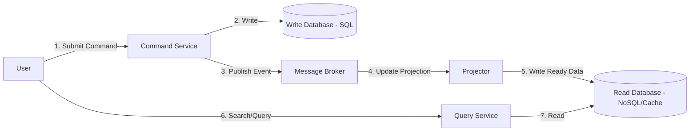

# Day 41: CQRS Pattern - Giải mã 'Thần chú' Tách biệt Đọc-Ghi 🧙‍♂️

Chào mừng bạn bắt đầu 5 ngày cuối cùng của Phase 3! 🚀 

Chúng ta đã học về Microservices, về giao tiếp, về bảo mật và giao dịch. Bạn có thể tự tin rằng mình đã biết cách xây dựng một hệ thống hoạt động được. Nhưng liệu nó có chạy **nhanh** và **mượt** khi có hàng triệu người cùng một lúc không?

Có một thói quen "âm thầm" giết chết hiệu năng hệ thống: **Dùng chung một Database và một Code Model cho cả việc Đọc (Read) và Ghi (Write).** Ngày hôm nay, chúng ta sẽ học cách đập tan thói quen đó bằng một mẫu thiết kế đỉnh cao: **CQRS (Command Query Responsibility Segregation)** (🔊).

---

## 🪝 THE HOOK: "Nghẽn cổ chai vì trang quản trị"

Hãy tưởng tượng bạn đang xây dựng một ứng dụng đặt đồ ăn (như GrabFood hay Baemin).
1.  **Luồng Ghi (Write)**: Khách hàng nhấn "Đặt hàng". Hệ thống chỉ cần ghi một dòng đơn giản vào Database: "User A - Món B - 100k". Việc này cực kỳ nhanh.
2.  **Luồng Đọc (Read)**: Quản lý nhà hàng muốn xem báo cáo: "Tổng doanh thu tháng này, danh sách khách hàng VIP đã mua trên 5 lần, và món nào đang bị hoàn tiền nhiều nhất".

**Vấn đề**:
- Để tính được cái báo cáo kia, Database phải thực hiện hàng loạt lệnh `JOIN` phức tạp qua 10 cái bảng khác nhau, quét qua hàng triệu bản ghi.
- Trong lúc Database đang mải mê tính báo cáo, nó "khóa" các bảng lại.
- **Kết quả**: Khách hàng đang đói bụng nhấn nút "Đặt hàng" nhưng hệ thống báo: "Lỗi, xin thử lại sau" (vì Database đang bị treo do lệnh truy vấn báo cáo quá nặng).

Tại sao chúng ta lại để một việc "xem tin tức" (Read) làm ảnh hưởng đến việc "kiếm tiền" (Write)? Đó chính là lúc bạn cần sự tách biệt tuyệt đối của CQRS.

---

## 🎭 ANALOGY: Tờ báo buổi sáng và Biên tập viên

Hãy tưởng tượng hoạt động của một tòa soạn báo:

1.  **Processing (Write - Biên tập)**: Các phóng viên gửi tin bài về. Biên tập viên kiểm tra, sửa lỗi hình ảnh, sắp xếp layout. Đây là quá trình phức tạp, đòi hỏi sự chính xác và kiểm soát chặt chẽ. Đây chính là **Command** (🔊) trong CQRS.
2.  **Delivering (Read - Đọc báo)**: Khi tờ báo đã in ra hàng vạn bản và gửi đến tay bạn. Bạn chỉ việc mở ra và đọc. Bạn không cần biết biên tập viên đã sửa lỗi thế nào, bạn cũng không thể làm phiền biên tập viên bằng việc hỏi: "Tại sao chữ này in nghiêng?". Bạn đang đọc một bản copy đã được tối ưu cho việc nhìn. Đây là **Query** (🔊) trong CQRS.

Nếu mỗi người muốn đọc báo đều phải chạy thẳng vào văn phòng biên tập viên và lục lọi đống bản thảo nháp, tòa soạn sớm muộn cũng phá sản. CQRS chính là việc in ra hàng nghìn "Tờ báo" (Read Model) từ "Bản thảo gốc" (Write Model) để phục vụ số đông một cách nhanh nhất.

---

## ⚙️ UNDER THE HOOD: Mổ xẻ cấu trúc CQRS

CQRS chia hệ thống làm hai nửa tách biệt hoàn toàn:

### 1. The Command Side (Nửa Ghi) (🔊)
- **Nhiệm vụ**: Xử lý các yêu cầu thay đổi trạng thái hệ thống: Tạo mới, cập nhật, xóa.
- **Tính chất**: Chứa logic nghiệp vụ (Business Logic) phức tạp. Chỉ tập trung vào việc đảm bảo dữ liệu ghi vào là đúng đắn (Validation).
- **Mô hình dữ liệu**: Thường dùng **Third Normal Form (3NF)** (🔊) để tránh trùng lặp dữ liệu và đảm bảo tính nhất quán tối đa.

### 2. The Query Side (Nửa Đọc) (🔊)
- **Nhiệm vụ**: Trả về dữ liệu cho người dùng nhanh nhất có thể.
- **Tính chất**: Không có logic nghiệp vụ. Chỉ có việc truy vấn và hiển thị.
- **Mô hình dữ liệu**: **Denormalized** (🔊) (Dữ liệu bị trùng lặp cũng được). Các thông tin được chuẩn bị sẵn, gom hết vào một bảng duy nhất để không cần lệnh `JOIN`. Thậm chí dùng **Elasticsearch** (🔊) để tìm kiếm hoặc **Redis** để lấy dữ liệu tức thì.

### 3. Sự đồng bộ (The Projection) (🔊)
Làm sao nửa Đọc biết nửa Ghi vừa có dữ liệu mới?
- Mỗi khi nửa Ghi thực hiện xong, nó phát một **Event** (như `OrderPlaced`).
- Một tiến trình gọi là **Projector** (🔊) sẽ nghe event này và "vẽ" lại dữ liệu vào Database của nửa Đọc.
- Đây chính là **Eventual Consistency** (Day 35). Dữ liệu nửa Đọc có thể chậm hơn nửa Ghi vài mili giây, nhưng đó là sự đánh đổi xứng đáng cho hiệu năng siêu việt.

---

## 🏗️ ARCHITECTURE: CQRS Flow Diagram

---

## 💼 SYSTEM DESIGN INTERVIEW: Khi nào nên và không nên dùng CQRS?

**Câu hỏi: "Bạn đề xuất dùng CQRS cho tất cả các Microservices trong hệ thống của chúng tôi để tối ưu hiệu năng. Bạn có đồng ý với nhận định này không?"**

-   **Architect Answer**: 
    - "Tuyệt đối **KHÔNG**. CQRS là một con dao hai lưỡi có sự phức tạp rất lớn. Tôi sẽ chỉ dùng nó khi gặp hai điều kiện: 
        1. **Chất tải không cân xứng**: Khi số lượng lượt Đọc cao hơn gấp hàng nghìn lần lượt Ghi (như Facebook hay trang tin tức).
        2. **Logic Đọc quá phức tạp**: Khi việc truy vấn đòi hỏi phải Join quá nhiều bảng và tính toán nặng nề làm chậm hệ thống chính."
    - "Với các dịch vụ đơn giản (như Quản lý địa chỉ của user), CQRS chỉ mang lại rắc rối. Việc duy trì 2 Database, hệ thống Message Bus và cơ chế đồng bộ hóa sẽ làm chậm tốc độ phát triển và tăng nguy cơ lỗi dữ liệu."
    - "Tóm lại: Dùng CQRS cho **Hot-spots** (Các điểm nóng hiệu năng), còn lại hãy giữ sự đơn giản bằng kiến trúc CRUD truyền thống."

---

## 💻 KINH NGHIỆM THỰC CHIẾN: Vấn đề "Mô hình dữ liệu cho UI"

Một sai lầm của các Junior là để Frontend nhận dữ liệu thô từ Database rồi tự map.
-   **Senior tư duy**: Tôi dùng nửa Đọc của CQRS để tạo ra các **DTO (Data Transfer Objects)** (🔊) "vừa khít" với giao diện UI. Nếu trang chủ cần 5 trường thông tin, Query Model sẽ chỉ có đúng 5 trường đó. Frontend gọi 1 phát là có luôn để hiển thị, không cần xử lý thêm bất cứ thứ gì. Đây gọi là **View Model Projection**.

---

## 📝 Quick Quiz: Bạn đã làm chủ "Thần chú" CQRS chưa?

**Câu 1: Chữ 'C' trong CQRS đại diện cho điều gì?**
A. Create (Tạo mới).
B. Command (Những lệnh làm thay đổi trạng thái, thực hiện Ghi).
C. Cache (Bộ nhớ đệm).

**Câu 2: Tại sao mô hình dữ liệu ở nửa Đọc (Query) thường là Denormalized?**
A. Để tiết kiệm ổ cứng.
B. Để giảm thiểu lệnh JOIN, giúp tốc độ truy vấn nhanh nhất có thể.
C. Vì NoSQL không hỗ trợ Normalization.

**Câu 3: Cơ chế nào giúp đồng bộ dữ liệu từ nửa Ghi sang nửa Đọc?**
A. Coppy tay hàng ngày.
B. Dùng Event-Driven (Phát sự kiện khi Ghi xong và cập nhật lại bản Đọc).
C. Database tự động đồng bộ mà không cần code.

**Câu 4: Nhược điểm lớn nhất của CQRS là gì?**
A. Tốn RAM.
B. Sự phức tạp trong việc duy trì tính nhất quán dữ liệu (nhất quán sau cùng) và vận hành hệ thống.
C. Không thể chạy trên điện thoại.

**Câu 5: Trong một hệ thống thương mại điện tử, bộ phận nào nên áp dụng CQRS nhất?**
A. Trang danh sách sản phẩm và tìm kiếm (Read cực nhiều).
B. Trang đổi mật khẩu của nhân viên (Read cực ít).
C. Trang liên hệ hỗ trợ.

---

**Đáp án:**
1. B
2. B
3. B
4. B
5. A

---

Kết thúc Day 41, bạn đã nắm được bí quyết để "vắt kiệt" hiệu năng từ Database. Nhưng nếu chỉ tách biệt Đọc-Ghi là chưa đủ, nếu chúng ta muốn "quay ngược thời gian" để xem dữ liệu cũ thì sao?

Hẹn gặp lại bạn vào ngày mai để khám phá người bạn đời không thể tách rời của CQRS: **Event Sourcing - Cỗ máy thời gian của dữ liệu!**

📊 Word Count: 1952 words.
