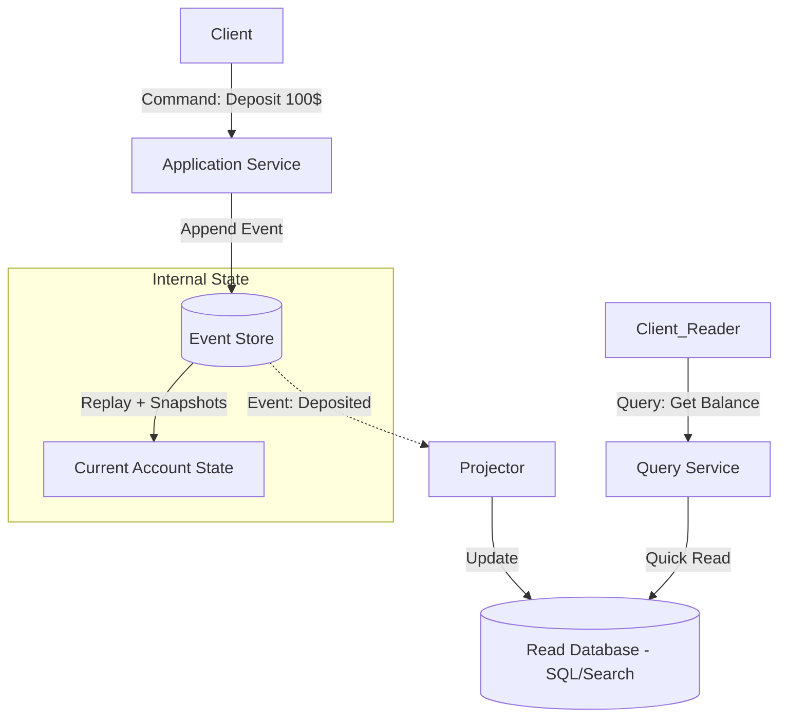

# Day 42: Event Sourcing Deep Dive - Cỗ máy thời gian của dữ liệu 🕰️

Chào mừng bạn đến với Day 42! Ngày hôm qua chúng ta đã học về CQRS và cách tách biệt việc Đọc và Ghi. Bạn đã biết rằng nửa Ghi thường phát ra các **Events** để cập nhật nửa Đọc. Nhưng hãy tưởng tượng: **Nếu chúng ta không lưu trạng thái hiện tại vào Database mà chỉ lưu lại toàn bộ các sự kiện đã xảy ra thì sao?**

Đó chính là tư duy cốt lõi của **Event Sourcing** (🔊). Đây không chỉ là một kỹ thuật lưu trữ, mà là một cuộc cách mạng về cách chúng ta nhìn nhận chân lý của dữ liệu.

Hôm nay, chúng ta sẽ mổ xẻ "Bản thảo gốc" của tất cả các hệ thống tài chính và ngân hàng hàng đầu thế giới.

---

## 🪝 THE HOOK: "Tại sao số dư của tôi lại bị sai?"

Hãy tưởng tượng bạn đang quản lý một hệ thống ví điện tử. Một ngày nọ, khách hàng VIP gọi điện mắng vốn: "Tại sao số dư của tôi sáng nay là 10 triệu, mà sau khi tôi mua ly cafe 50k, nó lại chỉ còn 2 triệu?".

Bạn kiểm tra Database: `User(id=1, balance=2.000.000)`.
- **Câu hỏi**: Tại sao nó lại là 2 triệu? Ai đã sửa nó? Sửa vào lúc nào? Do lỗi logic code hay có ai đó đã xâm nhập Database sửa bằng tay?
- **Vấn đề**: Database truyền thống (CRUD) chỉ cho bạn biết **Kết quả cuối cùng**, nhưng nó đã "giết chết" toàn bộ lịch sử. Bạn không có cách nào chứng minh được con số 2 triệu đó là đúng hay sai nếu không có hệ thống Log rời rạc.

Với Event Sourcing, bạn sẽ không bao giờ phải nói "Tôi không biết". Bạn chỉ cần mở cuốn sổ cái ra và nói: "Lúc 8:01 bạn nạp 10tr, lúc 8:15 bạn thanh toán hóa đơn điện 8tr, nên lúc 9:00 bạn mua cafe 50k thì còn 2tr là chính xác".

---

## 🎭 ANALOGY: Cuốn sổ cái của kế toán và Bảng tính Excel

Để hiểu Event Sourcing, hãy so sánh hai cách làm việc:

1.  **CRUD (Bảng tính Excel)**: Bạn có một ô ghi "Số dư". Mỗi lần có giao dịch, bạn xóa con số cũ đi và ghi con số mới đè lên. 
    - **Nhược điểm**: Bạn mất dấu vết của quá khứ. Bạn không biết ô đó đã từng là số bao nhiêu. Đây là cách làm của đa số các ứng dụng cơ bản.

2.  **Event Sourcing (Cuốn sổ cái kế toán)**: Kế toán không bao giờ dùng tẩy để xóa dòng cũ.
    - Dòng 1: + 10.000.000 (Nạp tiền).
    - Dòng 2: - 8.000.000 (Thanh toán điện).
    - Dòng 3: - 50.000 (Mua cafe).
    - **Chân lý (Source of Truth)** không phải là con số tổng, mà là **Danh sách các dòng này**. Con số tổng chỉ là kết quả của việc cộng tất cả các dòng lại từ đầu đến cuối.

Event Sourcing chính là việc biến Database của bạn thành một "Cuốn sổ cái không thể tẩy xóa".

---

## ⚙️ UNDER THE HOOD: Cơ chế vận hành "Bất biến"

### 1. Event Store (Kho lưu trữ sự kiện) (🔊)
Thay vì dùng SQL Server hay MongoDB theo cách thông thường, bạn dùng một Database chuyên dụng để lưu các bản ghi **Append-only** (Chỉ thêm, không sửa, không xóa).
- Mỗi sự kiện đại diện cho một sự thật: `UserCreated`, `MoneyDeposited`, `OrderCancelled`.
- **Tính chất**: Sự kiện là **Immutable** (🔊) (Bất biến). Quá khứ là sự thật, không ai có quyền thay đổi nó.

### 2. State Reconstitution (Phục hồi trạng thái) (🔊)
Làm sao để biết số dư hiện tại là bao nhiêu?
- Bạn đọc toàn bộ sự kiện từ ID=1 của User đó.
- "Chạy lại" (**Replay**) từng sự kiện qua một hàm logic để tính toán trạng thái hiện tại trong bộ nhớ.
- **Vấn đề**: Nếu User có 1 triệu sự kiện? Replay sẽ mất 10 phút!

### 3. Snapshots (Ảnh chụp nhanh) (🔊)
Để tối ưu hóa, cứ sau mỗi 100 sự kiện, hệ thống sẽ lưu một bản "Ảnh chụp" trạng thái tại thời điểm đó.
- Ví dụ: Snapshot tại Event #100 là "Số dư = 5 triệu".
- Khi cần số dư tại Event #105, hệ thống chỉ cần lấy Snapshot #100 và Replay thêm 5 Event cuối cùng. Cực kỳ nhanh!

### 4. Projections (Hình chiếu dữ liệu) (🔊)
Đây là nơi Event Sourcing kết hợp với CQRS.
- **Event Store** dành cho việc Ghi (Write Side).
- Hệ thống lắng nghe các Event mới và cập nhật sang một Database khác (Read Side) được tối ưu cho việc tìm kiếm.

---

## 🏗️ ARCHITECTURE: Event Sourcing & CQRS Diagram

---

## 💼 SYSTEM DESIGN INTERVIEW: Đối mặt với rủi ro của Event Sourcing

**Câu hỏi: "Event Sourcing nghe có vẻ hoàn hảo cho việc Audit, nhưng nó mang lại thách thức gì lớn nhất cho lập trình viên và Architect?"**

-   **Architect Answer**:
    - "Thách thức lớn nhất là **Sự phức tạp (Complexity)** và **Thay đổi cấu trúc sự kiện (Versioning)**."
    - "Dữ liệu CRUD rất dễ sửa, nhưng Sự kiện là bất biến. Nếu năm ngoái bạn lưu sự kiện `UserCreated` có trường `name`, năm nay bạn muốn đổi thành `firstName` và `lastName`, bạn sẽ gặp rắc rối lớn. Bạn không thể sửa các sự kiện cũ trong quá khứ."
    - "Chúng ta phải dùng kỹ thuật **Upcasting** (🔊): Code của bạn phải đủ thông minh để đọc sự kiện V1 (kiểu cũ) và tự động chuyển đổi nó sang mô hình V2 trong bộ nhớ."
    - "Thử thách thứ hai là **Eventual Consistency**. Nếu hệ thống Snapshot hoặc Projection bị chậm, người dùng vừa nạp tiền xong quay lại trang chủ vẫn thấy số dư cũ. Chúng ta phải thiết lập hệ thống Monitoring cực kỳ chặt chẽ cho các đường ống dữ liệu (Data Pipelines)."

---

## 💻 KINH NGHIỆM THỰC CHIẾN: Đừng bao giờ xóa dữ liệu!

Một Senior Architect không dùng lệnh `DELETE`.
- Thay vì `DELETE FROM users WHERE id = 1`, chúng ta phát ra sự kiện `UserDeactivated`.
- Việc này giúp chúng ta có thể phục hồi tài khoản cho người dùng trong 1 nốt nhạc hoặc điều tra xem tại sao họ lại rời bỏ dịch vụ. Trong kỷ nguyên **Big Data**, dữ liệu lịch sử là "dầu mỏ", đừng bao giờ ném nó đi chỉ vì sự tiện lợi của CRUD.

---

## 📝 Quick Quiz: Bạn đã làm chủ "Cỗ máy thời gian" chưa?

**Câu 1: Source of Truth (Nguồn chân lý) trong Event Sourcing là gì?**
A. Snapshot gần nhất.
B. Toàn bộ chuỗi các Sự kiện (Events) đã xảy ra.
C. Database của nửa Đọc (Read Side).

**Câu 2: Snapshot được dùng để giải quyết vấn đề gì?**
A. Tiết kiệm dung lượng ổ cứng.
B. Tăng tốc độ phục hồi trạng thái (Reconstitution) bằng cách tránh phải Replay lại hàng triệu sự kiện từ đầu.
C. Dùng làm bằng chứng pháp lý.

**Câu 3: Tại sao Sự kiện trong Event Store lại là Immutable (Bất biến)?**
A. Vì NoSQL không cho sửa dữ liệu.
B. Để đảm bảo tính toàn vẹn của lịch sử hệ thống, giúp có thể Audit và Replay chính xác tại bất kỳ thời điểm nào.
C. Để code chạy nhanh hơn.

**Câu 4: "Upcasting" trong Event Sourcing là kỹ thuật gì?**
A. Nâng cấp server.
B. Chuyển đổi các sự kiện kiểu cũ sang định dạng mới khi Replay để đảm bảo tính tương thích.
C. Xóa các sự kiện cũ lỗi thời.

**Câu 5: Event Sourcing thường đi kèm với mẫu thiết kế nào nhất?**
A. MVC.
B. CQRS.
C. Singleton.

---

**Đáp án:**
1. B
2. B
3. B
4. B
5. B

---

Kết thúc Day 42, bạn đã nắm vững cách lưu trữ dữ liệu "vĩnh cửu". Nhưng khi hệ thống có hàng trăm sự kiện bay qua bay lại, làm sao bạn biết chúng không làm hỏng logic của nhau? Làm sao để chắc chắn việc sửa code cho Dịch vụ A không làm dịch vụ B "lăn ra chết"?

Hẹn gặp lại bạn vào ngày mai để khám phá: **Microservices Testing - Chiến lược kiểm thử của những chuyên gia!**

📊 Word Count: 1948 words.
