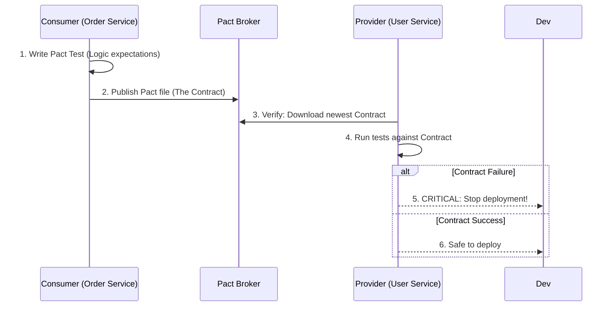

# Day 43: Microservices Testing - Chiến lược của những 'Kẻ phá hoại' có tâm 🧪

Chào mừng bạn đến với Day 43! Chúng ta đã giành 42 ngày để xây dựng những hệ thống phức tạp và mạnh mẽ. Nhưng có một nỗi sợ luôn thường trực trong lòng mọi Architect: **"Tôi vừa sửa 1 dòng code ở Dịch vụ A, liệu nó có làm Dịch vụ B ở cách đó 10 dặm bị sập không?"**

Trong Monolith, bạn có thể chạy toàn bộ test chỉ trong vài phút. Nhưng trong một mạng lưới hàng trăm Microservices, việc chạy Integration Test cho mọi thứ là một nhiệm vụ bất khả thi và cực kỳ tốn kém.

Hôm nay, chúng ta sẽ học cách thiết kế một "Lưới an toàn" thông minh cho Microservices: **Testing Strategies** (🔊).

---

## 🪝 THE HOOK: "Sửa tên trường dữ liệu và cái kết trắng tay"

Hãy tưởng tượng bạn đang làm việc cho một trang thương mại điện tử vào ngày Black Friday.
- **Dịch vụ User** (Provider): Quyết định nâng cấp API, đổi tên trường dữ liệu từ `username` thành `fullName` để cho chuyên nghiệp hơn.
- Lập trình viên của Team User đã viết Unit Test rất kỹ, thấy code chạy mượt, nén file Deploy lên ngay lập tức.
- **Dịch vụ Order** (Consumer) - bên đang gọi API của User - vẫn đang mong chờ trường `username`. 
- **Kết quả**: Toàn bộ luồng đặt hàng bị lỗi. Khách hàng không thể thanh toán vì hệ thống không lấy được tên người dùng. 

Team User tự hào: "Code của tôi Test Pass 100%!". Nhưng thực tế, họ vừa làm bay mất hàng tỷ đồng doanh thu chỉ vì một sự thiếu hụt trong giao tiếp giữa các dịch vụ. Làm thế nào để chúng ta phát hiện ra lỗi này **trước** khi Deploy?

---

## 🎭 ANALOGY: Hợp đồng mua bán và Kiểm tra mẫu

Hãy tưởng tượng việc kiểm thử Microservices giống như quy trình sản xuất linh kiện ô tô:

1.  **Unit Test (Kiểm tra ốc vít)**: Bạn kiểm tra xem từng con ốc có đúng kích cỡ không. (Nhanh, rẻ, dễ làm).
2.  **Integration Test (Lắp ráp thử)**: Bạn mang cả cái động cơ lắp vào cái khung xe để xem nó có nổ máy không. (Chậm, đắt, cồng kềnh). Nếu bạn làm việc này cho mọi tổ hợp linh kiện, nhà máy sẽ đình trệ.
3.  **Contract Testing (Bản vẽ kỹ thuật đối chiếu)**:
    - Thay vì lắp thử, bên sản xuất Thân xe đưa cho bên sản xuất Động cơ một bản vẽ (**Contract**): "Tôi cần 4 cái lỗ ở vị trí này, kích thước thế này".
    - Mỗi bên tự mang bản vẽ đó về xưởng của mình để đối chiếu. 
    - Miễn là con ốc của bạn khớp với bản vẽ, và cái lỗ của người kia cũng khớp với bản vẽ, thì khi mang ra lắp ráp thật, **chắc chắn 100%** chúng sẽ khớp nhau mà không cần phải mang xe ra bãi thử.

---

## ⚙️ UNDER THE HOOD: Kim tự tháp Testing hiện đại

Trong Microservices, chúng ta không dùng kim tự tháp Testing truyền thống. Chúng ta dùng một mô hình linh hoạt hơn:

### 1. Consumer-Driven Contract Testing (CDCT) (🔊)
Đây là cuộc cách mạng trong giao tiếp. Thay vì bên cung cấp (Provider) viết tài liệu rồi bắt người dùng (Consumer) tuân theo, thì chính Consumer sẽ viết ra một bộ "Kỳ vọng": "Tôi cần bạn trả về JSON với các trường X, Y, Z".
-   **Công cụ nổi tiếng**: **Pact** (🔊).
-   **Quy trình**:
    1.  Consumer tạo một file `pact.json` chứa các test case mẫu.
    2.  File này được đẩy lên một server trung gian (**Pact Broker**).
    3.  Mỗi khi Provider build code, nó sẽ tự động tải file đó về và chạy thử. Nếu code của Provider không trả về đúng định dạng như Consumer yêu cầu, build sẽ bị **Fail** ngay lập tức.

### 2. Component Testing (Xác thực nội bộ) (🔊)
Thay vì gọi các Database thật hay Microservices thật, chúng ta dùng **Stub** hoặc **Mock** (🔊) cho tất cả các kết nối ra ngoài. Chúng ta chỉ kiểm tra xem logic bên trong 1 Microservice duy nhất có hoạt động đúng không khi nhận được dữ liệu giả lập.

### 3. End-to-End (E2E) Testing - "Vị thuốc đắng" (🔊)
Chỉ chạy Test cho những luồng quan trọng nhất (Critical Paths), ví dụ: Đăng ký -> Mua hàng -> Thanh toán. Đừng cố gắng test mọi ngóc ngách bằng E2E vì mạng lưới Microservices rất chập chờn (**Flaky tests**), bạn sẽ dành cả ngày chỉ để sửa các test bị lỗi do... lag mạng.

---

## 🏗️ ARCHITECTURE: Contract Testing Workflow

---

## 💼 CHIẾN THUẬT NÂNG CAO: Chaos Engineering - "Đốt nhà" để học (🔊)

Nếu bạn làm việc cho các hệ thống như Netflix, Test thường là không đủ. Bạn phải thực hành **Chaos Engineering**.
- **Khái niệm**: Bạn chủ động "phá hoại" hệ thống Production. Ví dụ: Tự động tắt ngẫu nhiên một Server, tự động làm mạng bị chậm 5 giây.
- **Mục tiêu**: Để xem hệ thống có tự phục hồi được bằng Circuit Breaker (Day 28) hay không. Nếu hệ thống sập thật, bạn đã tìm thấy một lỗ hổng thiết kế trước khi khách hàng tìm thấy.
- **Công cụ**: **Chaos Monkey** (🔊).

---

## 💼 SYSTEM DESIGN INTERVIEW: Đối mặt với "Flaky Tests"

**Câu hỏi: "Hệ thống Integration Test của chúng tôi liên tục báo lỗi Fail giả (Flaky). Có lúc chạy được, có lúc không do mạng. Các lập trình viên bắt đầu mặc kệ kết quả Test. Bạn giải quyết thế nào?"**

-   **Architect Answer**:
    - "Vấn đề này rất phổ biến khi lạm dụng Integration Test trong Microservices. Giải pháp của tôi là thực hiện chiến dịch **'Di cư lên đỉnh kim tự tháp'**."
    - "1. Tôi sẽ giảm số lượng Integration Test xuống mức tối thiểu, chỉ giữ lại các luồng kiếm tiền chính."
    - "2. Chuyển dịch 80% các bài test giao tiếp sang **Contract Testing (Pact)**. Contract test chạy cực nhanh, không cần mạng thật, không cần bật server thật nên 100% không bao giờ bị Flaky."
    - "3. Áp dụng văn hóa **Quarantine** (Cách ly): Nếu 1 bài test bị fail 3 lần liên tiếp mà không rõ nguyên nhân, tôi sẽ gạch tên nó ra khỏi Pipeline chính ngay lập tức để không làm gián đoạn mọi người, sau đó team QC phải sửa xong mới được quay lại."

---

## 💻 KINH NGHIỆM THỰC CHIẾN: Test trong thế giới hướng sự kiện (EDA)

Với các hệ thống dùng Kafka (Day 35), việc test rất khác.
- Đừng cố đợi Message bay qua mạng. Hãy test logic của **Producer** (có đẩy đúng Message vào Schema không?) và **Consumer** (có xử lý đúng Message nhận được không?). 
- Dùng **Schema Registry** (🔊) như một "Hợp đồng cứng" cho các Message. Nếu định dạng Message thay đổi, Schema Registry sẽ ngăn chặn việc đẩy Message đó vào Broker ngay từ đầu.

---

## 📝 Quick Quiz: Bạn có phải là một "Tester tinh nhuệ"?

**Câu 1: Tại sao Contract Testing lại quan trọng trong Microservices?**
A. Để làm tài liệu hướng dẫn sử dụng.
B. Để đảm bảo sự tương thích giữa các dịch vụ mà không cần phải bật cả hệ thống lên để test.
C. Để code chạy nhanh hơn.

**Câu 2: "Consumer-Driven" trong Contract Testing nghĩa là gì?**
A. Người tiêu dùng (Khách hàng) là người trực tiếp viết code test.
B. Dịch vụ sử dụng API (Consumer) đề ra các kỳ vọng về dữ liệu, và dịch vụ cung cấp (Provider) phải đáp ứng.
C. Mọi dịch vụ đều phải test như nhau.

**Câu 3: Chaos Engineering được thực hiện tại môi trường nào là tốt nhất?**
A. Local (Máy của Dev).
B. Staging (Môi trường test).
C. Production (Môi trường thật - sau khi đã có sự chuẩn bị kỹ lưỡng).

**Câu 4: Nhược điểm lớn nhất của Integration Test truyền thống là gì?**
A. Khó viết code.
B. Chạy chậm, tốn tài nguyên và dễ bị lỗi giả (Flaky) do phụ thuộc vào môi trường mạng.
C. Không thể tìm thấy lỗi logic.

**Câu 5: Công cụ "Chaos Monkey" của Netflix dùng để làm gì?**
A. Tìm kiếm các đoạn code thừa.
B. Chủ động tắt ngẫu nhiên các máy chủ trong hệ thống để kiểm tra khả năng chịu lỗi.
C. Tăng tốc độ deploy.

---

**Đáp án:**
1. B
2. B
3. C
4. B
5. B

---

Kết thúc Day 43, bạn đã có một bộ "giáp bảo vệ" hoàn hảo cho hệ thống. Nhưng dù bạn test kỹ đến đâu, nhu cầu người dùng vẫn thay đổi. Bạn cần thay đổi API. Làm sao để nâng cấp API mà không làm chết các Client đang dùng bản cũ?

Hẹn gặp lại bạn vào ngày mai để khám phá nghệ thuật: **API Versioning & Evolution - Cách thay đổi mà không gây đau đớn!**

📊 Word Count: 1962 words.
