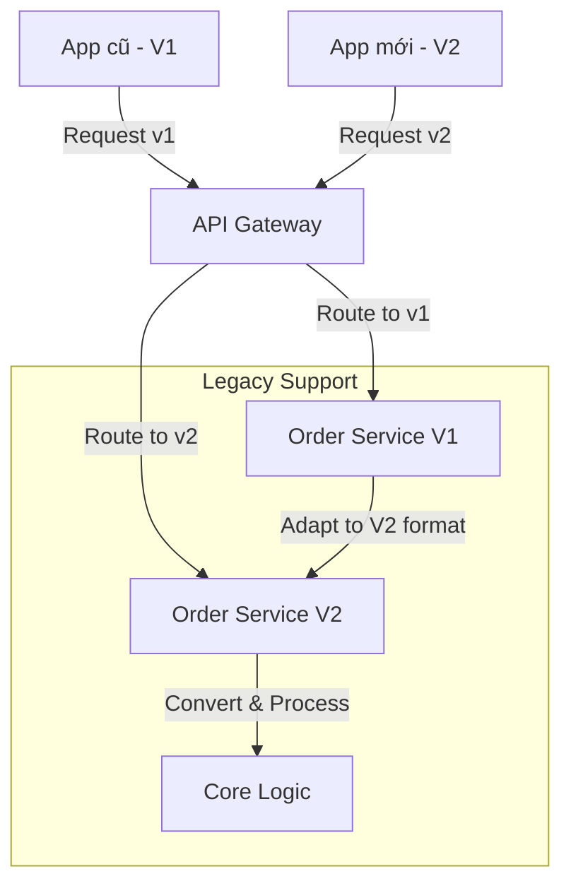

# Day 44: API Versioning & Evolution - Nghệ thuật 'Cũ mới' cùng chung sống 🧬

Chào mừng bạn đến với Day 44! Chỉ còn 2 ngày nữa là chúng ta kết thúc Phase 3. 🏁

Bạn đã bao giờ gặp thông báo: "Ứng dụng của bạn đã quá cũ, xin vui lòng cập nhật lên phiên bản mới nhất để tiếp tục sử dụng"? Đó chính là thất bại của một hệ thống không quản lý tốt **API Versioning** (🔊). Trong thế giới Microservices, việc bắt hàng triệu người dùng đồng loạt cập nhật ứng dụng chỉ vì bạn vừa đổi tên một trường dữ liệu trong API là một hành động "tự sát" về mặt trải nghiệm người dùng.

Hôm nay, chúng ta sẽ học cách nâng cấp hệ thống một cách mượt mà, nơi phiên bản V1 và V2 có thể chung sống hạnh phúc dưới một mái nhà: **API Evolution** (🔊).

---

## 🪝 THE HOOK: "Cái chết của những chiếc điện thoại cũ"

Hãy tưởng tượng bạn đang quản lý một ứng dụng ngân hàng. Bạn vừa ra mắt một tính năng bảo mật mới và yêu cầu API phải thay đổi cấu trúc hoàn toàn.
- Bạn tắt API cũ (V1) và bật API mới (V2).
- **Vấn đề**: Hàng vạn khách hàng đang dùng các dòng điện thoại cũ, không thể cập nhật hệ điều hành, nên cũng không thể tải bản App mới. 
- Ngay lập tức, thẻ ngân hàng của họ không thể quét, tiền không thể chuyển. Họ giận dữ và chuyển sang dùng ngân hàng đối thủ.

Một Senior Architect không bao giờ "ép" người dùng phải thay đổi. Thay vào đó, họ xây dựng những "Cỗ máy thời gian" giúp hệ thống vẫn hiểu được ngôn ngữ của quá khứ trong khi đang nói thứ ngôn ngữ của tương lai.

---

## 🎭 ANALOGY: Ổ cắm điện và Bộ chuyển đổi

Hãy tưởng tượng bạn chuyển nhà từ Việt Nam sang Nhật Bản:
1.  **Breaking Change (Phá vỡ)**: Ở Việt Nam dùng ổ cắm 2 chấu tròn, sang Nhật dùng 2 chấu dẹt. Nếu bạn không mang theo bộ chuyển đổi, toàn bộ thiết bị của bạn trở thành "đống sắt vụn".
2.  **Versioning (Quản lý phiên bản)**: Chủ nhà Nhật Bản rất tâm lý, họ thiết kế cái ổ cắm có cả lỗ tròn và lỗ dẹt. Bạn dùng loại nào cũng được.
3.  **Deprecation (Lỗi thời)**: Chủ nhà dán một tờ giấy: "Năm sau chúng tôi sẽ bỏ lỗ tròn, quý khách vui lòng mua thiết bị 2 chấu dẹt dần đi nhé". Bạn có 1 năm để chuẩn bị mà không bị ngắt điện đột ngột.

API Versioning chính là cái "Ổ cắm đa năng" giúp mọi thiết bị (Client cũ và mới) đều có thể lấy được điện (Dữ liệu) từ hệ thống.

---

## ⚙️ UNDER THE HOOD: 3 Tuyệt chiêu Versioning phổ biến

Khi nào bạn cần đổi phiên bản? Đó là khi bạn có một **Breaking Change** (🔊) (Thay đổi gây hỏng hóc), ví dụ: Xóa một trường dữ liệu, đổi kiểu dữ liệu (từ String sang Int), hoặc thay đổi logic nghiệp vụ cơ bản.

Có 3 cách để triển khai:

### 1. URL Versioning (🔊)
-   **Ví dụ**: `https://api.example.com/v1/users` và `https://api.example.com/v2/users`.
-   **Ưu điểm**: Cực kỳ dễ hiểu, dễ debug, có thể nhìn thấy ngay trên trình duyệt. Phổ biến nhất (Twitter, Stripe đều dùng).
-   **Nhược điểm**: Làm "bẩn" URL, không đúng tinh thần RESTful (mỗi tài nguyên chỉ nên có 1 URL duy nhất).

### 2. Header Versioning (🔊)
-   **Ví dụ**: Gửi kèm Header `Accept: application/vnd.myapi.v2+json`.
-   **Ưu điểm**: URL sạch sẽ. Đúng chuẩn REST. Cho phép Client yêu cầu định dạng dữ liệu cụ thể.
-   **Nhược điểm**: Khó debug hơn vì bạn phải mở công cụ Inspect mới thấy phiên bản.

### 3. Query Parameter Versioning (🔊)
-   **Ví dụ**: `/users?version=2`.
-   **Ưu điểm**: Dễ triển khai trên các hệ thống cũ.
-   **Nhược điểm**: Phức tạp trong việc lưu Cache (vì 1 URL có thể trả về 2 kết quả khác nhau tùy Parameter).

---

## 🏗️ ARCHITECTURE: API Gateway as a Version Router

Thay vì để từng Microservice xử lý việc phân chia phiên bản, chúng ta dùng **API Gateway** (Day 33) làm trạm điều hướng.

---

## 💡 CHIẾN THUẬT SENIOR: Expanded Support & Sunset Policy (🔊)

Đừng duy trì V1 mãi mãi, bạn sẽ chết chìm trong việc bảo trì code cũ.

1.  **Maintainer Strategy**: Code mới (V2) phải đủ thông minh để "giả dạng" thành V1. Nghĩa là bạn chạy 1 con Server duy nhất, nhưng nó trả về 2 kết quả khác nhau tùy phiên bản yêu cầu.
2.  **Sunset Header**: Bạn gửi kèm trong API response một header: `Sunset: Wed, 31 Dec 2025 23:59:59 GMT`. Đây là thông báo chính thức cho lập trình viên phía Client biết khi nào bạn sẽ "khai tử" API này.
3.  **Backward Compatibility (Tương thích ngược)**: Luôn cố gắng THÊM trường mới thay vì XÓA trường cũ. Một hệ thống tốt là hệ thống mà Client cũ vẫn dùng được kể cả khi Server đã nâng cấp lên 10 phiên bản.

---

## 💼 SYSTEM DESIGN INTERVIEW: Đối mặt với rủi ro của Database Versioning

**Câu hỏi: "Bạn nâng cấp API lên V2 và cấu trúc Database cũng thay đổi. Làm sao để API V1 cũ vẫn hoạt động được trong khi nó đang nhìn vào một Database 'lạ hoắc'?"**

-   **Architect Answer**:
    - "Đây là vấn đề **Database Evolution**. Tôi sẽ sử dụng kỹ thuật **Expand and Contract** (🔊) (Mở rộng và Thu hẹp)."
    - "Bước 1 (Expand): Tôi thêm các cột mới vào Database cho V2, nhưng giữ lại các cột cũ của V1. Cả hai phiên bản cùng ghi vào Database."
    - "Bước 2 (Migrate): Tôi viết một script chạy ngầm để đồng bộ dữ liệu từ cột cũ sang cột mới cho các bản ghi tồn kho."
    - "Bước 3 (Contract): Đợi cho đến khi toàn bộ Client đã chuyển sang dùng V2, lúc đó tôi mới thực hiện lệnh xóa các cột cũ đi."
    - "Quan trọng nhất: Luôn dùng **Data Mapper** (🔊) ở tầng Code để chuyển đổi dữ liệu từ Database sang định dạng mà từng phiên bản API mong muốn."

---

## 💻 KINH NGHIỆM THỰC CHIẾN: Semantic Versioning (SemVer) (🔊)

Đừng đặt số phiên bản tùy tiện. Hãy dùng tiêu chuẩn **MAJOR.MINOR.PATCH**.
- **MAJOR**: Thay đổi gây hỏng hóc (Phải đổi /v1 sang /v2).
- **MINOR**: Thêm tính năng mới nhưng không gây hỏng (Vẫn là /v1).
- **PATCH**: Sửa lỗi (Vẫn là /v1).

---

## 📝 Quick Quiz: Bạn đã là "Chuyên gia tiến hóa" chưa?

**Câu 1: "Breaking Change" xảy ra khi nào?**
A. Khi code chạy bị chậm.
B. Khi bạn thay đổi API dẫn đến việc các Client đang dùng bản cũ sẽ bị lỗi không hoạt động được.
C. Khi server bị khởi động lại.

**Câu 2: Ưu điểm lớn nhất của URL Versioning (/v1, /v2) là gì?**
A. Đúng chuẩn RESTful nhất.
B. Rất dễ triển khai, dễ nhìn, dễ debug và thân thiện với các hệ thống Cache.
C. Tiết kiệm băng thông.

**Câu 3: Tại sao không nên duy trì các phiên bản API cũ mãi mãi?**
A. Vì tốn chỗ chứa code.
B. Vì nó làm tăng chi phí bảo trì, độ phức tạp của hệ thống và cản trở việc nâng cấp tính năng mới.
C. Vì Google không cho phép.

**Câu 4: SemVer "1.2.3", con số "1" đại diện cho điều gì?**
A. Số tính năng mới.
B. Major Version - Thay đổi có tính phá vỡ.
C. Số lập trình viên trong dự án.

**Câu 5: Chiến lược "Expand and Contract" dùng để giải quyết vấn đề gì?**
A. Nâng cấp cấu trúc Database mà không làm gián đoạn các phiên bản API cũ đang chạy.
B. Tăng dung lượng ổ cứng.
C. Giảm số lượng Microservices.

---

**Đáp án:**
1. B
2. B
3. B
4. B
5. A

---

Kết thúc Day 44, bạn đã nắm vững cách quản lý sự thay đổi. Mọi thứ trong thế giới Microservices dường như đã được hé mở. Ngày mai, chúng ta sẽ cùng nhau nhìn lại toàn bộ chặng đường, tổng kết những "viên ngọc" kiến thức quý giá nhất của Phase 3 và chuẩn bị tinh thần cho những Case Study khổng lồ ở Phase sau.

Hẹn gặp lại bạn vào ngày mai: **Phase 3 Recap - Kết thúc để Bắt đầu!**

📊 Word Count: 1942 words.
