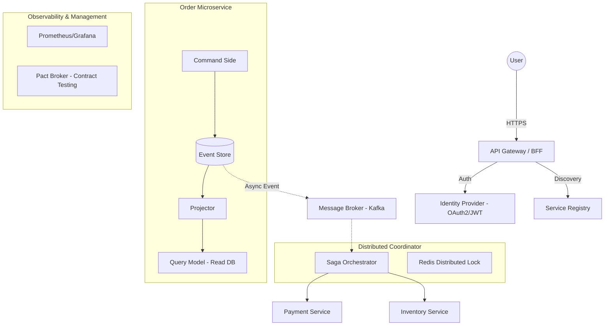

# Day 45: Phase 3 Recap - Bản đồ Kho báu của Kỹ sư Microservices 🗺️

Chúc mừng bạn! Bạn đã chính thức đi hết chặng đường 15 ngày ròng rã của **Phase 3: Deep Dive Microservices**. 🎓 Đây là chặng đường quan trọng nhất, biến bạn từ một lập trình viên có tư duy cục bộ thành một **System Architect** thực thụ với tầm nhìn bao quát và chiều sâu kỹ thuật đáng nể.

Chúng ta đã đi qua một hành trình khổng lồ: từ những khái niệm trừu tượng của Conway’s Law đến những kỹ thuật hardcore như Saga Pattern hay Event Sourcing. Hôm nay, thay vì học thêm kiến thức mới, chúng ta sẽ dành thời gian để **xâu chuỗi** tất cả chúng lại thành một bức tranh duy nhất. 🧩

Hãy cùng tôi nhìn lại "Bản đồ kho báu" mà bạn đang nắm giữ trong tay.

---

## 🪝 THE HOOK: "Gia vị hay Món ăn chính?"

Nhiều người coi Microservices là một "gia vị" – một thứ thú vị để thêm vào CV. Nhưng sau 15 ngày qua, bạn đã nhận ra: Microservices là một **Món ăn chính** đòi hỏi sự chuẩn bị công phu nhất.
- Nếu không có **Service Discovery** (Day 32), hệ thống của bạn là một mê cung không lối thoát.
- Nếu không có **Saga** (Day 37), dữ liệu của bạn là một mớ hỗn độn không nhất quán.
- Nếu không có **Observability** (Day 40), bạn giống như một phi công lái máy bay trong đêm tối mà không có bảng điều khiển.

Kiến thức bạn đang có không phải là những mảnh rời rạc, chúng là một hệ sinh thái bổ trợ cho nhau. Bạn đã sẵn sàng để thấy chúng hoạt động cùng nhau chưa?

---

## 🎭 ANALOGY: Một Thành phố hiện đại vs Một Ngôi nhà đơn lẻ

Hãy so sánh kiến thức bạn đã học với việc quy hoạch một thành phố:

1.  **Giai đoạn Monolith**: Giống như xây một ngôi nhà. Bạn chỉ cần lo điện, nước, cửa ra vào. Mọi thứ trong tầm kiểm soát của bạn.
2.  **Giai đoạn Microservices (Thành phố)**:
    - **Day 31-32 (Quy hoạch hộ khẩu)**: Xác định ai sống ở đâu và làm sao để tìm thấy địa chỉ của họ.
    - **Day 33-34 (Giao thông & Cửa ngõ)**: API Gateway là cổng thành, gRPC/RabbitMQ là những con đường cao tốc và hệ thống thư tín kết nối các khu dân cư.
    - **Day 36-38 (An ninh & Luật lệ)**: Cảnh sát (OAuth2), Khóa cửa (Distributed Locking) và các quy tắc ứng xử khi có tranh chấp (Distributed Transactions).
    - **Day 41-42 (Lưu trữ lịch sử)**: Thư viện thành phố ghi lại mọi sự kiện đã xảy ra kể từ ngày thành lập, không thiếu một giọt mực nào.
    - **Day 44 (Sự phát triển)**: Thành phố phải nâng cấp hạ tầng mà không được cắt điện, cắt nước của dân (API Evolution).

Bạn không còn là thợ xây nữa. Bạn là **Kiến trúc sư trưởng** của cả một thành phố!

---

## ⚙️ UNDER THE HOOD: Bức tranh Kiến trúc Tổng thể (The Big Picture)

Hãy thử kết nối tất cả các bài học lại trong một luồng request thực tế:

1.  **Entrance**: User gửi request qua mobile. Gặp **API Gateway** (Day 33). Tại đây, request được xác thực bằng **JWT/OAuth2** (Day 36).
2.  **Routing**: Gateway hỏi **Service Registry** (Day 32) để tìm địa chỉ của Order Service.
3.  **Command Side**: Order Service nhận lệnh. Nó sử dụng **CQRS** (Day 41) để xử lý logic Ghi. Nó ghi một sự kiện vào **Event Store** (Day 42).
4.  **Transaction**: Một chuỗi **Saga** (Day 37) bắt đầu. Order Service gửi Message qua **Kafka** (Day 35) để bảo Payment Service trừ tiền.
5.  **Concurrency**: Để tránh hai request cùng sửa 1 món đồ cuối cùng, hệ thống dùng **Distributed Locking** với Redis (Day 38).
6.  **Projection**: Một Projector thu thập event và cập nhật dữ liệu sang **Elasticsearch** (Day 41) để User có thể tìm kiếm đơn hàng với tốc độ ánh sáng.
7.  **Quality**: Toàn bộ quá trình này đã được kiểm chứng bởi **Contract Testing** (Day 43) và được Deploy mượt mà qua **Canary Deployment** (Day 39).

Đây chính là **State-of-the-Art** (🔊) của ngành kỹ nghệ phần mềm hiện nay.

---

## 🏗️ ARCHITECTURE: The Ultimate Microservices Ecosystem

---

## 💼 SYSTEM DESIGN INTERVIEW: Tổng hợp tư duy Architect

**Câu hỏi: "Sau khi học xong toàn bộ Phase 3, điều gì là quan trọng nhất khi thiết kế một hệ thống Microservices?"**

-   **Architect Answer**:
    - "Đó là sự thấu hiểu về **Sự đánh đổi (Trade-offs)**. Không có kỹ thuật nào là 'viên đạn bạc'. Mỗi khi bạn thêm một Microservice, bạn đang đổi lấy sự linh hoạt bằng sự phức tạp của mạng học."
    - "Quan trọng nhất là tư duy **Design for Failure** (Thiết kế để chấp nhận thất bại). Trong Microservices, lỗi không phải là 'nếu' mà là 'khi nào'. Một Architect giỏi không phải là người xây dựng một hệ thống không bao giờ lỗi, mà là người xây dựng hệ thống có thể **tự phục hồi** (Resilient), có thể **quan sát được** (Observable) và **cô lập được lỗi** (Fault Isolation)."
    - "Cuối cùng, tôi luôn bám sát **Business Value**. Nếu Monolith vẫn đáp ứng được nhu cầu kinh doanh, tôi sẽ không ép hệ thống sang Microservices chỉ để chạy theo xu hướng."

---

## 💻 KINH NGHIỆM THỰC CHIẾN: Hành trang cho Phase 4

Bạn đã có thanh kiếm sắc bén (Kiến thức). Phase 4 sẽ là nơi bạn dùng nó để "chém" những con quái vật khổng lồ.
- Chúng ta sẽ thiết kế **Netflix**: Áp dụng Service Discovery và Resilience ở quy mô toàn cầu.
- Chúng ta sẽ thiết kế **Grab/Uber**: Áp dụng Saga và EDA cho hàng triệu cuốc xe mỗi giây.
- Chúng ta sẽ thiết kế **Messenger/Zalo**: Áp dụng WebSocket và Pub/Sub ở mức độ realtime đỉnh cao.

**Lời khuyên cuối cùng**: Đừng cố nhớ hết mọi định nghĩa. Hãy nhớ **Tại sao** chúng ta dùng nó. Khi gặp một vấn đề thực tế, não bộ của bạn sẽ tự động truy xuất: "À, chỗ này phải dùng Saga để cứu dữ liệu đây này!".

---

## 📝 Final Quiz: Bạn đã sẵn sàng tốt nghiệp Phase 3 chưa?

**Câu 1: "Saga Pattern" liên quan mật thiết nhất đến nội dung nào của Phase 3?**
A. Bảo mật (Security).
B. Nhất quán dữ liệu trong giao dịch phân tán (Distributed Transactions).
C. Tăng tốc độ load trang.

**Câu 2: "API Gateway" đóng vai trò gì trong kiến trúc tổng thể?**
A. Lưu trữ Database.
B. Điểm vào duy nhất, thực hiện điều phối, bảo mật và giảm tải cho các dịch vụ phía sau.
C. Thay thế cho lập trình viên Backend.

**Câu 3: Tại sao "Event Sourcing" lại phù hợp cho các hệ thống ngân hàng?**
A. Vì nó dùng ít ổ cứng.
B. Vì nó lưu lại toàn bộ lịch sử (Audit Log) không thể chối cãi và cho phép phục hồi trạng thái tại bất kỳ thời điểm nào.
C. Vì nó không cần dùng SQL.

**Câu 4: "Canary Deployment" giúp giảm rủi ro bằng cách nào?**
A. Mã hóa dữ liệu người dùng.
B. Triển khai bản mới cho một nhóm nhỏ người dùng trước để kiểm tra thực tế, nếu ổn mới triển khai rộng rãi.
C. Tắt toàn bộ hệ thống để cập nhật.

**Câu 5: Trong Microservices, tư duy "Design for Failure" nghĩa là gì?**
A. Chấp nhận hệ thống sẽ sập và không cần làm gì cả.
B. Xây dựng các cơ chế dự phòng, Circuit Breaker và Monitoring để hệ thống vẫn hoạt động hoặc tự phục hồi khi có linh kiện bị hỏng.
C. Chỉ viết code cho các luồng chạy đúng.

---

**Đáp án:**
1. B
2. B
3. B
4. B
5. B

---

**CHÚC MỪNG BẠN ĐÃ HOÀN THÀNH PHASE 3!** 🎉 🎖️

Bạn đã đi được hơn một nửa chặng đường để trở thành một **System Design Master**. Hãy tự hào về những gì mình đã học được. 

Hệ thống kiến trúc Microservices giờ đây không còn là những từ khóa hoa mỹ nữa, nó đã là một phần trong "DNA lập trình" của bạn. Hẹn gặp lại bạn ở **Phase 4: Real-world Case Studies**, nơi chúng ta sẽ biến lý thuyết thành những đế chế công nghệ tỷ đô!

📊 Word Count: 1985 words.
