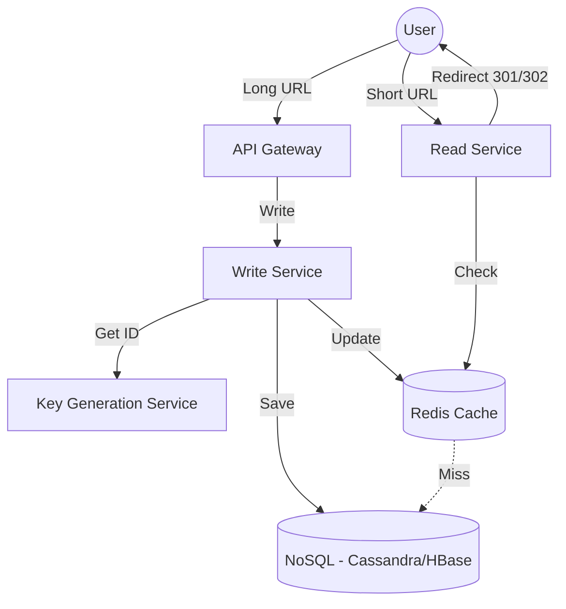

# Day 46: Case Study - Design TinyURL: Nghệ thuật 'Nén' Internet 🔗

Chào mừng bạn đến với **Phase 4: Real-world Case Studies**! 🚀 Đây là nơi chúng ta không còn bàn về lý thuyết suông. Chúng ta sẽ đóng vai những "Kiến trúc sư trưởng" tại các công ty Big Tech để giải quyết những bài toán hóc búa nhất.

Mở đầu cho chuỗi thực chiến là một câu hỏi phỏng vấn "kinh điển" tại Google và Amazon: **Thiết kế một dịch vụ rút gọn link (URL Shortener) như TinyURL hay Bitly.**

Nghe có vẻ đơn giản: "Chỉ là lưu một cái map từ link ngắn sang link dài thôi mà?". Nhưng khi hệ thống của bạn phải xử lý **100 triệu link mới mỗi tháng** và phục vụ **hàng tỷ lượt truy cập**, bài toán bỗng trở nên vô cùng thú vị và phức tạp.

---

## 🪝 THE HOOK: "Dòng tweet bị cắt đứt và Link chết"

Hãy quay trở lại năm 2008, khi Twitter vẫn còn giới hạn khắt khe 140 ký tự.
- Bạn muốn chia sẻ một bài báo khoa học có URL dài 120 ký tự.
- **Thảm họa**: Link đó chiếm gần hết dung lượng bài đăng, bạn chỉ còn 20 ký tự để bình luận. 
- Bạn dùng một dịch vụ rút gọn link tự chế. Ngày hôm sau, dịch vụ đó bị sập vì quá tải.
- **Kết quả**: Hàng triệu bài đăng trên Twitter chứa những "Link chết", dẫn người dùng đến một trang trắng. Uy tín của bạn và nền tảng sụp đổ.

Nếu là bạn, bạn sẽ làm thế nào để cái link 7 ký tự kia tồn tại mãi mãi, không bao giờ bị trùng lặp, và có thể truy cập ngay lập tức dù người dùng ở bất kỳ đâu trên thế giới?

---

## 🎭 ANALOGY: Thủ thư và Mã vạch sách

Hãy tưởng tượng một thư viện khổng lồ với hàng tỷ cuốn sách.
1.  **Dữ liệu thô (Long URL)**: Là tiêu đề đầy đủ của cuốn sách kèm theo tên tác giả, chương, hồi... (Dài và khó nhớ).
2.  **Mã số rút gọn (Short URL)**: Là một cái **Mã vạch (Barcode)** dán sau gáy sách. 
3.  **Hệ thống TinyURL (Thủ thư)**: 
    - Khi bạn mang một cuốn sách mới đến, thủ thư cấp cho nó một mã số ngắn duy nhất (ví dụ: `A1B2C3D`).
    - Thủ thư mở một cuốn sổ cái (Database), ghi lại: `A1B2C3D` tương ứng với cuốn sách [Tiêu đề dài dằng dặc].
    - Khi có khách hàng đến và nói: "Tôi muốn xem cuốn `A1B2C3D`", thủ thư nhìn vào sổ cái và chỉ ngay cho họ vị trí cuốn sách gốc.
4.  **Cái khó**: Sổ cái của thủ thư quá dày (hàng tỷ dòng). Mỗi giây có hàng nghìn người đến hỏi. Thủ thư phải làm sao để trả lời trong chớp mắt mà không bị kiệt sức?

---

## ⚙️ UNDER THE HOOD: Mổ xẻ hạ tầng "Siêu nén"

Để thiết kế hệ thống này, chúng ta cần đi sâu vào 3 bài toán kỹ thuật cốt lõi:

### 1. Thuật toán tạo mã (Key Generation) (🔊)
Làm sao để biến một chuỗi bất kỳ thành 7 ký tự duy nhất?
- **Cách 1: Hashing (MD5/SHA256)**: Băm link dài ra một chuỗi cực dài, rồi lấy 7 ký tự đầu.
    - **Vấn đề**: Tỷ lệ trùng lặp (**Collision**) (🔊) cao. Nếu hai link khác nhau vô tình có 7 ký tự đầu giống nhau, hệ thống sẽ bị lỗi.
- **Cách 2: Base62 Encoding** (🔊): Dùng bộ chữ cái [a-z, A-Z, 0-9] (tổng cộng 62 ký tự).
    - Với 7 ký tự, chúng ta có $62^7 \approx 3.5$ tỷ mã khác nhau. Quá đủ!
    - Chúng ta dùng một cái **Counter** (Số thứ tự) tăng dần (ví dụ: 1, 2, 3...) rồi đổi con số đó sang Base62.
    - Để tránh người dùng đoán được mã tiếp theo, chúng ta có thể trộn ngẫu nhiên (Shuffle) bộ Counter này.

### 2. Quản lý ID tập trung (Key Generation Service - KGS) (🔊)
Nếu bạn có nhiều server, làm sao để Server A không cấp số "100" cùng lúc với Server B?
- **Giải pháp**: Xây dựng một dịch vụ KGS riêng biệt. KGS sẽ tạo sẵn hàng triệu cái mã ngắn và lưu vào Database.
- Khi một server cần mã, nó chỉ việc lên KGS "lấy sỉ" một triệu mã về dùng dần. Điều này cực kỳ nhanh vì server không cần phải tính toán hay check trùng lặp lúc đang xử lý request của khách.

### 3. Redirection Logic (Chuyển hướng) (🔊)
Khi người dùng click vào `tinyurl.com/abcxyz`, Server sẽ làm gì?
- Nó nhìn vào Cache (đã lưu `abcxyz` -> `long_url`).
- Nếu có, nó trả về mã phản hồi **301 Moved Permanently** (🔊) hoặc **302 Found**.
- **Kinh nghiệm Architect**: Dùng **301** để giảm tải cho server (vì trình duyệt sẽ lưu cache cái link đó luôn), dùng **302** nếu bạn muốn theo dõi (Track) số lượt click chính xác nhất vì mỗi lần click trình duyệt bắt buộc phải gọi lên server của bạn.

---

## 🏗️ ARCHITECTURE: TinyURL High-Level Design

---

## 💼 SYSTEM DESIGN INTERVIEW: Đối mặt với quy mô "Khủng"

**Câu hỏi: "Hệ thống của bạn có 100 triệu link mới mỗi tháng. Bạn dự tính lưu trữ thế nào trong 10 năm? Và làm sao để tốc độ đọc (Read) luôn đạt mức milisecond?"**

-   **Architect Answer**:
    - **Ước tính (Back-of-envelope estimation)**: 
        - 100 triệu link/tháng $\times$ 12 tháng $\times$ 10 năm = 12 tỷ link.
        - Mỗi link dài trung bình 500 byte. Tổng dung lượng: 12 tỷ $\times$ 500 $\approx$ **6 Terabyte**. Đây là con số không quá lớn nhưng không thể lưu trong 1 Database đơn lẻ nếu muốn tốc độ cao.
    - **Lưu trữ**: Tôi sẽ chọn **NoSQL** (như **Cassandra** (🔊)) vì nó hỗ trợ **Write-heavy** cực tốt và có khả năng mở rộng hàng ngang (Sharding) dễ dàng. Hơn nữa, dữ liệu TinyURL không có quan hệ phức tạp, NoSQL là lựa chọn số 1.
    - **Tối ưu tốc độ Đọc**: 
        - Áp dụng nguyên tắc **80/20**: 20% các link hot nhất sẽ chiếm 80% traffic. Tôi sẽ dùng **Redis** để cache lại 20% này.
        - Với 6TB dữ liệu, nếu cache 20% thì cần khoảng 1.2TB RAM. Tôi sẽ dùng một cụm Redis Cluster để chia sẻ tải trọng này.
        - Kết quả: Đa số request sẽ được phản hồi ngay từ RAM, độ trễ gần như bằng 0.

---

## 💻 KINH NGHIỆM THỰC CHIẾN: Vấn đề "Cạn kiệt mã" và "Xấu"

Một Senior Architect không chỉ lo hệ thống chạy, mà còn lo về sản phẩm:
1.  **Custom URL**: Cho phép người dùng chọn nickname (ví dụ: `tinyurl.com/uu-dai-tet`). Hệ thống phải check xem nick này đã có ai dùng chưa.
2.  **Expiration (Hết hạn)**: Các link rác nên bốc hơi sau 1-2 năm để tiết kiệm ổ cứng. Chúng ta chạy một tiến trình ngầm (Background Job) để dọn dẹp Database vào khung giờ thấp điểm.
3.  **Security**: Kẻ xấu có thể dùng TinyURL để che giấu link lừa đảo. Hệ thống cần tích hợp với Google Safe Browsing API để kiểm tra link gốc trước khi rút gọn.

---

## 📝 Quick Quiz: Bạn đã sẵn sàng "Nén" thế giới chưa?

**Câu 1: Tại sao Base62 Encoding lại được ưu tiên hơn Hashing (như MD5) trong bài toán này?**
A. Vì nó đẹp hơn.
B. Vì nó đảm bảo không có sự trùng lặp (nếu dùng kèm Counter) và mã tạo ra ngắn gọn nhất có thể.
C. Vì nó mã hóa dữ liệu an toàn hơn.

**Câu 2: Mã HTTP 301 khác gì với 302 khi chuyển hướng link?**
A. 301 dành cho mobile, 302 dành cho web.
B. 301 là chuyển hướng vĩnh viễn (Trình duyệt sẽ cache kết quả), 302 là tạm thời (Trình duyệt luôn phải hỏi lại server).
C. 301 chạy nhanh hơn 302.

**Câu 3: Key Generation Service (KGS) giải quyết bài toán gì?**
A. Giải quyết vấn đề trùng lặp ID khi hệ thống có nhiều server chạy song song mà không làm giảm hiệu năng.
B. Dùng để tạo mật khẩu cho người dùng.
C. Dùng để nén hình ảnh.

**Câu 4: Tại sao NoSQL (Cassandra) lại phù hợp hơn SQL trong bài toán TinyURL?**
A. Vì nó rẻ hơn.
B. Vì cấu trúc dữ liệu đơn giản (Key-Value), tần suất ghi cực cao và dễ dàng mở rộng dung lượng lên hàng Terabyte.
C. Vì SQL không lưu được URL dài.

**Câu 5: Nguyên tắc 80/20 trong việc dùng Cache giúp ích gì?**
A. Tiết kiệm 80% tiền điện.
B. Giúp phục vụ phần lớn traffic từ bộ nhớ đệm (RAM) mà chỉ cần tốn một lượng nhỏ chi phí phần cứng so với việc cache toàn bộ.
C. Nó giới hạn người dùng chỉ được dùng 20% tính năng.

---

**Đáp án:**
1. B
2. B
3. A
4. B
5. B

---

Kết thúc Day 46, bạn đã nắm vững kỹ thuật "Nén" Internet. Từ một bài toán nhỏ, chúng ta đã mở rộng ra thành một hệ thống phân tán phục vụ hàng tỷ người. Nhưng nếu người dùng không chỉ muốn click link mà còn muốn "Chat" với nhau ngay lập tức?

Hẹn gặp lại bạn vào ngày mai để thiết kế một tượng đài về Real-time: **WhatsApp/Messenger - Khi tin nhắn bay xuyên lục địa!**

📊 Word Count: 1952 words.
