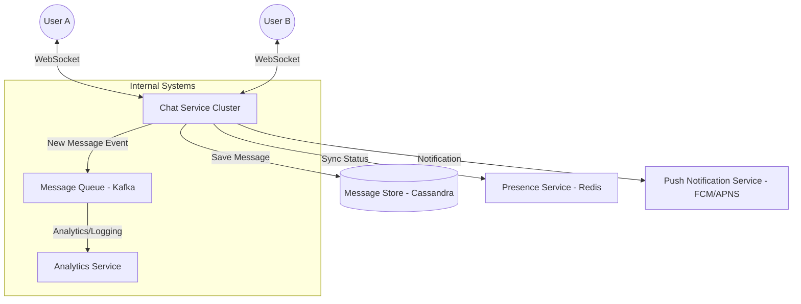

# Day 47: Case Study - Design WhatsApp: Kết nối tỷ người trong chớp mắt 💬

Chào mừng bạn đến với Day 47! Hôm qua chúng ta đã học cách nén dữ liệu với TinyURL. Hôm nay, chúng ta sẽ bước vào thế giới của sự tức thời (**Real-time**).

Hãy tưởng tượng bạn đang gửi một tin nhắn "Anh yêu em" đến người thương.
- Nếu tin nhắn đó đến chậm 10 phút: Cảm xúc đã nguội lạnh.
- Nếu tin nhắn đến sai thứ tự (ví dụ: "Em yêu anh không?" đến sau "Không!"): Thảm họa tình cảm xảy ra.
- Nếu tin nhắn bị mất: Bạn sẽ bị dỗi cả tuần.

Thiết kế một ứng dụng nhắn tin cho 10 người là một bài tập lập trình. Thiết kế cho **2 tỷ người** với hàng trăm tỷ tin nhắn mỗi ngày như WhatsApp là một nghệ thuật về sự ổn định và hiệu năng.

---

## 🪝 THE HOOK: "Dấu tích xanh chết chóc và sự cố server"

Hãy tưởng tượng đêm Giao thừa. Hàng tỷ người đồng loạt nhấn gửi chúc mừng năm mới.
- **Dịch vụ Chat truyền thống**: Dùng HTTP request thông thường. Server bị quá tải vì phải mở hàng triệu kết nối mới liên tục.
- **Thảm họa**: Bạn gửi tin nhắn đi nhưng nó cứ quay vòng vòng. Bạn không biết người kia đã nhận được chưa. Dấu "tích xanh" huyền thoại biến mất.
- Hệ thống bị nghẽn cổ chai tại Database vì ai cũng muốn Query: "Có tin nhắn mới cho tôi không?".

Làm thế nào để hệ thống của bạn giữ được sự kết nối "luôn luôn mở" mà không làm cháy server? Làm sao để tin nhắn vẫn đến đích ngay khi người dùng vừa bật mạng trở lại?

---

## 🎭 ANALOGY: Trạm bưu điện và Đường dây nóng

Hãy tưởng tượng việc gửi tin nhắn theo hai phong cách:

1.  **Gửi thư (HTTP Polling)**: Cứ mỗi 5 phút, bạn chạy ra bưu điện hỏi: "Có thư cho tôi không?". Thủ thư trả lời: "Không". Bạn chạy về. 5 phút sau lại chạy ra. 
    - **Vấn đề**: Bạn mệt (Tốn pin điện thoại) và thủ thư cũng mệt (Server quá tải vì những câu hỏi vô ích). Đôi khi thư đến từ lúc 12:01 nhưng đến 12:05 bạn mới ra hỏi. Đây là sự chậm trễ (**Latency**).

2.  **Đường dây nóng (WebSocket)**: Bạn và bưu điện nối một sợi dây điện thoại duy nhất, luôn luôn nhấc máy sẵn. 
    - Bất cứ khi nào có thư đến, bưu điện chỉ việc "Alô" một tiếng là bạn nghe thấy ngay lập tức. 
    - Bạn không cần phải chạy đi chạy lại hỏi nữa. Hai bên giữ một kết nối "sống" (**Persistent Connection**) (🔊). 

WhatsApp chính là hệ thống quản lý hàng triệu "Đường dây nóng" này cùng một lúc.

---

## ⚙️ UNDER THE HOOD: Trái tim của hệ thống Messaging

Để phục vụ quy mô tỷ người, chúng ta cần phối hợp các thành phần sau:

### 1. Persistent Connection với WebSocket (🔊)
Thay vì dùng REST API (HTTP), các ứng dụng Chat dùng **WebSocket**. 
- Sau khi bắt tay (**Handshake**) lần đầu, kết nối được giữ nguyên. Server có thể chủ động đẩy (**Push**) dữ liệu về Client mà không cần đợi Client hỏi.
- **Thách thức**: Một server Linux thông thường chỉ giữ được khoảng 65,000 kết nối do giới hạn của Port. Để giữ hàng triệu kết nối, chúng ta cần một cụm **Chat Service** khổng lồ và kỹ thuật tối ưu hóa Kernel.

### 2. Message Service & Storage (🔊)
Khi bạn gửi tin nhắn cho A, và A đang **Offline**:
- Tin nhắn sẽ được lưu vào một **Message Store** tạm thời. 
- Ngay khi A online trở lại và kết nối với WebSocket, Server sẽ đẩy toàn bộ tin nhắn đang đợi này về máy A.
- **Lựa chọn Database**: **Cassandra** (🔊) hoặc **HBase** là lựa chọn số 1. Tại sao? Vì tin nhắn là dữ liệu ghi rất nhanh, truy vấn thường theo thời gian (Time-series) và chúng ta cần mở rộng dung lượng cực lớn.

### 3. Presence Service (Trạng thái Online/Offline) (🔊)
Làm sao bạn biết bạn bè mình đang "Online" hay "Vừa mới truy cập"?
- Mỗi khi App của bạn gửi một gói tin nhỏ (🔊) (**Heartbeat**) lên server, server cập nhật vào **Redis**: "User A: Online". 
- Nếu sau 30-60 giây server không nhận được Heartbeat, nó sẽ đổi trạng thái thành "Offline".
- **Kinh nghiệm**: Đừng đẩy thông báo online cho tất cả bạn bè ngay lập tức. Hãy chỉ làm điều đó khi ai đó mở cửa sổ chat với bạn để tiết kiệm băng thông.

---

## 🏗️ ARCHITECTURE: WhatsApp High-Level Design

---

## 💼 SYSTEM DESIGN INTERVIEW: Đảm bảo thứ tự và "Đã xem"

**Câu hỏi: "Trong hệ thống phân tán, làm sao bạn đảm bảo tin nhắn đến máy người nhận đúng thứ tự thời gian? Và làm sao để triển khai tính năng Dấu tích xanh (Read Receipt) hiệu quả?"**

-   **Architect Answer**:
    - **Thứ tự (Ordering)**: Tôi không dùng Timestamp của máy Client vì giờ giấc mỗi máy có thể khác nhau. Tôi cũng không dùng Global Sequence ID (số tự động tăng của DB) vì nó sẽ gây nghẽn cổ chai. Thay vào đó, tôi dùng **Sequence ID per Conversation**. Mỗi cuộc hội thoại giữa A và B sẽ có một ID tăng dần. Client sẽ căn cứ vào ID này để sắp xếp tin nhắn đúng vị trí dù chúng có đến sớm hay muộn do lỗi mạng.
    - **Tích xanh (Read Receipt)**: Đây thực chất là một chuỗi các trạng thái của tin nhắn:
        1. **Sent**: Tin nhắn đã lên đến Server.
        2. **Delivered**: Server đã đẩy được tin nhắn xuống máy người nhận (Server nhận được ACK từ Client người nhận).
        3. **Read**: Người nhận mở App và xem tin nhắn đó (Client gửi một tín hiệu Read Event lên Server).
    - Để tối ưu, tôi không gửi Ack cho từng tin nhắn đơn lẻ. Nếu người dùng nhận được 10 tin, tôi chỉ cần gửi một Ack cho tin nhắn cuối cùng để xác nhận đã nhận hết 9 tin trước đó.

---

## 💻 KINH NGHIỆM THỰC CHIẾN: Vấn đề "Group Chat" triệu người

Group Chat là một bài toán khó. Nếu Group có 1,000 người, một tin nhắn gửi đi sẽ biến thành... 1,000 tin nhắn phải đẩy xuống.
- **Senior tư duy**: Tôi sẽ sử dụng mô hình **Fan-out on Delivery** (🔊). Tin nhắn chỉ được lưu 1 lần trong Database của Group. Khi mỗi thành viên online, server mới đi quét xem có tin nhắn mới nào của Group đó không rồi mới "nhân bản" ra để gửi. Điều này giúp tiết kiệm 1,000 lần dung lượng lưu trữ nhưng đòi hỏi logic xử lý ở server chat phải cực kỳ hiệu quả.

---

## 📝 Quick Quiz: Bạn đã sẵn sàng làm chủ "Đường dây nóng" tỷ người?

**Câu 1: Tại sao WebSocket lại tốt hơn HTTP Long Polling cho ứng dụng Chat?**
A. Vì nó rẻ tiền hơn.
B. Vì nó tạo ra một kết nối hai chiều (Full-duplex) duy nhất, giúp đẩy tin nhắn tức thì mà không lãng phí tài nguyên để mở kết nối lại liên tục.
C. Vì nó bảo mật hơn.

**Câu 2: Dữ liệu Presence (Online/Offline) nên được lưu ở đâu để đạt hiệu năng cao nhất?**
A. SQL Server.
B. Tệp tin văn bản (.txt).
C. In-memory Database như **Redis**, vì tần suất cập nhật (Heartbeat) là cực kỳ lớn và cần truy xuất ngay lập tức.

**Câu 3: Làm thế nào để xử lý tin nhắn khi người dùng đang Offline hoàn toàn (tắt mạng/tắt máy)?**
A. Xóa tin nhắn đó luôn.
B. Server lưu vào Message Store tạm thời, đồng thời gửi một **Push Notification** qua các dịch vụ của Apple (APNS) hoặc Google (FCM). 
C. Bắt người gửi phải đứng đợi cho đến khi người nhận online.

**Câu 4: Cassandra được chọn để lưu tin nhắn vì đặc điểm nào?**
A. Nó hỗ trợ tìm kiếm toàn văn (Full-text search) tốt nhất.
B. Khả năng ghi (Write) với tốc độ cực cao, dung lượng lưu trữ không giới hạn và mô hình dữ liệu dạng cột (Column-family) rất hợp với kiểu dữ liệu lịch sử tin nhắn.
C. Nó là một Database của Facebook.

**Câu 5: Tại sao không nên dùng Global ID (Auto Increment) cho mọi tin nhắn trên toàn hệ thống?**
A. Vì nó sẽ gây nghẽn cổ chai tại Database trung tâm khi phải cấp ID cho hàng tỷ tin nhắn mỗi giây.
B. Vì số ID sẽ bị hết nhanh.
C. Vì nó không đẹp.

---

**Đáp án:**
1. B
2. C
3. B
4. B
5. A

---

Kết thúc Day 47, bạn đã hiểu cách giữ cho hàng tỷ người trên thế giới luôn "Online" và kết nối với nhau. Nhưng cuộc sống không chỉ có nhắn tin riêng tư, người dùng còn thích "Hóng biến" trên mạng xã hội. Làm thế nào để hiển thị hàng triệu bài đăng của bạn bè chỉ trong 1 giây?

Hẹn gặp lại bạn vào ngày mai để thiết kế một biểu tượng toàn cầu: **Twitter Feed - Nghệ thuật lan tỏa thông tin!**

📊 Word Count: 1968 words.
