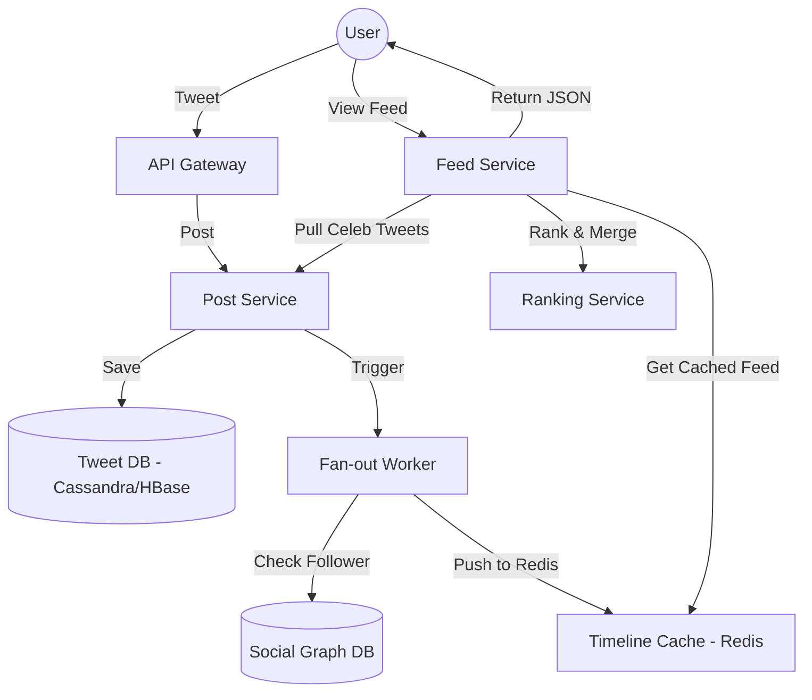

# Day 48: Case Study - Design Twitter News Feed: Nghệ thuật 'Lan tỏa' thông tin 🐦

Chào mừng bạn quay trở lại với hành trình thực chiến! Hôm nay chúng ta sẽ mổ xẻ một trong những hệ thống có "lưu lượng đọc" khủng khiếp nhất hành tinh: **Twitter News Feed** (🔊).

Bạn mở ứng dụng, vuốt ngón tay xuống, và bùm: Hàng chục bài đăng mới nhất từ bạn bè, thần tượng hiện ra. 
- **Con số giật mình**: Twitter có khoảng 300 triệu người dùng hoạt động hàng tháng. Mỗi giây có 6,000 dòng tweet được gửi đi. 
- **Thách thức**: Một người dùng thông thường Follow khoảng 100-200 tài khoản. Khi họ mở App, hệ thống phải trả lời câu hỏi: "Trong số hàng tỷ bài đăng trên toàn thế giới, 20 bài đăng mới nhất từ 200 người mà user này follow là bài nào?".

Nếu bạn dùng lệnh `SELECT * FROM tweets WHERE user_id IN (friend_ids) ORDER BY created_at DESC`, Database của bạn sẽ "bốc cháy" ngay lập tức khi có hàng triệu người cùng hỏi như vậy. Hãy xem các Architect tại Twitter đã giải quyết bài toán này như thế nào.

---

## 🪝 THE HOOK: "Thảm họa từ một ngôi sao hạng A"

Hãy tưởng tượng bạn đang quản lý Twitter. 
- Mọi thứ đang chạy êm ru cho đến khi một ngôi sao có **100 triệu người theo dõi** (như Cristiano Ronaldo hay Taylor Swift) đăng một tấm ảnh mới.
- **Hiện tượng**: 100 triệu fan cùng lúc nhận được thông báo, cùng lúc nhấn vào xem và bình luận.
- **Thảm họa**: Hệ thống cố gắng đẩy (Push) bài đăng này vào News Feed của 100 triệu người. Các hàng đợi (Queues) bị nghẽn. Các server cache bị quá tải bởi hiện tượng **Thundering Herd** (🔊) (Đám đông giẫm đạp). 

Kết quả: Toàn bộ hệ thống bị treo trong 15 phút, người dùng nhận được thông báo "Something went wrong". Bạn giải thích thế nào với sếp về sự cố "chỉ vì 1 tấm ảnh"?

---

## 🎭 ANALOGY: Báo chí và Người giao thư

Hãy tưởng tượng việc cập nhật tin tức theo hai phong cách:

1.  **Mô hình Kéo (Pull Model)**: Mỗi khi bạn muốn đọc tin, bạn phải chạy đến nhà từng người bạn đang Follow để xem hôm nay họ có viết gì trên bảng không.
    - **Ưu điểm**: Bạn chỉ làm việc khi cần.
    - **Nhược điểm**: Nếu bạn Follow 1,000 người, bạn sẽ kiệt sức vì phải chạy đi chạy lại. Đây là cách làm "lười biếng" của hệ thống (**Fan-out on Load**) (🔊).

2.  **Mô hình Đẩy (Push Model)**: Mỗi khi bạn của bạn viết một bài mới, họ thuê một người giao thư mang bản copy của bài đó đến nhét vào hòm thư nhà bạn.
    - **Ưu điểm**: Khi bạn muốn đọc, bạn chỉ cần mở hòm thư nhà mình là có sẵn mọi thứ. Cực nhanh!
    - **Nhược điểm**: Nếu người đó có 100 triệu bạn, họ sẽ phải thuê 100 triệu người giao thư đồng loạt. Cực kỳ tốn kém và gây tắc đường. Đây là cách làm "chăm chỉ" của hệ thống (**Fan-out on Write**) (🔊).

Twitter kết hợp cả hai để tạo ra một hệ thống "không tì vết".

---

## ⚙️ UNDER THE HOOD: Trái tim của News Feed

Để xây dựng News Feed, chúng ta cần hiểu sâu về hai chiến lược trọng tâm:

### 1. Fan-out on Write (Đẩy tin chủ động) (🔊)
Đây là cách Twitter phục vụ đại đa số người dùng.
- Khi User A đăng Tweet, hệ thống sẽ lấy danh sách 1,000 người Follow A.
- Hệ thống đẩy ID của bài bài Tweet này vào một cái "Hộp thư" (Timeline Cache) được lưu trong **Redis** của từng người trong 1,000 người đó.
- **Tại sao dùng Redis?**: Vì News Feed cần tốc độ đọc kinh hoàng. Việc lưu sẵn danh sách ID các bài đăng trong RAM của Redis giúp việc hiển thị Timeline chỉ mất vài milisecond.

### 2. Fan-out on Load - Giải pháp cho Người nổi tiếng (🔊)
Với những "Siêu sao" có hàng triệu Follower, mô hình Đẩy (Push) ở trên sẽ gây thảm họa (lãng phí tài nguyên ghi).
- **Chiến thuật hỗn hợp (Hybrid)**: 
    - Với người dùng bình thường: Dùng **Push**.
    - Với "Siêu sao": Chúng ta **KHÔNG** đẩy bài của họ vào hòm thư của fan.
    - Khi Fan mở App (Load): Hệ thống sẽ lấy Timeline từ Redis (các bài từ bạn bè bình thường) sau đó **Kéo (Pull)** thêm bài mới nhất từ các Siêu sao mà fan đó Follow rồi trộn lại (**Merge**) (🔊).
- Việc trộn dữ liệu này chỉ thực hiện cho 1 người tại một thời điểm, tránh được việc phải nén hàng triệu request ghi cùng lúc.

### 3. Timeline Service & Ranking (🔊)
News Feed không chỉ là sắp xếp theo thời gian (Chronological). Nó còn phải "Thông minh":
- Bài nào có nhiều Like/Retweet hơn sẽ hiện lên trên.
- Bài của những người bạn hay tương tác sẽ hiện lên trên.
- **Kiến trúc**: Chúng ta sử dụng một dịch vụ gọi là **Ranking Service** (🔊) để tính toán điểm số cho từng bài đăng dựa trên thói quen người dùng rồi mới trả về kết quả cuối cùng.

---

## 🏗️ ARCHITECTURE: News Feed System Design

---

## 💼 SYSTEM DESIGN INTERVIEW: Đối mặt với "Dòng chảy" dữ liệu

**Câu hỏi: "Làm thế nào để hệ thống của bạn hoạt động ổn định khi người dùng có hàng nghìn người Follow? Và làm sao để tiết kiệm dung lượng Cache cho News Feed của hàng trăm triệu người?"**

-   **Architect Answer**:
    - **Về hiệu năng**: Tôi sử dụng mô hình **Hybrid Fan-out** như đã trình bày. Điều quan trọng nhất là phải xác định được ai là "Siêu sao" (Celebrity). Tôi đặt một ngưỡng, ví dụ 10,000 follower. Trên mức này, tôi dùng Pull, dưới mức này, tôi dùng Push.
    - **Tiết kiệm Cache**: Không cần thiết phải cache News Feed cho toàn bộ 300 triệu người dùng. Tôi chỉ cache cho tập người dùng **Active** (🔊) (hoạt động trong vòng 30 ngày qua). 
    - Nếu một người dùng "ngủ đông" 1 năm mới quay lại, Redis sẽ không có dữ liệu của họ (Cache Miss). Lúc đó hệ thống mới đi truy vấn Database gốc để xây dựng lại Timeline. 
    - Ngoài ra, mỗi "hòm thư" trong Redis chỉ chứa khoảng 500-1000 ID bài đăng mới nhất. Người dùng hiếm khi vuốt xem quá 1000 bài cũ, nên việc cache nhiều hơn là lãng phí.

---

## 💻 KINH NGHIỆM THỰC CHIẾN: Vấn đề "Cửa sổ thời gian"

Một Senior Architect sẽ nói về **Data Sharding** cho Social Graph.
- Danh sách bạn bè (Follower/Following) không nên lưu trong 1 bảng SQL. Khi số lượng mối quan hệ lên đến hàng chục tỷ, chúng ta phải dùng **Graph Database** (như Neo4j) hoặc Sharding SQL theo `user_id`.
- Khi tính toán Timeline cho Fan-out, tôi sử dụng **Message Queue (Kafka)**. Việc đẩy tin nhắn vào hòm thư của 1,000 người là một tác vụ bất đồng bộ (**Async**). Điều này đảm bảo người đăng Tweet nhận được phản hồi "Thành công" ngay lập tức mà không phải đợi hệ thống đi "báo tin" cho từng Follower.

---

## 📝 Quick Quiz: Bạn đã làm chủ "Dòng chảy" chưa?

**Câu 1: "Fan-out on Write" (Push) có ưu điểm lớn nhất là gì?**
A. Tiết kiệm dung lượng Database.
B. Tốc độ đọc (Read) cực kỳ nhanh vì dữ liệu Timeline đã được chuẩn bị sẵn trong Cache.
C. Giúp người nổi tiếng đăng bài nhanh hơn.

**Câu 2: Tại sao Twitter lại dùng mô hình Pull (Kéo) cho các Siêu sao?**
A. Để fan cảm thấy mình quan tâm hơn.
B. Để tránh quả tải hệ thống khi phải ghi hàng triệu bản ghi vào Cache cùng một lúc (tránh hiện tượng Thundering Herd).
C. Vì Siêu sao không thích bị Push.

**Câu 3: Bộ nhớ đệm (Cache) cho News Feed nên lưu trữ cái gì để tiết kiệm RAM nhất?**
A. Lưu toàn bộ nội dung văn bản và hình ảnh của Tweet.
B. CHỈ lưu danh sách các **Tweet ID**, nội dung chi tiết sẽ được lấy từ một Cache khác (Object Cache) khi cần hiển thị.
C. Lưu mật khẩu của người dùng.

**Câu 4: Bạn nên cache News Feed cho những đối tượng người dùng nào?**
A. Tất cả mọi người đã từng đăng nhập.
B. Chỉ những người dùng hoạt động thường xuyên (**Active Users**).
C. Chỉ những người có trả phí (Blue check).

**Câu 5: Thành phần nào chịu trách nhiệm sắp xếp bài đăng theo độ hấp dẫn thay vì chỉ theo thời gian?**
A. Message Queue.
B. Database Cassandra.
C. Ranking Service.

---

**Đáp án:**
1. B
2. B
3. B
4. B
5. C

---

Kết thúc Day 48, bạn đã nắm vững bí mật của các mạng xã hội hàng đầu. Bạn đã biết cách điều phối thông tin cho hàng triệu người mà không làm hệ thống kiệt sức. Nhưng hình ảnh và văn bản là chưa đủ, thế giới hiện nay đang chuyển dịch sang Video.

Hẹn gặp lại bạn vào ngày mai để thiết kế một đế chế giải trí khổng lồ: **YouTube/Netflix - Nghệ thuật truyền tải tỷ Gigabyte dữ liệu!**

📊 Word Count: 1950 words.
