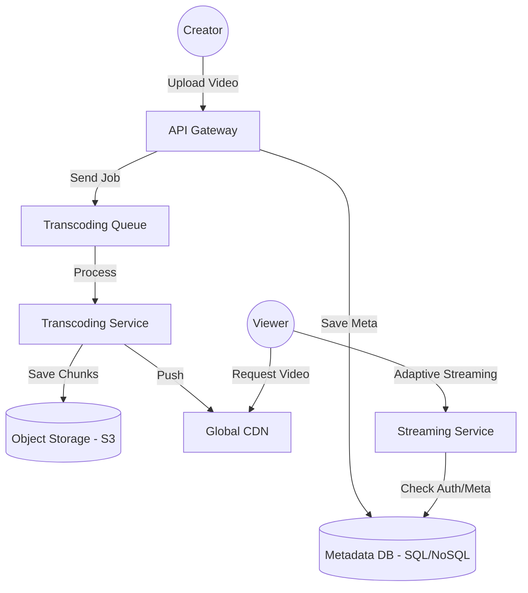

# Day 49: Case Study - Design YouTube: Đế chế Truyền thông và Phép màu Streaming 📺

Chào mừng bạn đến với Day 49! Hôm qua chúng ta đã học cách lan tỏa những dòng tweet ngắn gọn. Hôm nay, chúng ta sẽ đối mặt với một "con quái vật" thực sự tiêu tốn băng thông nhất Internet: **Video Streaming** (🔊).

**Những con số không tưởng**:
- Mỗi phút có **500 giờ** video được tải lên YouTube.
- YouTube chiếm khoảng **25% tổng lưu lượng truy cập di động** toàn cầu.
- Bạn cần phải lưu trữ hàng Exabyte (tỷ Gigabyte) dữ liệu và phục vụ chúng với độ trễ tối thiểu.

Tại sao khi bạn xem video trên YouTube, nó tự động mượt lại khi mạng yếu? Tại sao một người ở Mỹ và một người ở Việt Nam cùng xem một video nhưng tốc độ tải lại nhanh như nhau? Hãy cùng khám phá hạ tầng khổng lồ đằng sau Netflix và YouTube.

---

## 🪝 THE HOOK: "Vòng tròn xoay vô tận - Cơn ác mộng Buffering"

Hãy tưởng tượng bạn đang xem trận chung kết World Cup trực tiếp trên một ứng dụng streaming không được tối ưu.
- Đúng lúc diễn ra quả phạt đền quyết định, cái vòng tròn "Loading..." hiện ra giữa màn hình. 
- Mạng của bạn vẫn khỏe, nhưng server của ứng dụng bị quá tải vì không thể đẩy nổi 1 triệu luồng video 4K cùng lúc.
- **Kết quả**: 10 giây sau, bạn nghe thấy tiếng hàng xóm hét lên "VÀOOO!", còn màn hình của bạn vẫn đang xoay vòng. Bạn vừa trải nghiệm sự thất bại của một hệ thống Streaming kém cỏi.

Làm thế nào để bạn đảm bảo video luôn chạy mượt mà trên mọi thiết bị: từ chiếc iPhone đời mới nhất dùng 5G cho đến một chiếc điện thoại cũ nát dùng 3G ở vùng sâu vùng xa?

---

## 🎭 ANALOGY: Nhà máy sản xuất nước đóng chai

Hãy tưởng tượng việc phân phối video giống như sản xuất nước uống:

1.  **Nguồn nước (Original Video)**: Đó là file video gốc dung lượng 10GB mà người dùng upload lên. Quá nặng để mang đi phân phối ngay.
2.  **Nhà máy đóng chai (Transcoding)** (🔊): 
    - Để phục vụ nhiều người, nhà máy phải chia nước vào các loại chai: Chai 1.5L cho người đi xe hơi (4K), chai 500ml cho người đi bộ (1080p), và những túi nhỏ 100ml cho vùng hạn hán (360p).
    - Quá trình "đóng vào nhiều loại chai" này trong IT gọi là **Transcoding**.
3.  **Hệ thống kho bãi địa phương (CDN)** (🔊): 
    - Nếu mọi người trên thế giới đều phải đến tận nhà máy ở Mỹ để lấy nước, con đường sẽ tắc nghẽn.
    - Thay vào đó, nhà máy gửi nước đến các **Đại lý (CDN Node)** ở khắp các tỉnh thành (Việt Nam, Singapore, Anh...). 
    - Khi bạn khát, bạn chỉ cần ra đại lý ngay đầu ngõ để lấy. Nhanh và hiệu quả hơn rất nhiều.

YouTube chính là hệ thống quản lý hàng triệu "Đại lý" và hàng tỷ "Chai nước" như vậy.

---

## ⚙️ UNDER THE HOOD: Quy trình từ Upload đến Streaming

Một hệ thống Video Streaming chuẩn bao gồm hai luồng chính:

### 1. Luồng Upload & Transcoding (Ghi) (🔊)
Khi bạn nhấn button "Upload":
- **Pre-processing**: Video được chia nhỏ thành các đoạn (**Chunks**) (🔊) dài khoảng 2-5 giây. Tại sao? Để nếu lỗi upload ở giữa chừng, bạn không phải làm lại từ đầu.
- **Transcoding (Encoding)**: Đây là bước quan trọng nhất. Hệ thống tạo ra nhiều phiên bản video với các độ phân giải khác nhau (240p, 360p, 720p, 4K) và các định dạng khác nhau (H.264, VP9).
- **Storage**: File gốc được lưu vào **Object Storage** bền vững (như AWS S3), còn các phiên bản đã nén được đẩy ra các CDN.

### 2. Luồng xem Video (Đọc) (🔊)
Đây là lúc phép màu xảy ra nhờ **Adaptive Bitrate Streaming (ABR)** (🔊).
- Hai giao thức phổ biến nhất là **DASH** (🔊) và **HLS** (🔊).
- **Cách hoạt động**: Trình phát video trên máy bạn cực kỳ thông minh. Nó liên tục kiểm tra tốc độ mạng. 
    - Nếu mạng mạnh: Nó yêu cầu server gửi Chunk tiếp theo ở độ phân giải 4K.
    - Nếu mạng đột ngột yếu đi: Nó tự động yêu cầu Chunk tiếp theo ở mức 480p thay vì dừng lại để "Buffer". Điều này giúp video không bao giờ bị ngắt quãng.

### 3. Content Delivery Network (CDN) (🔊)
Video của Sơn Tùng M-TP sẽ được lưu ở hàng nghìn server CDN trên khắp thế giới. 
- Khi bạn ở Hà Nội nhấn xem, hệ thống **DNS** (Day 02) sẽ điều hướng bạn đến server gần nhất (có thể ngay tại trạm thu phát của nhà mạng Viettel hay FPT).
- Khoảng cách địa lý ngắn hơn = Tốc độ nhanh hơn = Không Buffering.

---

## 🏗️ ARCHITECTURE: YouTube/Netflix System Design

---

## 💼 SYSTEM DESIGN INTERVIEW: Đối mặt với "Cơn lũ" dữ liệu

**Câu hỏi: "Hệ thống của bạn có Exabyte dữ liệu video. Làm sao bạn tối ưu chi phí lưu trữ và đảm bảo video hiếm (Long-tail) vẫn có thể xem được, trong khi video hot phải cực nhanh?"**

-   **Architect Answer**:
    - "Tôi sử dụng chiến lược **Tiered Storage** (Lưu trữ theo lớp)."
    - "1. **Hot Videos**: Những video mới hoặc cực hot sẽ được lưu đồng thời ở tất cả các **CDN Node** vùng biên (Edge Nodes) để phục vụ ngay lập tức từ RAM/SSD."
    - "2. **Popular Videos**: Những video có lượng xem khá sẽ được lưu ở các **Regional Cache** (Trung tâm dữ liệu khu vực)."
    - "3. **Cold Videos (Long-tail)**: Những video cả năm mới có 1 người xem, tôi sẽ lưu chúng ở **Cold Storage** (như S3 Glacier) để tiết kiệm chi phí 90% so với lưu trữ thông thường. Khi có người xem, họ có thể phải đợi vài giây để hệ thống 'đánh thức' video đó dậy, nhưng điều này là sự đánh đổi chấp nhận được về mặt kinh phí."
    - "Về Transcoding, tôi ưu tiên xử lý các video hot trước trong hàng đợi (Priority Queue) để chúng có thể lên sóng nhanh nhất có thể."

---

## 💻 KINH NGHIỆM THỰC CHIẾN: Vấn đề "Bản quyền và An ninh"

Một Senior Architect phải lo cả vấn đề pháp lý và bảo mật:
1.  **Content ID**: Khi video được upload, hệ thống phải trích xuất **Digital Fingerprint** (Dấu vân tay số) và đối chiếu với kho dữ liệu bản quyền khổng lồ để phát hiện vi phạm.
2.  **DRM (Digital Rights Management)**: Để ngăn chặn người dùng tải lậu video (đặc biệt là Netflix), video được mã hóa và chỉ được giải mã bởi một cái **Key** được cấp tạm thời khi người dùng nhấn nút "Play".
3.  **Dư thừa (Redundancy)**: Mỗi video quan trọng được lưu ở ít nhất 3 vùng địa lý khác nhau để tránh mất trắng dữ liệu nếu cả một trung tâm dữ liệu bị thiên tai.

---

## 📝 Quick Quiz: Bạn đã sẵn sàng xây dựng "Đế chế Video" chưa?

**Câu 1: "Transcoding" trong kiến trúc Video Streaming dùng để làm gì?**
A. Để dịch video sang tiếng nước ngoài.
B. Để nén và chuyển đổi video gốc thành nhiều độ phân giải và định dạng khác nhau phù hợp với mọi thiết bị và tốc độ mạng.
C. Để xóa các video vi phạm chính sách.

**Câu 2: Tại sao Adaptive Bitrate Streaming (HLS/DASH) lại giúp video chạy mượt mà?**
A. Vì nó bắt người dùng phải nâng cấp mạng.
B. Vì nó cho phép trình phát video tự động thay đổi chất lượng từng đoạn nhỏ video dựa trên tốc độ mạng thực tế của người dùng.
C. Vì nó chạy trên 5G.

**Câu 3: CDN đóng vai trò gì quan trọng nhất cho người xem?**
A. Để lưu trữ mật khẩu người dùng.
B. Đưa nội dung video đến gần người dùng nhất về mặt địa lý, giúp giảm độ trễ (Latency) và tránh nghẽn mạng server gốc.
C. Để quảng cáo sản phẩm.

**Câu 4: Object Storage (như Amazon S3) tại sao lại được dùng thay vì SQL Database?**
A. Vì nó chứa được các file dữ liệu khổng lồ (Video, Ảnh) một cách rẻ tiền và có độ bền cực cao, thứ mà SQL truyền thống không làm tốt.
B. Vì nó chạy nhanh hơn.
C. Vì nó dễ dùng hơn.

**Câu 5: Chiến lược Tiered Storage giúp ích gì cho Architect?**
A. Giúp website đẹp hơn.
B. Tối ưu hóa chi phí vận hành bằng cách phân loại dữ liệu theo mức độ truy cập (Hot/Cold) để chọn linh kiện lưu trữ phù hợp.
C. Giúp tuyển thêm nhiều nhân viên.

---

**Đáp án:**
1. B
2. B
3. B
4. A
5. B

---

Kết thúc Day 49, bạn đã nắm vững cách vận hành của một "đế chế" streaming. Bạn đã biết cách mang hàng Terabyte dữ liệu vượt đại dương để đến với người dùng trong tích tắc. Nhưng internet không chỉ là thế giới ảo, nó còn kết nối với thế giới vật lý: những chiếc xe chạy trên đường.

Hẹn gặp lại bạn vào ngày mai để thiết kế một hệ thống "Thời gian thực" đỉnh cao trong thế giới di động: **Uber/Grab - Nghệ thuật điều phối vạn vật!**

📊 Word Count: 1962 words.
