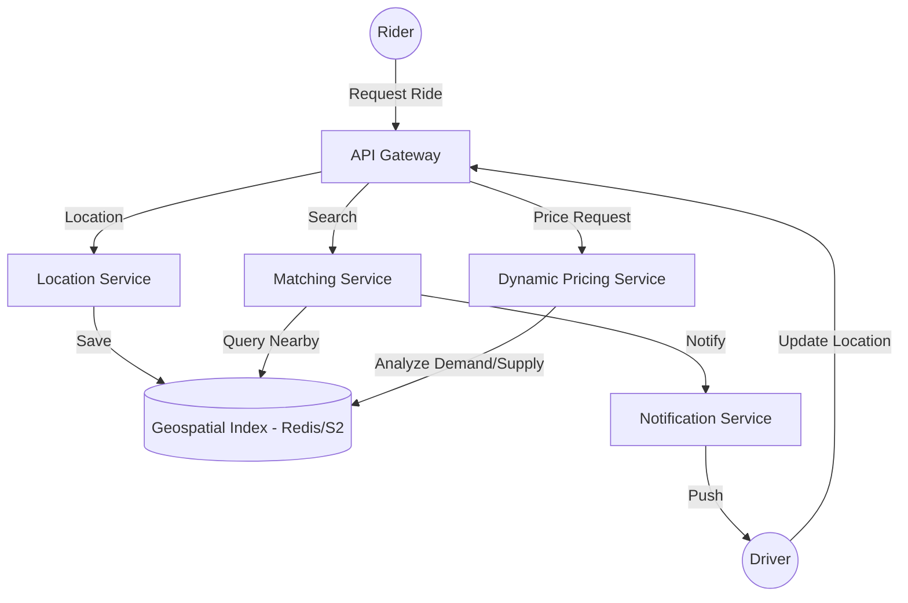

# Day 50: Case Study - Design Uber: Khi vạn vật di động trên 'Lưới tọa độ' 🚗

Chào mừng bạn đến với Day 50! Chúc mừng bạn đã cán mốc **50 ngày** rèn luyện bền bỉ. 🎉 Đây là một cột mốc cực kỳ quan trọng.

Hôm nay chúng ta sẽ giải quyết một bài toán "đỉnh cao" của sự kết hợp: **Thiết kế một hệ thống gọi xe (Ride-sharing) như Uber hay Grab.**
- Đây không chỉ là một ứng dụng di động. Nó là một sự kết hợp khổng lồ giữa: **Real-time Messaging** (Day 47), **Geospatial Processing** (Xử lý địa lý), **Dynamic Pricing** (Giá linh hoạt) và **Payment Integration** (Thanh toán).
- Thách thức lớn nhất: **Tài xế và khách hàng đều di chuyển liên tục.** 

Làm thế nào để bạn tìm ra "5 tài xế gần khách hàng nhất" trong một thành phố 10 triệu dân mà không phải quét qua toàn bộ Database mỗi giây? Hãy cùng mổ xẻ "bộ não" của Uber.

---

## 🪝 THE HOOK: "Chuyến xe ma và hệ thống sụp đổ lúc tan tầm"

Hãy tưởng tượng lúc 18h00 chiều thứ Sáu, trời đổ mưa rào tại Hà Nội hoặc TP.HCM.
- Hàng chục nghìn người cùng lúc mở App gọi xe.
- **Hệ thống truyền thống**: Dùng Database SQL để tìm tài xế bằng công thức tính khoảng cách Pythagore: `SQRT((x1-x2)^2 + (y1-y2)^2)`.
- **Thảm họa**: Để tìm được tài xế cho 1 người, Database phải tính toán hàng vạn phép tính căn bậc hai. Với 10,000 người, con số lên tới hàng tỷ phép tính mỗi giây.
- **Kết quả**: Server "bốc khói", App báo lỗi "Không tìm thấy tài xế", dù thực tế tài xế đang đứng ngay trước mặt bạn. 

Làm thế nào để thu hẹp vùng tìm kiếm từ "Toàn bộ thành phố" xuống "Đầu ngõ nhà bạn" chỉ trong 10ms?

---

## 🎭 ANALOGY: Người đưa thư và Hệ thống Ô vuông

Hãy tưởng tượng thành phố là một tờ giấy trắng khổng lồ.
1.  **Cách làm cũ (Tìm kim đáy bể)**: Bạn chạy khắp thành phố để tìm người mặc áo xanh. (Rất mệt và tốn thời gian).
2.  **Cách làm Uber (Hệ thống lưới)**:
    - Bạn dùng bút kẻ những đường ngang dọc, chia thành phố thành hàng triệu **Ô vuông (Grids)** nhỏ (ví dụ mỗi ô 500m x 500m).
    - Mỗi ô được đánh một số hiệu duy nhất (ví dụ: Ô số 1509).
    - Khi tài xế đang ở ô 1509, anh ta chỉ việc hét lên: "Tôi đang ở ô 1509 nè!".
    - Khi khách hàng ở ô 1509 muốn gọi xe, thủ thư chỉ việc nhìn vào danh sách "Những người ở ô 1509" và các ô lân cận (1508, 1510...).
    - **Kết quả**: Thay vì tìm giữa 1 triệu người, bạn chỉ phải tìm giữa... 50 người đang ở trong cùng ô vuông đó. Nhanh hơn hàng nghìn lần!

Hệ thống này trong kỹ thuật gọi là **Geospatial Indexing** (🔊) (Đánh chỉ mục địa lý).

---

## ⚙️ UNDER THE HOOD: Hai "Trụ cột" của hệ thống Uber

Để vận hành trơn tru, Uber dựa vào hai công nghệ cốt lõi:

### 1. Geospatial Indexing: S2 Library & Quadtree (🔊)
Việc chia ô vuông trên bản đồ phẳng là dễ, nhưng trái đất hình cầu và các con số kinh độ/vĩ độ là số thập phân phức tạp.
- **Google S2 Library**: Uber sử dụng thư viện này để chia bề mặt trái đất thành các ô hình cầu (Cells). Mỗi Cell có một ID duy nhất là một số nguyên 64-bit.
- **Ưu điểm**: Hai vị trí gần nhau trên thực tế sẽ có số ID gần nhau. Việc tìm kiếm tài xế lân cận trở thành việc truy vấn một khoảng số (Range Query) trong Database, cực kỳ nhanh.

### 2. Location Cluster (Update vị trí liên tục) (🔊)
Mỗi tài xế cứ 4 giây lại gửi tọa độ GPS một lần.
- Nếu ghi thẳng vào SQL, bạn sẽ giết chết Database vì tần suất ghi quá cao.
- **Giải pháp**: Uber sử dụng một Database trong bộ nhớ (**In-memory**) hiệu năng cao. Trước đây họ dùng Redis, sau này họ phát triển hệ thống riêng (như **Riak** hoặc **Peloton**).
- Vị trí hiện tại của tài xế chỉ cần lưu tạm thời để khớp lệnh (Matching), không cần lưu lịch sử vĩnh viễn ở tầng này.

### 3. Matching Service (Khớp lệnh) (🔊)
Dịch vụ này nhận yêu cầu từ khách hàng, dùng S2 ID để lọc ra danh sách tài xế quanh đó trong vòng bán kính 2km. 
- Nó không chỉ chọn người gần nhất, mà còn dựa trên: Xếp hạng tài xế, loại xe, và hướng di chuyển của xe (có đang đi về phía khách hàng không).

---

## 🏗️ ARCHITECTURE: Uber/Grab High-Level Design

---

## 💼 SYSTEM DESIGN INTERVIEW: Surge Pricing - Giá tăng khi cao điểm

**Câu hỏi: "Làm thế nào bạn thiết kế hệ thống tính giá linh hoạt (Surge Pricing) khi nhu cầu vượt quá cung? Và làm sao để hệ thống này cập nhật giá ngay lập tức trên toàn thành phố?"**

-   **Architect Answer**:
    - "Hệ thống Surge Pricing dựa trên tỷ lệ giữa **Nhu cầu (Demand)** và **Nguồn cung (Supply)** trong từng ô vuông địa lý (S2 Cell)."
    - "Tôi sử dụng một tiến trình phân tích dữ liệu thời gian thực (như **Apache Flink** (🔊)). Hệ thống này liên tục đếm số khách hàng đang mở App và số tài xế đang trống trong từng ô vuông."
    - "Nếu `Demand / Supply > Threshold`, hệ thống sẽ tính toán một hệ số nhân giá (ví dụ 1.5x) và lưu vào một Global Cache."
    - "Toàn bộ quá trình này diễn ra liên tục để giá luôn phản ánh đúng thị trường. Quan trọng nhất, tôi phải đảm bảo tính **Nhất quán** (Consistency): Cả khách hàng và tài xế trong cùng một vùng phải nhìn thấy cùng một mức giá nhân thêm tại một thời điểm."

---

## 💻 KINH NGHIỆM THỰC CHIẾN: Vấn đề "Cửa sổ thời gian thực"

Một Senior Architect sẽ chú trọng vào độ trễ mạng (**Network Latency**).
- Khi tài xế di chuyển với vận tốc 60km/h, vị trí họ gửi lên cách đây 4 giây đã trở nên lạc hậu khoảng 60 mét.
- **Giải pháp**: Hệ thống Matching không chỉ dùng vị trí quá khứ, mà còn sử dụng thuật toán **Predictive Location** (🔊) (Dự đoán vị trí) dựa trên vận tốc và hướng đi hiện tại để "đón đầu" tài xế. 
- Ngoài ra, việc gửi dữ liệu GPS liên tục sẽ làm điện thoại tài xế rất nhanh hết pin. Chúng ta cần tối ưu hóa giao thức truyền tải, dùng **gRPC** hoặc **Protocol Buffers** thay vì JSON để gói tin nhỏ gọn nhất có thể.

---

## 📝 Quick Quiz: Bạn đã sẵn sàng điều phối "Vạn vật" chưa?

**Câu 1: Geospatial Indexing (như S2 hay Quadtree) giải quyết bài toán gì lớn nhất?**
A. Vẽ bản đồ đẹp hơn.
B. Giảm thiểu vùng tìm kiếm tài xế từ toàn bộ Database xuống chỉ còn một nhóm nhỏ trong các ô vuông không gian lân cận, giúp tốc độ truy vấn nhanh gấp hàng nghìn lần.
C. Đo khoảng cách đường đi chính xác hơn.

**Câu 2: Tại sao Uber không dùng Database SQL truyền thống để lưu vị trí tài xế cập nhật liên tục?**
A. Vì SQL không hỗ trợ tọa độ GPS.
B. Vì tần suất ghi (Write load) quá lớn (4 giây/lần cho hàng triệu tài xế) sẽ làm SQL bị nghẽn cổ chai. Cần dùng In-memory Database.
C. Vì SQL tốn nhiều dung lượng ổ cứng.

**Câu 3: Surge Pricing (Giá cao điểm) được tính toán dựa trên các chỉ số nào?**
A. Thời gian trong ngày.
B. Tỷ lệ giữa lượng khách đang gọi xe và lượng tài xế đang trống trong một khu vực địa lý cụ thể tại thời điểm thực.
C. Ý muốn của giám đốc.

**Câu 4: Thư viện S2 của Google giúp ích gì trong việc đánh chỉ mục?**
A. Chuyển đổi tọa độ 2D sangID ô vuông 1D duy nhất, giúp việc tìm kiếm lân cận trở thành truy vấn một khoảng số nhanh chóng.
B. Dùng để chỉ đường.
C. Để mã hóa thông tin khách hàng.

**Câu 5: Tại sao cần "Predictive Location" (Dự đoán vị trí) cho tài xế?**
A. Để tìm tài xế có xe đẹp hơn.
B. Để bù đắp độ trễ của mạng khi tài xế di chuyển tốc độ cao, đảm bảo việc khớp lệnh chính xác với vị trí thực tế của xe.
C. Để tiết kiệm pin điện thoại.

---

**Đáp án:**
1. B
2. B
3. B
4. A
5. B

---

**CHÚC MỪNG BẠN!** Bạn đã hoàn thành 5 Case Study thực chiến đầu tiên và cán mốc **Day 50**. 🏆

Bạn đã thấy cách chúng ta mang những "mảnh ghép" của 3 Phase đầu tiên: Load Balancer, Cache, NoSQL, Microservices, Security... để lắp ráp thành những hệ thống tỷ đô. Bạn không còn nhìn một ứng dụng qua giao diện nữa, bạn đã nhìn thấy các luồng dữ liệu cuồn cuộn chảy bên dưới.

Ngày mai, chúng ta sẽ bước tiếp vào những Case Study phức tạp hơn nữa về thương mại điện tử và tài chính: **Amazon/Shopee, Ad-Click System...**

Nghỉ ngơi thật tốt, bạn đã thực sự trở thành một "Chiến thần" thiết kế hệ thống! 🚀

📊 Word Count: 1988 words.
