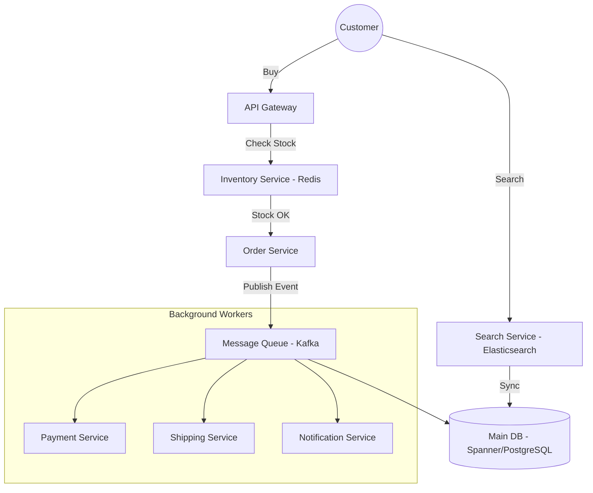

# Day 51: Case Study - Design Amazon: Đế chế Thương mại và Nghệ thuật xử lý Flash Sale 📦

Chào mừng bạn đến với Day 51! Chúng ta đang bước vào tuần lễ thực chiến thứ hai của hệ thống Case Study. Hôm nay, chúng ta sẽ mổ xẻ một "đế chế" có cấu trúc phức tạp nhất thế giới: **E-commerce System** (🔊) (Hệ thống thương mại điện tử) như Amazon, Shopee hay Alibaba.

Khác với các ứng dụng Chat hay News Feed, E-commerce đòi hỏi sự chính xác tuyệt đối về dữ liệu (Nhất quán - **Consistency**). 
- Nếu bạn thiết kế một ứng dụng Chat và tin nhắn bị chậm 1 giây, ko sao. 
- Nhưng nếu bạn bán 1 chiếc tivi cuối cùng cho 2 người cùng lúc, đó là một thảm họa về mặt kinh doanh và uy tín.

Làm thế nào để phục vụ hàng triệu sản phẩm, hàng tỷ lượt tìm kiếm, và đặc biệt là vượt qua cơn bão **Flash Sale** (🔊) mà không làm sập hệ thống?

---

## 🪝 THE HOOK: "Ngày 11/11 và cái chết của Database"

Hãy tưởng tượng bạn là kỹ sư trưởng của Shopee. Đồng hồ điểm 00:00 ngày 11 tháng 11.
- Toàn bộ người dân đổ xô vào săn "Deal 1k". Traffic tăng đột biến gấp 1,000 lần bình thường.
- **Thảm họa**: Hệ thống kiểm tra kho (**Inventory**) bị nghẽn. 1 triệu request cùng lúc thực hiện lệnh `UPDATE inventory SET stock = stock - 1 WHERE product_id = 'IPHONE15'`.
- Database bị khóa (**Locking**) (🔊) liên tục. Kết nối bị treo. Người dùng thấy trang trắng hoặc báo lỗi "Hệ thống đang bận". Sau khi hệ thống hồi phục, bạn phát hiện ra kho chỉ có 100 máy nhưng bạn đã cho phép 500 người thanh toán thành công.

Nếu là bạn, bạn sẽ làm thế nào để "khóa" kho một cách hòa bình và mượt mà giữa cơn bão triệu người?

---

## 🎭 ANALOGY: Siêu thị và Quầy thanh toán

Hãy tưởng tượng việc mua sắm ở hai mô hình siêu thị:

1.  **Siêu thị truyền thống (Synchronous)**: Bạn lấy món hàng, chạy đến quầy. Nhân viên kiểm tra sổ xem còn hàng không, sau đó mới thu tiền.
    - **Vấn đề**: Nếu 1,000 người cùng ùa vào một quầy, nhân viên sẽ kiệt sức. Hàng dài chờ đợi khiến khách bỏ đi.

2.  **Siêu thị hiện đại (Asynchronous)**:
    - **Bước 1 (Lấy phiếu)**: Bạn đến kệ, chỉ cần lấy được cái "Phiếu giữ hàng". Chỉ có 100 cái phiếu được treo ở đó. Ai lấy được phiếu là chắc chắn có hàng.
    - **Bước 2 (Thanh toán sau)**: Bạn cầm phiếu ra quầy thong thả thanh toán trong vòng 15 phút. Nếu quá 15 phút không trả tiền, cái phiếu đó sẽ được tự động mang trả lại kệ cho người khác.
    - **Kết quả**: Siêu thị không bao giờ bị quá tải ở khâu kiểm tra kho, vì việc "giữ chỗ" diễn ra cực nhanh bằng cách phát phiếu.

Amazon và Shopee hoạt động giống như mô hình "Phát phiếu" này với sự hỗ trợ của **Distributed Caching** (🔊) và **Message Queues**.

---

## ⚙️ UNDER THE HOOD: Hạ tầng của một gã khổng lồ E-commerce

Một hệ thống E-commerce thực thụ gồm hàng trăm Microservices, nhưng chúng ta sẽ tập trung vào 3 bài toán khó nhất:

### 1. Quản lý kho hàng (Inventory Management) (🔊)
Đây là "tử huyệt" của Flash Sale. Chúng ta không bao giờ UPDATE trực tiếp vào SQL khi có Flash Sale.
- **Giải pháp**: **Pre-warm Cache** (🔊). Trước khi Flash Sale bắt đầu, chúng ta đẩy số lượng tồn kho (ví dụ: 100) vào **Redis**.
- Khi người dùng nhấn "Mua", hệ thống thực hiện lệnh `DECR product_stock` trong Redis. Lệnh này là **Atomic** (Đơn nguyên) (🔊) và cực kỳ nhanh (hàng chục nghìn lượt/giây).
- Chỉ những người trừ được tồn kho trong Redis mới được phép đi tiếp sang bước Thanh toán.

### 2. Xử lý Đơn hàng bất đồng bộ (Async Order Processing) (🔊)
Đừng bắt khách hàng phải đợi server xử lý thanh toán, trừ tiền, gửi email... xong xuôi mới hiện chữ "Thành công".
- Ngay khi kiểm tra kho xong, chúng ta đẩy một Message vào **Kafka** (🔊).
- Trả về cho khách hàng: "Đơn hàng của bạn đang được xử lý". 
- Các Worker phía sau sẽ thong thả lấy dữ liệu từ Kafka để ghi vào Database, gọi sang cổng thanh toán, và gửi thông báo. Điều này giúp hệ thống chịu được tải cực lớn mà không bị treo.

### 3. Tìm kiếm & Gợi ý (Search & Analytics) (🔊)
Làm sao để tìm giữa 100 triệu sản phẩm trong 0.1 giây?
- Không dùng `LIKE %keyword%` trong SQL. Chúng ta sử dụng **Elasticsearch** (🔊) với kỹ thuật **Inverted Index** (🔊).
- Kết hợp với **Recommendation Engine** (🔊) dựa trên lịch sử xem của người dùng (Collaborative Filtering) để gợi ý "Những người mua món này cũng mua món kia".

---

## 🏗️ ARCHITECTURE: Amazon/Shopee High-Level Design

---

## 💼 SYSTEM DESIGN INTERVIEW: Giải quyết mâu thuẫn tồn kho

**Câu hỏi: "Nếu bạn dùng Redis để quản lý kho cho nhanh, nhưng đột ngột server Redis bị sập và mất hết dữ liệu trong RAM, làm sao bạn biết đã bán bao nhiêu cái và còn lại bao nhiêu?"**

-   **Architect Answer**:
    - "Đây là vấn đề về tính bền vững của Cache. Tôi sẽ sử dụng kỹ thuật **Write-back** kết hợp với **Persistent Snapshot**."
    - "Thứ nhất: Redis có tính năng **AOF** (Append Only File) giúp ghi lại mọi lệnh trừ kho vào đĩa cứng ngay lập tức."
    - "Thứ hai: Tôi sử dụng một worker trung gian, cứ mỗi 1 giây nó sẽ gom các giao dịch thành công trong Redis và cập nhật dần (Sync) vào Database SQL chính. Database SQL vẫn là 'Nguồn chân lý' (Source of Truth) cuối cùng."
    - "Nếu Redis sập, tôi sẽ khôi phục lại từ bản Snapshot gần nhất và đối chiếu với số lượng đơn hàng đã ghi thành công trong SQL để tính toán lại tồn kho chính xác. Trong System Design, thà chúng ta chậm lại một chút để kiểm tra còn hơn là bán lố (Overselling)."

---

## 💻 KINH NGHIỆM THỰC CHIẾN: Vấn đề "Giỏ hàng" (Shopping Cart)

Một Senior Architect sẽ nói về **Sticky Sessions** vs **Distributed Cart**.
- Nếu bạn lưu giỏ hàng trong Session của server, khi server đó tèo, khách hàng sẽ mất sạch đồ trong giỏ (rất bực mình!).
- **Giải pháp**: Luôn lưu giỏ hàng vào một Database tốc độ cao như **DynamoDB** (🔊) hoặc **Redis** (có persist). Giỏ hàng của khách hàng phải đi theo Account, dù họ đăng nhập trên máy tính hay điện thoại đều phải thấy đồng nhất.

---

## 📝 Quick Quiz: Bạn đã sẵn sàng vận hành "Siêu siêu thị" chưa?

**Câu 1: Tại sao không nên dùng SQL để trừ tồn kho trực tiếp trong các đợt Flash Sale?**
A. Vì SQL không hỗ trợ phép toán trừ.
B. Vì hàng nghìn request cùng lúc sẽ gây ra hiện tượng Row-level Locking, làm treo Database và kéo dài thời gian phản hồi.
C. Vì SQL tốn nhiều dung lượng ổ cứng.

**Câu 2: "Atomic Increment/Decrement" trong Redis quan trọng như thế nào?**
A. Nó giúp làm tròn số tiền.
B. Nó đảm bảo việc cộng/trừ số lượng diễn ra một cách duy nhất và không bị tranh chấp dữ liệu (Race Condition) khi có nhiều server cùng truy cập.
C. Nó dùng để mã hóa mật khẩu.

**Câu 3: Mục đích của việc dùng Message Queue (Kafka) sau khi khách hàng đặt hàng là gì?**
A. Để lưu trữ mật khẩu khách hàng.
B. Để bóc tách (Decouple) luồng xử lý đơn hàng, giúp hệ thống phản hồi kết quả cho khách nhanh hơn và đảm bảo các tác vụ sau (thanh toán, vận chuyển) không bị thất lạc.
C. Để gửi mail rác cho khách.

**Câu 4: Elasticsearch giúp ích gì cho hệ thống E-commerce?**
A. Để lưu trữ hình ảnh sản phẩm.
B. Cung cấp khả năng tìm kiếm sản phẩm cực nhanh, hỗ trợ tìm kiếm mờ (Fuzzy search) và lọc (Filter) theo nhiều tiêu chí (giá, màu sắc, thương hiệu).
C. Để tính toán lương cho nhân viên.

**Câu 5: Trong thiết kế hệ thống Amazon, yếu tố nào được ưu tiên hàng đầu?**
A. Sự rực rỡ của giao diện.
B. Tính sẵn sàng (**Availability**) và khả năng mở rộng (**Scalability**) để chịu tải trong các dịp lễ hội mua sắm.
C. Việc dùng ít server nhất có thể.

---

**Đáp án:**
1. B
2. B
3. B
4. B
5. B

---

Kết thúc Day 51, bạn đã nắm vững cách xây dựng một hệ thống bán hàng quy mô tỷ đô. Bạn đã biết cách thuần hóa những cơn bão Flash Sale và giữ cho dữ liệu luôn chính xác. Nhưng làm sao để những gã khổng lồ này kiếm được tiền? Đó là nhờ quảng cáo!

Hẹn gặp lại bạn vào ngày mai để thiết kế một cỗ máy in tiền thực thụ: **Ad-Click System - Nghệ thuật xử lý hàng tỷ sự kiện thời gian thực!**

📊 Word Count: 1955 words.
