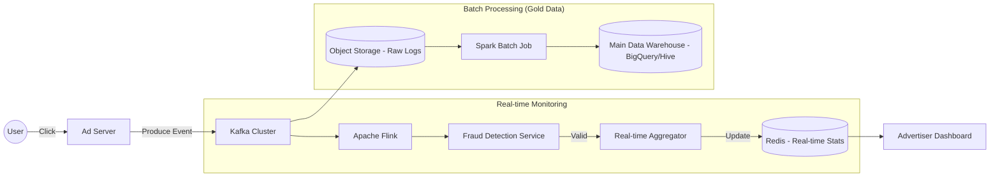

# Day 52: Case Study - Design Ad-Click System: Cỗ máy in tiền của Internet 💸

Chào mừng bạn đến với Day 52! Bạn có biết điều gì nuôi sống Google, Facebook và hầu hết các dịch vụ miễn phí trên Internet không? Đó chính là **Quảng cáo (Ads)**.

Tuy nhiên, việc xây dựng một hệ thống đếm lượt click quảng cáo (**Ad-Click System**) (🔊) không đơn giản như việc cộng dồn một con số trong Database.
- **Thử thách 1 (Quy mô)**: Hàng tỷ lượt hiển thị (**Impressions**) (🔊) và lượt click xảy ra mỗi giây.
- **Thử thách 2 (Gian lận)**: Làm sao phân biệt được đâu là người thật click, đâu là **Bot** (🔊) đang cố tình "đốt tiền" của đối thủ?
- **Thử thách 3 (Nhất quán)**: Nhà quảng cáo chỉ trả tiền cho những gì bạn đếm được. Nếu hệ thống của bạn đếm thiếu, công ty bạn mất tiền. Nếu đếm thừa, bạn bị kiện.

Hôm nay, chúng ta sẽ thiết kế một "Cỗ máy đo lường" siêu chính xác, hoạt động với tốc độ ánh sáng.

---

## 🪝 THE HOOK: "Vụ nổ Click và sự biến mất của 1 tỷ đô"

Hãy tưởng tượng bạn đang vận hành hệ thống quảng cáo cho một mạng xã hội lớn.
- Một thương hiệu thời trang lớn chạy chiến dịch Flash Sale và được hàng triệu người nổi tiếng chia sẻ.
- **Thảm họa**: Server xử lý Click bị nghẽn cổ chai. Log về lượt click chất đống trong ổ cứng nhưng không được xử lý kịp. 
- Nhà quảng cáo nạp 1 tỷ đô để chạy quảng cáo trong 1 giờ. Nhưng do hệ thống đếm chậm, quảng cáo vẫn tiếp tục hiển thị dù tiền trong tài khoản của họ đáng lẽ đã hết từ lâu.
- **Kết quả**: Công ty bạn phục vụ miễn phí lượt click trị giá hàng triệu đô mà không thu được đồng nào. Sếp của bạn đang đứng chờ ở cửa với một tờ quyết định thôi việc.

Làm thế nào để bạn "chốt sổ" tiền bạc của khách hàng gần như ngay lập tức khi họ đang đạt đỉnh traffic?

---

## 🎭 ANALOGY: Máy đếm tiền và Những đồng xu giả

Hãy tưởng tượng bạn đang quản lý một sòng bạc khổng lồ:

1.  **Đám đông (Traffic)**: Hàng triệu người ném đồng xu vào máy mỗi giây. Bạn không thể đứng đó cầm sổ ghi chép từng người một.
2.  **Máy gom tiền (Aggregator)** (🔊): 
    - Thay vì mang từng đồng xu vào kho chính (Database), bạn đặt các máy gom tiền ở từng khu vực. Máy này sẽ đếm nhanh: "Khu vực A có 1,000 đồng xu". Sau đó, nó mới gửi con số "1,000" vào kho chính. Điều này giảm tải cho kho chính hàng nghìn lần.
3.  **Máy soi tiền giả (Fraud Detection)** (🔊): 
    - Luôn có những kẻ dùng tiền giả hoặc máy tự động ném xu. Bạn cần một đội an ninh đứng quan sát: "Người này ném xu quá nhanh, không thể là người thật", hoặc "Người này ném 100 đồng xu giống hệt nhau cùng lúc". Đội an ninh sẽ loại bỏ những đồng xu này trước khi chúng được tính vào doanh thu.

Ad-Click System hoạt động y hệt như vậy với **Stream Processing** (🔊) và **Rule Engines**.

---

## ⚙️ UNDER THE HOOD: Kiến trúc xử lý dòng dữ liệu (Stream Pipeline)

Hệ thống Ad-Click không thể dùng mô hình Request-Response truyền thống. Chúng ta cần một **Data Pipeline** (🔊) hùng mạnh:

### 1. Ingestion Layer (Tiếp nhận) (🔊)
Khi user click vào quảng cáo, họ được gửi đến một **Ad Server**. Server này sẽ log lại sự kiện click.
- **Kinh nghiệm**: Đừng ghi trực tiếp vào File hay DB. Hãy đẩy sự kiện đó ngay lập tức vào một **Message Queue** như **Apache Kafka** (🔊). Kafka đóng vai trò là một "vùng đệm" cực lớn, đảm bảo không một click nào bị thất lạc dù hệ thống phía sau có chậm lại.

### 2. Stream Processing (Xử lý dòng) (🔊)
Chúng ta dùng các công cụ như **Apache Flink** (🔊) hoặc **Spark Streaming** để xử lý dữ liệu ngay khi nó đang chảy qua:
- **Deduplication** (🔊): Loại bỏ các click bị trùng do user nhấn đúp hoặc mạng lỗi.
- **Aggregation** (🔊): Gom nhóm theo `ad_id` trong một khoảng thời gian ngắn (ví dụ 10 giây). Thay vì 1 triệu dòng log, chúng ta chỉ còn 1 bản ghi: `ad_1: 500 clicks`.

### 3. Fraud Detection (Chống gian lận) (🔊)
Đây là phần khó nhất. Hệ thống phải chạy các thuật toán Machine Learning hoặc các bộ quy tắc (**Rules**) để phát hiện bất thường:
- Nếu 1 IP click 100 lần trong 1 phút -> Bot.
- Nếu các click đến từ một vùng địa lý không liên quan -> Bot.
- Toàn bộ click nghi vấn sẽ được đánh dấu và không được tính tiền (Invalid Clicks).

---

## 🏗️ ARCHITECTURE: Ad-Click High-Level Design

---

## 💼 SYSTEM DESIGN INTERVIEW: Tính đúng đắn của dữ liệu (Exactly-once)

**Câu hỏi: "Làm thế nào để bạn đảm bảo mỗi click chỉ được đếm duy nhất 1 lần? Nếu hệ thống aggregation sập giữa chừng khi đang đếm, làm sao để nó phục hồi mà không đếm lại những gì đã đếm rồi?"**

-   **Architect Answer**:
    - "Tôi sử dụng cơ chế **Exactly-once Processing** (🔊) được hỗ trợ bởi Apache Flink."
    - "Cơ chế này dựa trên **Checkpointing**. Cứ mỗi vài giây, Flink sẽ chụp lại 'ảnh tức thời' của trạng thái hệ thống và vị trí (Offset) trong Kafka."
    - "Nếu hệ thống sập, nó sẽ khởi động lại từ Point gần nhất. Các database nhận dữ liệu (như Redis hay PostgreSQL) phải hỗ trợ tính **Idempotent** (Đơn định) (🔊). Tức là nếu tôi gửi kết quả 'Ad A có 500 clicks' hai lần, kết quả trong Database vẫn không đổi thông qua lệnh `UPSERT` thay vì `INCREMENT`."
    - "Ngoài ra, mỗi click được cấp một `unique_request_id`. Ở tầng aggregator, tôi dùng một **Bloom Filter** (🔊) để check nhanh xem ID này đã được xử lý trong 1 giờ qua chưa."

---

## 💻 KINH NGHIỆM THỰC CHIẾN: Vấn đề "Cửa sổ thời gian" (Windowing)

Một Senior Architect sẽ nói về **Event Time** vs **Processing Time**.
- **Processing Time**: Thời gian mà server của bạn nhận được click.
- **Event Time**: Thời gian thực sự user click (lưu trong timestamp của điện thoại). 
- Do mạng chậm, một click lúc 12:00 có thể đến server lúc 12:05. Nếu bạn đếm theo Processing Time, báo cáo sẽ bị sai lệch. 
- **Giải pháp**: Luôn sử dụng **Watermarks** (🔊) trong Stream Processing để chờ đợi các dữ liệu đến muộn (Late Data) trong một khoảng thời gian nhất định (ví dụ 1 minute) để đảm bảo báo cáo chính xác nhất.

---

## 📝 Quick Quiz: Bạn đã sẵn sàng vận hành "Cỗ máy in tiền" chưa?

**Câu 1: Tại sao Kafka lại cực kỳ quan trọng trong Ad-Click System?**
A. Để lưu trữ database vĩnh viễn.
B. Đóng vai trò vùng đệm (Buffer) để tách rời luồng nhận click và luồng xử lý, giúp hệ thống không bị sập khi traffic tăng đột biến.
C. Để hiển thị quảng cáo lên màn hình.

**Câu 2: "Aggregation" giúp gì cho việc tối ưu Database?**
A. Giúp mã hóa dữ liệu.
B. Gom hàng triệu sự kiện nhỏ thành vài bản ghi tổng hợp, giảm thiểu số lượng lệnh ghi (Write IOPs) vào Database chính hàng nghìn lần.
C. Làm cho quảng cáo đẹp hơn.

**Câu 3: Làm thế nào để loại bỏ các Click ảo từ Bot hiệu quả nhất?**
A. Chặn toàn bộ IP của các nước ngoài.
B. Sử dụng Fraud Detection Service để phân tích hành vi bất thường (tần suất, mẫu click) ngay trong luồng dữ liệu thời gian thực.
C. Bắt người dùng phải nhập mã Capcha trước khi click vào mỗi quảng cáo.

**Câu 4: "Exactly-once processing" nghĩa là gì?**
A. Mỗi click chỉ được gửi đi một lần duy nhất.
B. Đảm bảo kết quả thống kê cuối cùng chính xác như thể mỗi sự kiện chỉ được xử lý đúng một lần, dù hệ thống có bị lỗi hay khởi động lại nhiều lần.
C. Mỗi khách hàng chỉ được xem quảng cáo một lần.

**Câu 5: Tại sao nên dùng Redis để hiển thị Dashboard cho nhà quảng cáo?**
A. Vì Redis là database miễn phí.
B. Vì Redis lưu dữ liệu trong RAM, cho phép truy xuất các con số thống kê gần như tức thời (Real-time analytics) mà không làm chậm hệ thống.
C. Vì Redis có thể lưu trữ được video quảng cáo.

---

**Đáp án:**
1. B
2. B
3. B
4. B
5. B

---

Kết thúc Day 52, bạn đã nắm vững bí mật của ngành Ad-Tech. Bạn đã biết cách đếm từng đồng xu lẻ giữa một cơn bão traffic khổng lồ. Tuy nhiên, để quảng cáo đến được với người dùng, họ phải tìm kiếm thông tin trước đã.

Hẹn gặp lại bạn vào ngày mai để thiết kế một tượng đài về việc tổ chức thông tin thế giới: **Google Search - Nghệ thuật Indexing hàng tỷ trang web!**

📊 Word Count: 1948 words.
