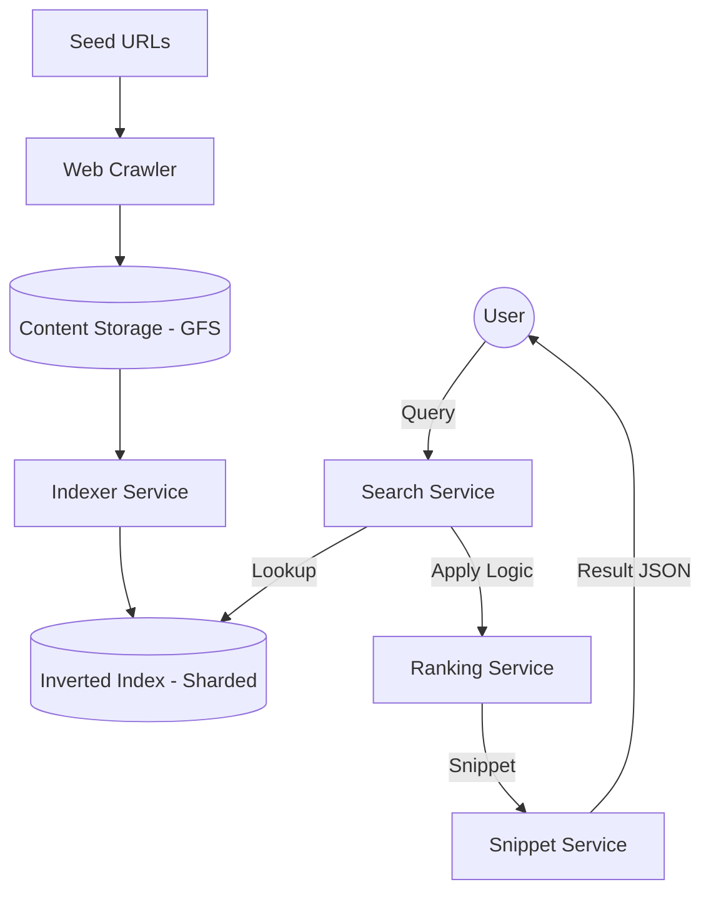

# Day 53: Case Study - Design Google Search: Sắp xếp cả thế giới 🌍

Chào mừng bạn đến với Day 53! Hôm nay chúng ta sẽ mổ xẻ "bộ não" của Internet: **Hệ thống tìm kiếm (Search Engine)** (🔊).

Hãy dừng lại một giây và suy nghĩ về con số này: Internet có khoảng **130 nghìn tỷ (130 Trillion)** trang web cá lẻ. 
- Khi bạn gõ từ khóa "System Design Master" vào Google, nó không bao giờ đi lục tung 130 nghìn tỷ trang đó ngay lúc đó. Nó đã chuẩn bị trước mọi thứ.
- **Thách thức**: Làm sao để thu thập thông tin khổng lổ đó? Làm sao để tổ chức nó để có thể tìm ra kết quả đúng trong vòng 0.2 giây? Và làm sao để biết trang nào là "uy tín" hơn để đưa lên trang đầu?

Hôm nay, bạn sẽ đóng vai Larry Page và Sergey Brin để thiết kế một hệ thống đánh chỉ mục quy mô toàn vũ trụ.

---

## 🪝 THE HOOK: "Lạc giữa mê cung thông tin"

Hãy tưởng tượng bạn đang ở trong một thư viện khổng lồ nhất thế giới, chứa hàng tỷ cuốn sách nhưng **không hề có mục lục**.
- Bạn muốn tìm một câu nói của Albert Einstein. Bạn phải đi lật từng trang của từng cuốn sách một.
- **Thảm họa**: Kể cả khi bạn đọc 1 trang mỗi giây, bạn sẽ mất hàng nghìn năm để tìm thấy. Trong khi đó, mỗi giây thư viện lại nhận thêm hàng nghìn cuốn sách mới.
- Đây chính là trạng thái của Internet nếu không có các Search Engine. Thông tin tồn tại, nhưng chúng ta không thể chạm tới nó.

Làm thế nào để bạn tạo ra một cuốn "Bách khoa toàn thư" chỉ trong tích tắc, luôn cập nhật và cực kỳ chính xác?

---

## 🎭 ANALOGY: Con nhện và Chùm chìa khóa

Hãy tưởng tượng hệ thống Google Search gồm 3 thành phần như sau:

1.  **Con nhện (Web Crawler)** (🔊): Một bầy nhện máy đi len lỏi qua các sợi tơ (Liên kết/Links) từ trang web này sang trang web khác. Mỗi khi gặp một trang mới, nó "đọc" nội dung rồi báo về cho tổ nhện.
2.  **Chùm chìa khóa (Inverted Index)** (🔊): 
    - Thông thường, bạn tìm theo cuốn sách -> nội dung.
    - Tìm kiếm thì ngược lại: Bạn tìm theo **Từ khóa** (Tên chìa khóa) -> **Danh sách các trang web chứa từ đó**.
    - Ví dụ: Chìa khóa mang tên "System Design" sẽ mở ra một danh sách các trang web: [Trang A, Trang B, Trang C...].
3.  **Vị giám khảo (Ranking)** (🔊): Gian phòng này đầy các vị giám khảo thông thái. Khi có nhiều trang web cùng chứa từ khóa, họ sẽ chấm điểm: "Trang A được nhiều người nhắc đến nhất, trang A thắng!".

Đây chính là 3 trụ cột của Google: **Crawling - Indexing - Ranking**.

---

## ⚙️ UNDER THE HOOD: Hạ tầng của sự tìm kiếm tuyệt đối

Để thiết kế Google Search, chúng ta phải giải quyết 2 luồng công việc chính:

### 1. Web Crawling & Storage (Phần Ghi) (🔊)
- **Crawler**: Một hệ thống phân tán khổng lồ. Nó bắt đầu từ một danh sách các trang web uy tín (**Seed URLs**), sau đó trích xuất các Link từ những trang này để đi tiếp.
- **Deduplication** (🔊): Crawler phải đủ thông minh để không tải một trang web nhiều lần nếu nó có nhiều URL khác nhau dẫn đến cùng 1 nội dung.
- **Storage**: Nội dung thô của các trang web được lưu trữ dưới định dạng nén trong các hệ thống file phân tán như **GFS (Google File System)** (🔊).

### 2. Inverted Indexing (Đánh chỉ mục ngược) (🔊)
Đây là "bảo bối" giúp Google tìm kiếm nhanh.
- Thay vì cấu trúc `Document -> Words`, chúng ta tạo cấu trúc `Word -> Document List`.
- Mỗi từ khóa sẽ đi kèm với một **Posting List** (🔊) chứa ID của các tài liệu và vị trí của từ đó trong tài liệu để hỗ trợ tìm kiếm theo cụm từ.
- **Dữ liệu lớn**: Với hàng nghìn tỷ từ khóa, Index này không thể nằm trên 1 máy. Nó được chia nhỏ (**Sharding**) (🔊) theo từ khóa hoặc theo ID tài liệu trên hàng vạn server.

### 3. Ranking với PageRank (🔊)
Google nổi tiếng nhờ thuật toán **PageRank**.
- Ý tưởng: Một trang web càng uy tín khi có càng nhiều trang web uy tín khác trỏ link về nó.
- Ngày nay, Google sử dụng cả **Machine Learning (RankBrain)** để hiểu ngữ cảnh của người dùng thay vì chỉ đếm từ khóa.

---

## 🏗️ ARCHITECTURE: Search Engine High-Level Design

---

## 💼 SYSTEM DESIGN INTERVIEW: Đối mặt với quy mô "Vô tận"

**Câu hỏi: "Làm thế nào để hệ thống Crawler của bạn không làm sập server của người khác khi truy cập quá nhiều lần? Và làm sao để Index của bạn luôn mới (Freshness) trong khi dữ liệu web thay đổi từng giây?"**

-   **Architect Answer**:
    - **Về lịch sự (Politeness)**: Tôi thiết kế một cơ chế **Politeness Policy**. Mỗi tên miền (Domain) sẽ có một hàng đợi riêng. Crawler sẽ không bao giờ truy vấn cùng 1 domain quá 1 lần trong mỗi vài giây để tránh bị coi là tấn công DDoS.
    - **Về độ tươi mới (Freshness)**: Web không được crawler đồng loạt. Các trang web cực hot (như báo chí, mạng xã hội) được crawler theo chu kỳ tính bằng phút. Các trang cá nhân ít cập nhật thì chỉ crawler vài tháng một lần.
    - Ngoài ra, chúng ta sử dụng kiến trúc **Lambda Architecture**. Một luồng xử lý Real-time cho tin tức mới, và một luồng Batch Processing khổng lồ cho toàn bộ dữ liệu lịch sử để đảm bảo Index tối ưu nhất.

---

## 💻 KINH NGHIỆM THỰC CHIẾN: Vấn đề "Từ gợi ý" (Typeahead)

Một Senior Architect sẽ nói về bài toán **Autocomplete/Typeahead Suggestion**.
- Khi bạn vừa gõ "Syst...", Google đã gợi ý "System Design".
- **Giải pháp**: Chúng ta sử dụng cấu trúc dữ liệu **Trie** (🔊) (Cây tiền tố) lưu trữ trong bộ nhớ RAM.
- Mỗi Node trên cây Trie sẽ lưu trữ Top 10 từ khóa tìm kiếm phổ biến nhất bắt đầu bằng chuỗi đó. Khi user gõ thêm 1 ký tự, hệ thống chỉ việc di chuyển một bước trên cây Trie để lấy kết quả ngay lập tức (Thời gian $O(L)$ với $L$ là độ dài từ khóa).

---

## 📝 Quick Quiz: Bạn đã sẵn sàng "Sắp xếp thế giới" chưa?

**Câu 1: "Inverted Index" giải quyết vấn đề gì quan trọng nhất?**
A. Nó dùng để dịch văn bản.
B. Giúp tìm ra tất cả các tài liệu chứa một từ khóa cụ thể trong thời gian cực ngắn mà không phải duyệt qua toàn bộ nội dung web.
C. Để mã hóa nội dung trang web.

**Câu 2: "Politeness Policy" trong Web Crawler dùng để làm gì?**
A. Để Crawler viết mail xin phép chủ trang web trước khi tải.
B. Kiểm soát tần suất truy cập vào một server để tránh làm quá tải hoặc gây sập website của người khác.
C. Để Crawler tự động xóa các bình luận thô lỗ.

**Câu 3: Thuật toán PageRank dựa trên giả thuyết nào?**
A. Trang web nào dài hơn thì uy tín hơn.
B. Một trang web nhận được nhiều liên kết (Backlinks) từ các trang web uy tín khác thì trang web đó cũng có độ uy tín cao.
C. Trang web nào nhiều ảnh đẹp hơn thì được ưu tiên.

**Câu 4: Cấu trúc dữ liệu "Trie" thường được dùng cho tính năng nào của Search Engine?**
A. Dùng để lưu trữ video.
B. Dùng để triển khai tính năng tự động gợi ý từ khóa khi người dùng đang gõ (Typeahead/Autocomplete).
C. Dùng để tính toán quảng cáo.

**Câu 5: Tại sao Google phải chia nhỏ (Sharding) cái Inverted Index?**
A. Vì một server đơn lẻ không bao giờ chứa nổi hàng tỷ từ khóa và hàng nghìn tỷ danh sách trang web đi kèm.
B. Vì chia nhỏ ra sẽ bảo mật hơn.
C. Vì Google có quá nhiều server thừa.

---

**Đáp án:**
1. B
2. B
3. B
4. B
5. A

---

Kết thúc Day 53, bạn đã hiểu cách Google "biết tuốt" mọi thứ. Bạn đã nắm vững bí mật của việc tổ chức hàng tỷ Terabyte dữ liệu. Nhưng đôi khi người dùng không tìm kiếm, họ đang tranh nhau "giành giật" những chiếc vé xem nhạc hội của Taylor Swift.

Hẹn gặp lại bạn vào ngày mai để thiết kế một hệ thống đầy rủi ro và kịch tính: **Ticketmaster Booking - Nghệ thuật xử lý 1 triệu request mỗi giây và chống Race Condition!**

📊 Word Count: 1968 words.
