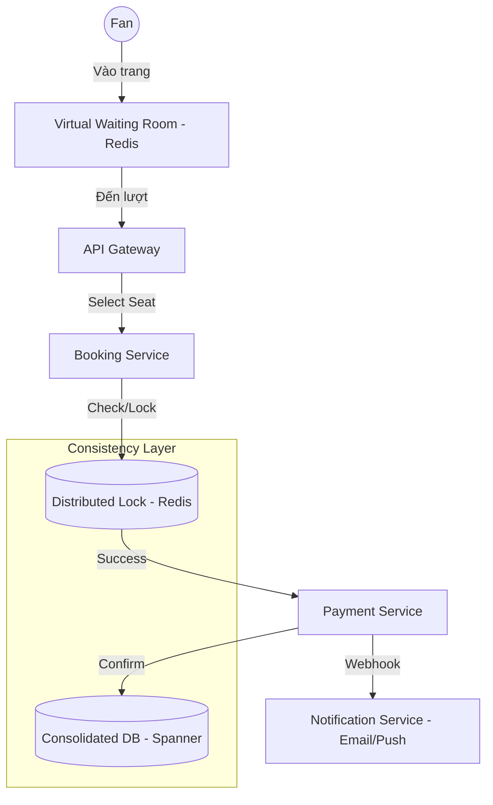

# Day 54: Case Study - Design Ticketmaster: Trận chiến giành giật những chiếc vé cuối cùng 🎟️

Chào mừng bạn đến với Day 54! Hôm nay chúng ta sẽ bước vào một trong những bài toán kịch tính và gây áp lực nhất cho mọi kỹ sư hệ thống: **Hệ thống đặt vé (Booking System)** (🔊) cho các sự kiện khổng lồ.

Hãy tưởng tượng Taylor Swift công bố tour diễn toàn cầu và vé sẽ mở bán vào lúc 10h sáng thứ Sáu.
- **Trạng thái bình thường**: Website của bạn có 1,000 người truy cập mỗi ngày.
- **Trạng thái 10h sáng thứ Sáu**: **1 triệu người** (và hàng vạn con bot) cùng lúc ùa vào một thời điểm. Đây gọi là **Flash Traffic** (🔊).
- **Thách thức cực đại**: Nếu hai người cùng nhìn thấy một chỗ ngồi trống và cùng nhấn "Mua", làm sao để đảm bảo chỉ có 1 người mua được? Làm sao để server không bị "treo cứng" trước cơn bão request?

Chúng ta không chỉ cần một hệ thống chạy nhanh, chúng ta cần một hệ thống "Công bằng" và "Bền bỉ".

---

## 🪝 THE HOOK: "Sập web và sự phẫn nộ của hàng triệu fan"

Năm 2022, Ticketmaster đã thực sự bị sập khi mở bán tour của Taylor Swift.
- Mặc dù họ là gã khổng lồ, nhưng hệ thống vẫn không chịu nổi nhiệt.
- **Thảm họa**: Người dùng đợi 5 tiếng trong hàng chờ ảo, đến lượt mình thì web báo lỗi 404. Có những người đã thanh toán xong nhưng sau đó nhận được mail báo "Vé đã hết, chúng tôi sẽ hoàn tiền".
- **Kết quả**: Uy tín của công ty chạm đáy, thậm chí bị đưa ra điều trần trước Quốc hội Mỹ.

Nếu là bạn, với ngân sách không giới hạn của Taylor Swift, bạn sẽ làm gì để 1 triệu người xếp hàng một cách trật tự và không ai bị "oan ức"?

---

## 🎭 ANALOGY: Rạp phim và Phòng chờ ảo

Hãy tưởng tượng việc bán vé giống như một rạp chiếu phim ngoài đời thực:

1.  **Cách làm tệ (Sập tiệm)**: Bạn mở cửa rạp cho 1 triệu người cùng ùa vào một lúc. Họ giẫm đạp lên nhau, ai cũng hét vào mặt nhân viên bán vé. Nhân viên bị ngất, rạp bị phá nát.
2.  **Cách làm hiện đại (Waiting Room)** (🔊): 
    - Bạn đặt một chiếc **Phòng chờ (Virtual Waiting Room)** trước cửa rạp. Khi có 1 triệu người đến, bạn chỉ cho họ lấy số thứ tự. 
    - Cứ mỗi phút, bảo vệ chỉ cho phép 50 người vào rạp. 
    - Bên trong rạp, nhân viên chỉ việc thong thả phục vụ 50 người đó. Không có sự giẫm đạp, không có sai sót. 
    - Những người còn lại ở phòng chờ được nhìn thấy một cái đồng hồ: "Thời gian chờ dự kiến của bạn là 30 phút". Điều này làm giảm sự lo lắng và bực tin.

Ticketmaster chính là sự kết hợp giữa **Queue System** và **Distributed Locking**.

---

## ⚙️ UNDER THE HOOD: Hạ tầng chịu tải "Siêu cấp"

Hệ thống Booking bao gồm các thành phần quan trọng sau để vượt qua cơn bão:

### 1. Virtual Waiting Room (Phòng chờ ảo) (🔊)
Thay vì để Request của user bay thẳng vào Application Server, chúng ta chặn họ ở tầng này.
- **Cơ chế**: Dùng các dịch vụ như **Cloudflare Waiting Room** hoặc một cụm **Micro-service** gọn nhẹ lưu số thứ tự vào **Redis** (🔊).
- User nhận được một **Token** biểu thị vị trí của họ trong hàng đợi. Chỉ khi Token này "đến lượt", API Gateway mới cho phép Request tiếp theo đi sâu vào hệ thống.

### 2. Distributed Locking & Transaction (🔊)
Làm sao để không bán 1 ghế cho 2 người?
- Khi User A chọn ghế số A1, hệ thống sẽ đặt một cái **Khóa (Lock)** (🔊) lên ghế đó trong Redis với thời gian hết hạn (ví dụ 10 phút).
- Trong 10 phút này, ghế A1 sẽ hiện trạng thái "Đang được giữ". User B sẽ thấy nó màu xám và không thể chọn.
- Nếu User A thanh toán thành công -> Chốt vé.
- Nếu User A thoát ra hoặc hết 10 phút chưa thanh toán -> Lock bị xóa, ghế A1 lại trống cho người khác.

### 3. Database Strategy (🔊)
Hệ thống này đòi hỏi tính nhất quán cực cao (**Strong Consistency**).
- Không dùng NoSQL (như Cassandra) ở đây vì bạn không muốn gặp lỗi "Eventually Consistent" (Vừa bán rồi nhưng máy khác tưởng vẫn còn).
- Chúng ta dùng **NewSQL** (như **Google Spanner** (🔊)) hoặc các Database SQL có khả năng mở rộng nhưng vẫn duy trì tính **ACID** (🔊).

---

## 🏗️ ARCHITECTURE: Ticketmaster System Design

---

## 💼 SYSTEM DESIGN INTERVIEW: Đối mặt với "Cơn lũ" thực tế

**Câu hỏi: "Nếu bạn dùng Waiting Room, làm sao để ngăn chặn Bot tự động lấy hàng vạn số thứ tự ngay giây đầu tiên? Và nếu server xử lý Lock bị sập, làm sao để không ai mất ghế đang giữ?"**

-   **Architect Answer**:
    - **Chống Bot**: Chúng ta sử dụng **CAPTCHA** ngay tại bước lấy số thứ tự trong Waiting Room. Ngoài ra, giới hạn mỗi tài khoản/IP chỉ được lấy 1 số thứ tự. Sử dụng AI để phân tích hành vi: "Ai vừa vào trang đã nhấn nút lấy vé trong 0.1 giây là Bot".
    - **Về độ bền của Lock**: Tôi sử dụng **Redlock Algorithm** (🔊) trên một cụm Redis Cluster. Tức là cái Lock đó phải được xác nhận bởi đa số server Redis (Quorum). Nếu 1 máy Redis sập, các máy khác vẫn giữ thông tin Lock đó, đảm bảo không có chuyện 2 người cùng vào lấy 1 ghế do lỗi server.
    - Một điểm quan trọng: ghế chỉ được giữ (**Reserve**) khi user đã đi đến bước điền thông tin thanh toán, tránh việc user chỉ click dạo xung quanh cũng khóa hết ghế của người khác.

---

## 💻 KINH NGHIỆM THỰC CHIẾN: Vấn đề "Cập nhật bản đồ chỗ ngồi"

Một Senior Architect sẽ nói về việc cập nhật UI.
- Trong một rạp 50,000 chỗ, hàng vạn người cùng lúc thấy ghế biến đổi màu sắc (Trống -> Đang giữ -> Đã bán).
- **Giải pháp**: Không nên bắt Client gọi API liên tục (Polling). Hãy dùng **Server-Sent Events (SSE)** (🔊) hoặc **WebSocket**. 
- Mỗi khi có 1 ghế thay đổi trạng thái, Server sẽ đẩy (Push) một gói tin nhỏ chứa `seat_id` và `status` cho tất cả mọi người đang xem bản đồ đó. Điều này tạo cảm giác cực kỳ Real-time và chuyên nghiệp.

---

## 📝 Quick Quiz: Bạn đã sẵn sàng "Bảo vệ" Taylor Swift chưa?

**Câu 1: "Virtual Waiting Room" giúp ích gì lớn nhất cho hệ thống?**
A. Để người dùng ngắm ảnh quảng cáo lâu hơn.
B. Kiểm soát lưu lượng truy cập (Rate Limiting) và điều tiết dòng người vào hệ thống một cách trật tự, giúp server không bị sập do traffic đột biến.
C. Để bán thêm đồ ăn vặt.

**Câu 2: Tại sao lại dùng Redis để thực hiện "Distributed Locking" cho ghế ngồi?**
A. Vì Redis là database rẻ nhất.
B. Vì Redis xử lý cực nhanh trong RAM và hỗ trợ các thao tác Atomic, giúp thực hiện việc giữ ghế trong vài milisecond mà không bị tranh chấp.
C. Vì Redis có màu đỏ (Red).

**Câu 3: Điều gì xảy ra nếu bạn dùng một Database "Eventually Consistent" cho việc đặt vé?**
A. Không có vấn đề gì cả.
B. Có thể xảy ra hiện tượng **Double Booking** (🔊) (hai người cùng mua được một cái ghế duy nhất) do dữ liệu giữa các server chưa kịp đồng bộ.
C. Vé sẽ được bán với giá rẻ hơn.

**Câu 4: "Redlock Algorithm" dùng để giải quyết vấn đề gì?**
A. Tăng tốc độ internet.
B. Đảm bảo tính sẵn sàng và chính xác của Distributed Lock ngay cả khi một vài server trong cụm Cache bị sập.
C. Để mã hóa mật khẩu người dùng.

**Câu 5: Tại sao nên dùng SSE hoặc WebSocket để cập nhật bản đồ chỗ ngồi?**
A. Để tiết kiệm pin điện thoại.
B. Để người dùng thấy trạng thái ghế thay đổi theo thời gian thực (Real-time) mà không cần phải tải lại trang liên tục, tạo trải nghiệm mượt mà.
C. Vì nó bảo mật hơn HTML.

---

**Đáp án:**
1. B
2. B
3. B
4. B
5. B

---

Kết thúc Day 54, bạn đã nắm vững kỹ thuật điều phối đám đông và xử lý tranh chấp dữ liệu ở cấp độ cao nhất. Bạn đã sẵn sàng bảo vệ hệ thống trước bất kỳ cơn bão traffic nào. Tuy nhiên, sau khi mua vé xong, người dùng cần tìm đường đến rạp và xem các đánh giá về nơi đó.

Hẹn gặp lại bạn vào ngày mai để thiết kế một hệ thống "Địa phương hóa" hàng đầu: **Yelp/Google Maps - Nghệ thuật đánh chỉ mục thế giới vật lý!**

📊 Word Count: 1952 words.
