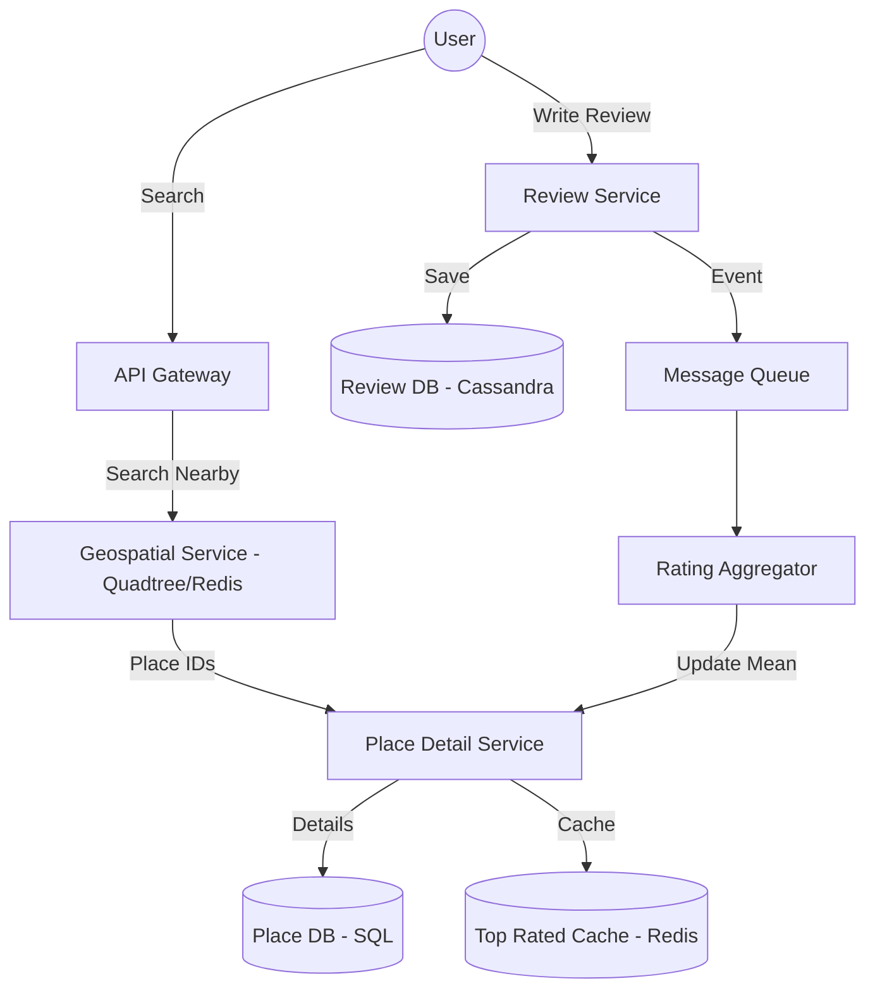

# Day 55: Case Study - Design Yelp: Bản đồ của sự tin cậy và Khám phá địa điểm 📍

Chào mừng bạn đến với Day 55! Chúng ta đã hoàn thành 10 Case Study thực chiến đỉnh cao. Hôm nay, chúng ta sẽ kết thúc đợt 2 của Phase 4 bằng một hệ thống kết hợp giữa **Địa lý** và **Cộng đồng**: **Yelp/Google Maps (Point of Interest - POI)** (🔊).

Hãy tưởng tượng bạn đang ở một thành phố xa lạ và bụng đang rất đói. Bạn mở App và tìm "Nhà hàng Ý".
- **Thách thức 1 (Địa lý)**: Hệ thống phải quét hàng triệu địa điểm để tìm ra những nhà hàng quanh bạn (Tương tự Uber - Day 50 nhưng dữ liệu POI mang tính tĩnh hơn).
- **Thách thức 2 (Dòng thông tin)**: Khi bạn nhấn vào một quán, bạn muốn thấy ngay hàng nghìn đánh giá (Reviews), hình ảnh và con số "4.5 sao" được tính toán chính xác từ hàng vạn người khác.
- **Thách thức 3 (Tìm kiếm)**: Bạn muốn lọc theo: "Giá rẻ", "Đang mở cửa", "Có chỗ đỗ xe".

Thiết kế Yelp là bài toán về việc tổ chức dữ liệu địa lý sao cho có thể truy vấn cực nhanh nhưng vẫn hỗ trợ các tính năng mạng xã hội phức tạp.

---

## 🪝 THE HOOK: "Quán ăn ngon nhất bị bỏ lỡ"

Hãy tưởng tượng hệ thống của bạn gặp lỗi logic.
- Một nhà hàng cực kỳ nổi tiếng, đạt 5 sao với 10,000 lượt đánh giá, nhưng do lỗi ở hệ thống **Ranking** (🔊), nó bị đẩy xuống trang thứ 10 của kết quả tìm kiếm.
- **Thảm họa**: Nhà hàng bị mất khách, người dùng thì không tìm thấy đồ ăn ngon. Uy tín của App Yelp bị sụt giảm vì người dùng cho rằng "App này toàn gợi ý quán dở". 
- Hoặc tệ hơn: Khi 1,000 người cùng lúc gửi đánh giá cho 1 quán cafe đang hot, hệ thống **Counter** (🔊) bị nghẽn, làm số sao hiển thị bị sai lệch.

Làm thế nào để bạn đảm bảo thông tin về hàng triệu địa điểm luôn chính xác, mới nhất và có thể tìm kiếm trong tích tắc?

---

## 🎭 ANALOGY: Cuốn danh bạ vàng và Những tờ giấy nhớ

Hãy tưởng tượng việc quản lý thông tin địa điểm như sau:

1.  **Cuốn danh bạ khổng lồ (SQL Database)**: Ghi lại tên, địa chỉ, số điện thoại của mọi cửa hàng. Rất chi tiết nhưng rất nặng để lật từng trang.
2.  **Hệ thống Bản đồ Ô vuông (Geospatial Index)** (🔊): 
    - Giống như Day 50, chúng ta chia thế giới thành các ô (Grids). Nhưng vì địa điểm (Nhà hàng, Khách sạn) không di chuyển như tài xế Uber, chúng ta có thể làm những cuốn "Danh bạ nhỏ" cho từng khu vực một cách ổn định hơn.
3.  **Hộp thư góp ý (Review System)**: 
    - Mỗi khi khách hàng ăn xong, họ ném một tờ giấy đánh giá vào hộp. 
    - Để tính ra "Số sao trung bình", chúng ta không cử người đi đếm lại toàn bộ hộp thư mỗi khi có ai đó hỏi. Thay vào đó, chúng ta có một bảng thống kê đặt ngay ngoài cửa: "Tổng số sao: 4500 | Tổng số lượt: 1000 => Trung bình 4.5". 
    - Mỗi khi có tờ giấy mới, chúng ta chỉ việc cộng thêm vào bảng thống kê này. Đây là kỹ thuật **Pre-aggregation** (🔊).

---

## ⚙️ UNDER THE HOOD: Hai hệ thống chạy song song

Kiến trúc Yelp được chia làm hai phần tách biệt nhưng bổ trợ cho nhau:

### 1. POI Service & Geospatial Indexing (Phần Tìm kiếm) (🔊)
Dữ liệu địa điểm (Tên, Tọa độ, Mô tả) thường ít thay đổi.
- **Giải pháp**: Chúng ta sử dụng **Quadtree** (🔊) hoặc **Geohash**. 
- Toàn bộ Quadtree có thể được lưu trữ trong bộ nhớ RAM của một cụm server để tốc độ tìm kiếm đạt mức milisecond. 
- Khi một cửa hàng mới mở (Ví dụ: 1 lần/ngày), chúng ta mới cập nhật lại Quadtree này.

### 2. Review & Rating System (Phần Nội dung) (🔊)
Đây là phần dữ liệu "Nóng" và thay đổi liên tục.
- **Lưu trữ**: Chúng ta dùng **NoSQL** (như **Cassandra** (🔊) hoặc **MongoDB**) để lưu hàng tỷ bản ghi đánh giá. Tại sao? Vì đánh giá thường được truy xuất theo `place_id` và thời gian, cấu trúc NoSQL hỗ trợ việc này cực tốt.
- **Rating Aggregator**: Sử dụng một dịch vụ chạy ngầm (**Batch Job** hoặc **Stream Processing**) để tính toán lại điểm số trung bình của các địa điểm sau mỗi vài phút và lưu vào Cache.

---

## 🏗️ ARCHITECTURE: Yelp/Google Maps System Design

---

## 💼 SYSTEM DESIGN INTERVIEW: Đối mặt với rủi ro "Spam" và "Độ trễ"

**Câu hỏi: "Làm thế nào để hệ thống của bạn chống lại việc các chủ quán thuê người đánh giá ảo (Spam) để tăng sao? Và nếu người dùng ở vùng mạng yếu, làm sao để họ vẫn thấy được bản đồ và các địa điểm xung quanh?"**

-   **Architect Answer**:
    - **Chống Spam**: Tôi xây dựng một **Fraud Detection System** (như Day 52). Hệ thống này kiểm tra: Nếu 1 account mới tạo mà đánh giá 10 quán trong 5 phút -> Spam. Nếu 100 đánh giá 5 sao đến từ cùng 1 dải IP trong 1 giờ -> Spam. Ngoài ra, tôi ưu tiên hiển thị đánh giá của những "Expert" (người dùng lâu năm, có uy tín cao).
    - **Về độ trễ và mạng yếu**: Tôi áp dụng kỹ thuật **Map Tiling** (🔊). Bản đồ được chia thành các mảnh hình ảnh nhỏ (Tiles). Client sẽ cache các Tiles của khu vực người dùng hay tới.
    - Với dữ liệu địa điểm, tôi sử dụng **Lazy Loading** (🔊). Đầu tiên chỉ hiện tên và số sao (dữ liệu nhẹ). Khi người dùng nhấn vào chi tiết, lúc đó mới tải hình ảnh và nội dung review đầy đủ.

---

## 💻 KINH NGHIỆM THỰC CHIẾN: Vấn đề "Cập nhật Rating"

Một Senior Architect sẽ nói về tính **Eventual Consistency** (🔊) của số sao.
- Bạn không cần phải cập nhật số sao ngay lập tức (Real-time) sau từng giây. Việc một quán cafe hiện 4.5 sao trong khi thực tế vừa có 1 người đánh giá 1 sao (đáng lẽ phải là 4.49) là hoàn toàn chấp nhận được.
- **Giải pháp**: Tôi sử dụng **Asynchronous Aggregation**. Điều này giúp giảm tải cực lớn cho Database, tránh việc mỗi lượt review lại gây ra một lệnh tính toán trung bình phức tạp cho toàn bộ 10,000 review cũ.

---

## 📝 Quick Quiz: Bạn đã sẵn sàng "Kết nối địa điểm" chưa?

**Câu 1: Tại sao Quadtree lại phù hợp cho việc tìm kiếm địa điểm trên Yelp?**
A. Vì nó là một loại cây cảnh đẹp.
B. Vì nó cho phép phân mảnh bản đồ thành các vùng nhỏ hơn một cách linh hoạt dựa trên mật độ địa điểm, giúp việc tìm kiếm lân cận cực kỳ hiệu quả mà không tốn nhiều RAM.
C. Vì nó chạy trên mọi hệ điều hành.

**Câu 2: "Pre-aggregation" trong hệ thống Rating có lợi ích gì?**
A. Để người dùng không phải viết review.
B. Giúp hiển thị số sao trung bình ngay lập tức mà không phải thực hiện lệnh tính toán (SUM/AVG) trên hàng triệu bản ghi mỗi khi có người xem.
C. Để mã hóa dữ liệu.

**Câu 3: Tại sao Cassandra thường được chọn để lưu trữ Review?**
A. Vì nó hỗ trợ tính toán số học tốt nhất.
B. Vì khả năng ghi (Write) cực nhanh, mô hình dữ liệu cột (Column-family) giúp lưu trữ hàng tỷ bản ghi và truy xuất theo ID địa điểm một cách tối ưu nhất.
C. Vì nó là database của Google.

**Câu 4: Bạn giải quyết vấn đề Spam Review như thế nào?**
A. Xóa hết các review 1 sao.
B. Sử dụng hệ thống Fraud Detection để phân tích hành vi người dùng, dải IP và lịch sử tương tác để gắn cờ các review nghi vấn.
C. Không cho phép người lạ review.

**Câu 5: Tại sao tính "Eventual Consistency" lại được chấp nhận ở số sao trung bình?**
A. Vì lập trình viên lười.
B. Vì việc sai lệch nhẹ một con số lẻ trong vài phút không ảnh hưởng đến trải nghiệm người dùng, nhưng lại giúp hệ thống tiết kiệm được rất nhiều tài nguyên tính toán.
C. Vì khách hàng không để ý.

---

**Đáp án:**
1. B
2. B
3. B
4. B
5. B

---

Kết thúc Day 55, bạn đã nắm vững cách số hóa thế giới vật lý và xây dựng niềm tin cho cộng đồng thông qua dữ liệu. Chúng ta đã cùng nhau vượt qua 10 Case Study thực chiến "khủng" nhất. Bạn đã sẵn sàng cho 5 ngày cuối cùng của Phase 4 chưa?

Hẹn gặp lại bạn vào ngày mai để bắt đầu chặng đường nước rút: **Thiết kế các hệ thống Infrastructure và Specialized Systems!**

📊 Word Count: 1972 words.
