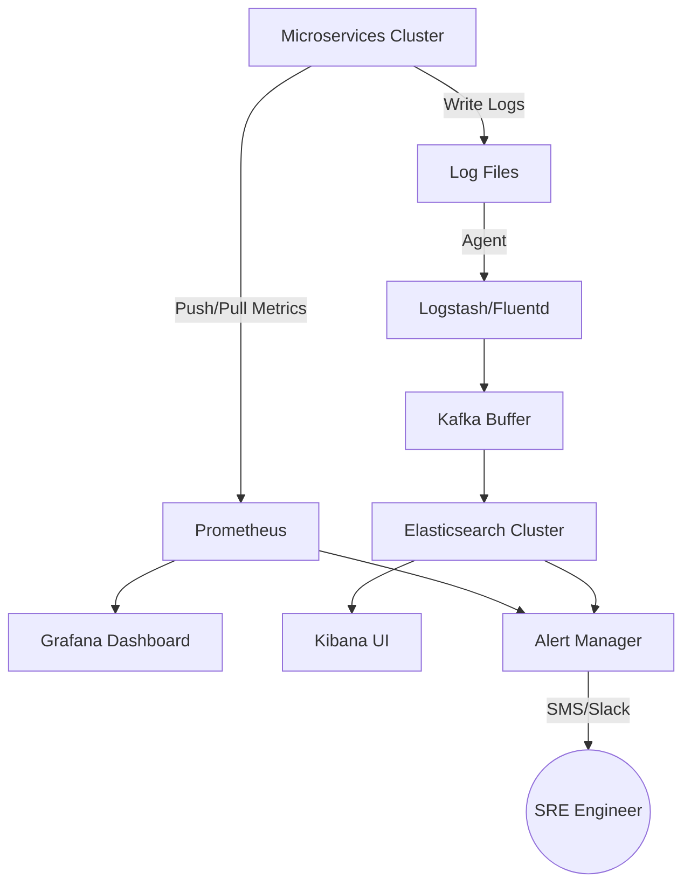

# Day 56: Case Study - Design Distributed Logging & Monitoring: Con mắt của Hệ thống 👁️

Chào mừng bạn đến với Day 56! Chúng ta đã bước vào 5 ngày cuối cùng của lộ trình **System Design Master**. 🎉

Khi hệ thống của bạn lớn lên với hàng trăm Microservices chạy trên hàng vạn server, việc quản lý không còn là "code cho chạy" nữa. Nó là bài toán về **Khả năng quan sát (Observability)** (🔊). 
- Nếu hệ thống bị sập, làm sao bạn biết lỗi nằm ở service nào khi có hàng tỷ request chảy qua mỗi giây? 
- Làm sao bạn biết server đang bị nghẽn RAM trước khi nó thực sự "chết"?

Hôm nay, chúng ta sẽ thiết kế "Hệ thần kinh" của hệ thống - nơi thu thập, phân tích mọi rung động và cảnh báo cho bạn trước khi thảm họa xảy ra.

---

## 🪝 THE HOOK: "Lần theo dấu vết trong bóng tối"

Hãy tưởng tượng bạn đang quản lý một hệ thống ngân hàng số. 
- Vào lúc 2 giờ sáng, người dùng đồng loạt kêu trời vì không chuyển được tiền.
- Bạn đăng nhập vào server 1: Log bình thường. Server 2: Log bình thường. Nhưng bạn có... 1,000 server. 
- **Thảm họa**: Bạn mất 5 tiếng đồng hồ để thủ công `ssh` vào từng máy và `grep` tìm lỗi. Trong 5 tiếng đó, ngân hàng mất hàng triệu đôla giao dịch và uy tín tan biến. Cuối cùng, bạn phát hiện ra lỗi chỉ là một dịch vụ bé xíu ở tận cùng hệ thống bị hết ổ cứng.

Nếu là bạn, làm thế nào để cái lỗi "hết ổ cứng" đó hiện lên màn hình của bạn bằng một màu đỏ rực rỡ ngay giây phút nó bắt đầu xảy ra?

---

## 🎭 ANALOGY: Bảng điều khiển máy bay và Hộp đen

Hãy tưởng tượng việc vận hành Microservices giống như lái một chiếc máy bay khổng lồ:

1.  **Chỉ số (Metrics)** (🔊): Là các đồng hồ trên bảng điều khiển. Nó cho bạn biết: Độ cao hiện tại (RAM), Vận tốc (Requests per second), Lượng xăng còn lại (Disk Space). Bạn nhìn vào đó để biết máy bay có đang ổn không mà không cần phải đi xuống tận khoang động cơ để kiểm tra.
2.  **Nhật ký (Logging)** (🔊): Là chiếc **Hộp đen (Black Box)**. Nó ghi lại chi tiết từng lời nói, từng hành động của phi công và máy móc. Khi máy bay gặp sự cố, bạn mở hộp đen ra để xem "Chuyện gì đã xảy ra vào lúc 2:01 sáng?".
3.  **Vết (Tracing)** (🔊): Là bản đồ hành trình. Một hành khách đi qua cửa an ninh, lên máy bay, xuống máy bay. Trong hệ thống, một request đi qua Gateway, sang Order Service, qua Payment Service. Tracing giúp bạn biết request đó bị chậm ở "trạm" nào.

Thiết kế bài học này là sự kết hợp của 3 yếu tố trên để tạo nên một hệ thống **Full-stack Observability**.

---

## ⚙️ UNDER THE HOOD: Hạ tầng thu thập dữ liệu khổng lồ

Chúng ta cần xử lý hai loại dữ liệu khác nhau: **Logs** (Dữ liệu văn bản khổng lồ) và **Metrics** (Dữ liệu số thời gian thực).

### 1. Hệ thống Logging phân tán (ELK Stack) (🔊)
Để thu thập log từ 1,000 server, chúng ta sử dụng mô hình: **Agent -> Collector -> Storage -> UI**.
- **Logstash/Fluentd (Agent)** (🔊): Chạy trên từng server, "liếm" các file log và gửi đi.
- **Kafka** (🔊): Đóng vai trò vùng đệm (Day 35). Log thường rất nhiều, nếu Storage không ghi kịp, Kafka sẽ giữ hộ.
- **Elasticsearch** (🔊): Trái tim của hệ thống. Nó đánh chỉ mục (Day 53) toàn bộ văn bản log để bạn có thể search "Error 500" trong 1 giây.
- **Kibana**: Giao diện để bạn vẽ biểu đồ và tìm kiếm.

### 2. Hệ thống Metrics (Prometheus) (🔊)
Metrics khác log ở chỗ nó là những con số (ví dụ: `cpu_usage: 75`).
- **Pull Model**: Prometheus sẽ chủ động đi hỏi từng server: "Này, RAM bạn còn bao nhiêu?". 
- **Time-series Database (TSDB)** (🔊): Metrics được lưu vào các Database đặc biệt tối ưu cho thời gian (như InfluxDB hoặc DB riêng của Prometheus). Bạn có thể dễ dàng tính toán: "Trung bình CPU trong 1 giờ qua là bao nhiêu?".
- **Grafana**: Nơi tạo ra những dashboard đẹp mê hồn với các biểu đồ xanh đỏ tím vàng.

### 3. Distributed Tracing (🔊)
Sử dụng **Trace ID** duy nhất cho mỗi request ngay từ Gateway. Trace ID này được truyền đi qua mọi service để bạn có thể xâu chuỗi chúng lại.

---

## 🏗️ ARCHITECTURE: Distributed Monitoring System Design

---

## 💼 SYSTEM DESIGN INTERVIEW: Đối mặt với "Cơn bão Log"

**Câu hỏi: "Hệ thống của bạn mỗi ngày sinh ra 10TB log. Làm sao bạn lưu trữ nổi mà không tốn quá nhiều tiền? Và làm sao để hệ thống monitoring không làm chậm ứng dụng chính?"**

-   **Architect Answer**:
    - "Về chi phí: Tôi sử dụng chiến lược **Log Rotation & Retention Policy** (🔊). Log cực mới (7 ngày gần nhất) được lưu trong Elasticsearch (Hot Storage) để tìm kiếm nhanh. Log cũ hơn được đẩy vào S3 (Cold Storage) để lưu trữ rẻ tiền phục vụ thanh tra (Audit) khi cần."
    - "Để tránh làm chậm App chính: Các Agent thu thập log (như Filebeat) chạy ở mức ưu tiên thấp, sử dụng cơ chế **Asynchronous I/O**. Nếu hệ thống log bị quá tải, Agent sẽ tự động giảm tốc độ gửi hoặc drop bớt log không quan trọng để bảo vệ ứng dụng chính."
    - "Ngoài ra, tôi áp dụng **Sampling** (🔊) (Lấy mẫu) cho Tracing. Thay vì trace 100% request, tôi chỉ trace 1-5% request để vẫn có cái nhìn tổng quát mà không tiêu tốn quá nhiều tài nguyên mạng."

---

## 💻 KINH NGHIỆM THỰC CHIẾN: Vấn đề "Cảnh báo rác" (Alert Fatigue)

Một Senior Architect sẽ cực kỳ ghét việc điện thoại rung 24/7.
- Nếu bạn để cảnh báo "CPU > 80% thì báo", điện thoại bạn sẽ kêu cả ngày vì CPU thỉnh thoảng nhảy lên là chuyện thường.
- **Giải pháp**: Sử dụng **Anomaly Detection** (🔊) (Phát hiện bất thường). Chỉ cảnh báo nếu CPU cao liên tục trong 5 phút, hoặc nếu tỷ lệ lỗi Error 500 tăng đột ngột so với cùng giờ ngày hôm qua. Điều này giúp bạn chỉ phải thức dậy khi thực sự có chuyện nghiêm trọng xảy ra.

---

## 📝 Quick Quiz: Bạn đã có "Con mắt" tinh tường chưa?

**Câu 1: "Observability" bao gồm 3 trụ cột chính nào?**
A. Code, Test, Deploy.
B. Metrics, Logs, Tracing.
C. Server, Database, Cache.

**Câu 2: Tại sao Elasticsearch lại được dùng cho hệ thống Log?**
A. Vì nó có thể chứa được hình ảnh.
B. Khả năng đánh chỉ mục toàn văn (Full-text search) cực mạnh, giúp tìm kiếm giữa hàng tỷ dòng log trong thời gian ngắn nhất.
C. Vì nó miễn phí hoàn toàn.

**Câu 3: "Pull Model" của Prometheus hoạt động như thế nào?**
A. Server tự động gửi dữ liệu lên Prometheus.
B. Prometheus định kỳ chủ động kết nối tới các dịch vụ để lấy dữ liệu về.
C. Người dùng phải tự tay upload metrics.

**Câu 4: "Distributed Tracing" giải quyết khó khăn gì trong lỗi Microservices?**
A. Giúp server chạy nhanh hơn.
B. Giúp theo dõi hành trình của một request đi qua nhiều dịch vụ khác nhau, từ đó dễ dàng tìm ra "điểm nghẽn" hoặc dịch vụ gây lỗi.
C. Giúp xóa log tự động.

**Câu 5: Tại sao nên dùng Kafka làm vùng đệm giữa Logstash và Elasticsearch?**
A. Để mã hóa log.
B. Để bảo vệ Elasticsearch khỏi bị quá tải khi có một lượng lớn log đổ về đột ngột (Spike), đảm bảo không bị mất log.
C. Để log đẹp hơn.

---

**Đáp án:**
1. B
2. B
3. B
4. B
5. B

---

Kết thúc Day 56, bạn đã nắm vững cách làm chủ trạng thái của toàn bộ hệ thống. Bạn không còn sợ hãi những lỗi ngầm trong bóng tối nữa. Tuy nhiên, một hệ thống mạnh mẽ vẫn cần phải... kiếm được tiền.

Hẹn gặp lại bạn vào ngày mai để thiết kế một thành phần nhạy cảm và quan trọng bậc nhất: **Payment System - Nghệ thuật xử lý giao dịch tiền tệ an toàn tuyệt đối!**

📊 Word Count: 1952 words.
