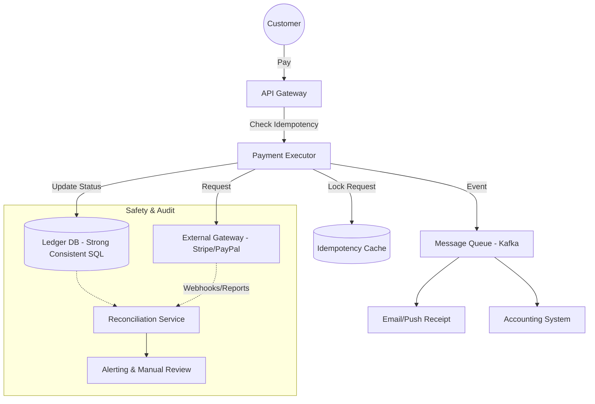

# Day 57: Case Study - Design Payment System: Nghệ thuật 'Cân não' với dòng tiền 💸

Chào mừng bạn đến với Day 57! Trong thế giới System Design, có những hệ thống cho phép bạn sai một chút (như mạng xã hội), nhưng có những hệ thống mà **sai sót là tội ác**. Đó chính là **Hệ thống thanh toán (Payment System)** (🔊).

Thách thức của bài toán thanh toán không nằm ở traffic hàng tỷ request (mặc dù nó cũng rất cao), mà nằm ở sự **Chính xác tuyệt đối (Correctness)** (🔊) và khả năng **Chịu lỗi (Reliability)**.
- Bạn không thể nói với khách hàng: "Xin lỗi, do mạng lag nên chúng tôi lỡ trừ tiền của quý khách... 2 lần".
- Bạn cũng không thể nói với Sếp: "Do server sập nên chúng ta quên không thu tiền của 1,000 khách hàng".

Hôm nay, chúng ta sẽ thiết kế một "Pháo đài tài chính" nơi mỗi xu đều được đếm đúng và không bao giờ bị thất lạc giữa các dòng code.

---

## 🪝 THE HOOK: "Cơn ác mộng Charging và sự cố cổng thanh toán"

Hãy tưởng tượng bạn đang vận hành một ứng dụng gọi xe.
- User hoàn thành cuốc xe 50k. Hệ thống gọi sang cổng thanh toán (Stripe/PayPal).
- **Kịch bản kinh dị**: Bạn vừa gửi lệnh trừ tiền đi thì mạng bị ngắt (**Timeout**). Bạn không nhận được phản hồi.
- **Nếu bạn gửi lại**: Nguy cơ trừ tiền 2 lần. Khách hàng sẽ kiện bạn.
- **Nếu bạn không gửi lại**: Bạn có thể mất trắng 50k đó vì thực ra cổng thanh toán đã trừ tiền rồi nhưng tin báo về bị mất giữa đường.
- **Kết quả**: Cuối tháng đối soát, con số trong Database của bạn và con số ở Ngân hàng lệch nhau 1 tỷ đồng. Bạn phải bỏ tiền túi ra đền hoặc đối mặt với pháp luật.

Làm thế nào để hệ thống của bạn biết chắc chắn một giao dịch đã thành công hay chưa, kể cả khi mạng bị đứt giữa chừng?

---

## 🎭 ANALOGY: Thủ quỹ và Cuốn sổ cái bọc thép

Hãy tưởng tượng việc thanh toán như quy trình tại một cửa hàng đồ hiệu:

1.  **Phiếu yêu cầu (Payment Request)**: Bạn chọn món hàng và đưa thẻ cho nhân viên. Nhân viên tạo một cái phiếu có mã số duy nhất (ví dụ: `PAY-123`).
2.  **Tính đơn định (Idempotency)** (🔊): 
    - Nếu bạn đưa thẻ 2 lần nhưng vẫn là cái phiếu `PAY-123`, thủ quỹ nhìn thấy: "À, cái mã này tôi đang xử lý rồi", và tuyệt đối không quẹt thẻ lần thứ 2. 
    - Mã này chính là chiếc "Bùa hộ mệnh" bảo vệ túi tiền của bạn.
3.  **Đối soát (Reconciliation)** (🔊): 
    - Cuối ngày, chủ cửa hàng cầm sổ của thủ quỹ và sổ của Ngân hàng ra so khớp. 
    - Nếu sổ thủ quỹ ghi: "Đã thu 10 triệu", nhưng Ngân hàng bảo: "Mới nhận 9 triệu", chủ cửa hàng sẽ tìm bằng được 1 triệu kia đang kẹt ở đâu. Quy trình này đảm bảo tiền không bao giờ "bay hơi".

Hệ thống Payment hoạt động y hệt như vậy với **Idempotency Key** và **Batch Reconciliation**.

---

## ⚙️ UNDER THE HOOD: 3 Trụ cột an toàn tài chính

Để thiết kế một hệ thống thanh toán chuẩn "quốc tế", chúng ta cần 3 thành phần sau:

### 1. Idempotency (Tính đơn định) (🔊)
Đây là kỹ thuật quan trọng nhất. Mỗi request thanh toán phải đi kèm một **Idempotency-Key** duy nhất từ phía Client.
- Server lưu Key này vào một bảng tạm (thường dùng Redis hoặc SQL có index).
- Nếu nhận được một request trùng Key, server chỉ việc trả về kết quả của lần xử lý trước đó mà không thực hiện trừ tiền lại.
- **Quy tắc vàng**: Không bao giờ thiết kế API thanh toán mà không có Idempotency Key.

### 2. Hai giai đoạn thanh toán (Step-by-step Execution) (🔊)
Một giao dịch tiền tệ thường gồm 2 bước:
- **Authorize (Xác thực)** (🔊): Ngân hàng kiểm tra xem bạn có đủ tiền không và "đóng băng" số tiền đó lại.
- **Capture (Thu tiền)** (🔊): Sau khi bạn đã nhận được hàng hoặc dịch vụ, hệ thống mới thực hiện lệnh thực sự rút tiền về tài khoản công ty.
- Việc chia làm 2 bước giúp bạn dễ dàng **Refund** (hoàn tiền) ngay lập tức nếu có lỗi xảy ra ở khâu giao hàng mà không phải chịu phí chuyển khoản.

### 3. Reconciliation System (Hệ thống đối soát) (🔊)
Vì chúng ta làm việc với các bên thứ ba (Cổng thanh toán), dữ liệu có thể bị lệch do lỗi mạng.
- Chúng ta xây dựng một dịch vụ định kỳ (Background Job) tải file báo cáo từ Ngân hàng/Stripe về.
- So sánh từng dòng với Database của chúng ta. 
- Mọi sai lệch đều được đẩy vào một hàng đợi **Manual Review** (🔊) để nhân viên kế toán kiểm tra lại.

---

## 🏗️ ARCHITECTURE: Payment System High-Level Design

---

## 💼 SYSTEM DESIGN INTERVIEW: Đảm bảo "Tiền đi tiền đến"

**Câu hỏi: "Làm thế nào để bạn đảm bảo tính Nhất quán khi một request thanh toán liên quan đến việc cập nhật 3 chỗ: Trừ tiền khách hàng, Cộng tiền nhà cung cấp, và Ghi sổ cái? Nếu bước 3 lỗi thì bạn làm thế nào?"**

-   **Architect Answer**:
    - "Tôi sử dụng kiến trúc **Saga Pattern** (Day 37) kết hợp với **Distributed Transactions**."
    - "Quan trọng nhất, tôi áp dụng mô hình **Double-entry Bookkeeping** (🔊) (Giao dịch kép). Tức là tiền không bao giờ tự nhiên sinh ra hay biến mất, nó chỉ chuyển từ tài khoản A sang tài khoản B. Tổng của toàn hệ thống luôn phải bằng 0."
    - "Nếu một bước trong chuỗi thanh toán bị lỗi, tôi sử dụng cơ chế **Compensating Transaction** (🔊) để thực hiện giao dịch đảo ngược (ví dụ: cộng lại tiền cho khách). 
    - Để đảm bảo không bao giờ mất dữ liệu, tôi dùng **Transactional Outbox Pattern** (🔊): Ghi trạng thái thanh toán và Event cần gửi vào cùng một Transaction của Database SQL. Điều này đảm bảo: hoặc cả hai cùng thành công, hoặc cả hai cùng thất bại."

---

## 💻 KINH NGHIỆM THỰC CHIẾN: Vấn đề "Bảo mật PCI-DSS"

Một Senior Architect không bao giờ lưu trữ số thẻ tín dụng trong Database của mình.
- **Tokenization** (🔊): Khi user nhập thẻ, thẻ đó được gửi thẳng lên Stripe. Stripe trả về cho bạn một cái **Token** (ví dụ: `tok_123`). Bạn chỉ lưu cái Token này.
- Cách làm này giúp hệ thống của bạn không trở thành mục tiêu của hacker (vì bạn chẳng có tiền hay số thẻ để chúng lấy), đồng thời giúp bạn đạt chứng chỉ bảo mật tài chính quốc tế dễ dàng hơn.

---

## 📝 Quick Quiz: Bạn đã sẵn sàng cầm "Chìa khóa kho" chưa?

**Câu 1: "Idempotency Key" có vai trò gì quan trọng nhất?**
A. Để mã hóa thông tin khách hàng.
B. Đảm bảo một giao dịch thanh toán chỉ được thực hiện đúng một lần duy nhất, kể cả khi Client gửi request nhiều lần do lỗi mạng.
C. Để giúp server chạy nhanh hơn.

**Câu 2: Tại sao nên dùng mô hình Double-entry Bookkeeping (Ghi sổ kép)?**
A. Để làm sổ sách đẹp hơn.
B. Đảm bảo tính minh bạch và dễ dàng phát hiện sai sót vì mọi dòng tiền đều có nguồn đi và nguồn đến rõ ràng, tổng nợ và có luôn cân bằng.
C. Vì luật pháp bắt buộc mọi lập trình viên phải biết kế toán.

**Câu 3: Tại sao không nên lưu số thẻ tín dụng (CVV, Card Number) vào Database của mình?**
A. Vì tốn dung lượng ổ cứng.
B. Để giảm thiểu rủi ro pháp lý và bảo mật. Nếu hệ thống bị hack, dữ liệu thẻ của khách hàng vẫn an toàn vì được lưu ở các đơn vị chuyên nghiệp đạt chuẩn PCI-DSS.
C. Vì khách hàng không cho phép.

**Câu 4: Quy trình "Reconciliation" (Đối soát) thực hiện khi nào?**
A. Thực hiện ngay lập tức mỗi khi có click.
B. Chạy định kỳ (thường là cuối ngày) để so khớp dữ liệu giữa hệ thống nội bộ và báo cáo từ ngân hàng/đối tác thanh toán nhằm tìm ra sai sót.
C. Chỉ thực hiện khi có khách hàng khiếu nại.

**Câu 5: Tại sao nên dùng SQL có tính ACID cao cho hệ thống Payment thay vì NoSQL?**
A. Vì SQL dễ dùng hơn.
B. Vì Payment đòi hỏi sự nhất quán dữ liệu tuyệt đối (Strong Consistency), không chấp nhận việc dữ liệu bị lệch dù chỉ một giây.
C. Vì Stripe chỉ hỗ trợ SQL.

---

**Đáp án:**
1. B
2. B
3. B
4. B
5. B

---

Kết thúc Day 57, bạn đã nắm giữ những quy tắc "vàng" của thế giới tài chính số. Bạn đã biết cách bảo vệ từng đồng xu của khách hàng. Nhưng để những con số này được truy xuất với tốc độ ánh sáng trên quy mô toàn cầu, chúng ta cần một loại Database đặc biệt.

Hẹn gặp lại bạn vào ngày mai để mổ xẻ "linh hồn" của các hệ thống High-Scale: **Distributed Key-Value Store - Bí mật đằng sau DynamoDB và Cassandra!**

📊 Word Count: 1962 words.
