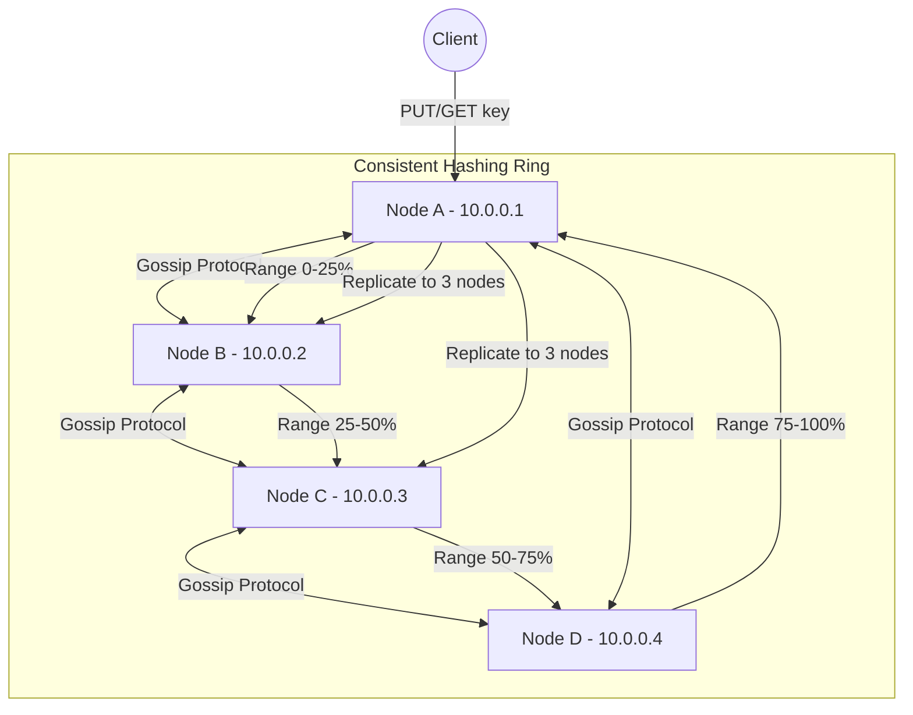

# Day 58: Case Study - Design Distributed KV Store: Bí mật của sức mạnh vô hạn 🗄️

Chào mừng bạn đến với Day 58! Chúng ta đang ở rất gần đích đến. 🏁

Hôm nay là một ngày "hardcore". Chúng ta sẽ không thiết kế một ứng dụng nữa, chúng ta sẽ thiết kế một **hạ tầng lưu trữ (Storage Infrastructure)** (🔊). Cụ thể là một **Distributed Key-Value Store** (🔊) - thứ đứng sau những hệ thống khủng khiếp nhất như Amazon DynamoDB, Cassandra hay Redis Cluster.

Kiến thức hôm nay sẽ giúp bạn hiểu tại sao những hệ thống này có thể:
- Chịu được việc 10% server bị sập mà không mất dữ liệu.
- Mở rộng (Scale) thêm hàng trăm server chỉ bằng một nút bấm.
- Phục vụ hàng triệu request mỗi giây với độ trễ cực thấp.

Hãy chuẩn bị tinh thần, chúng ta sắp đi vào "DNA" của hệ thống phân tán.

---

## 🪝 THE HOOK: "Thảm họa Sharding và Database chết đứng"

Hãy tưởng tượng bạn đang dùng SQL để lưu trữ dữ liệu người dùng.
- Bạn dùng kỹ thuật **Sharding** (Chia nhỏ DB) theo ID: Server 1 lưu ID 1-1tr, Server 2 lưu 1tr1-2tr.
- **Thảm họa 1**: Server 2 đột ngột bị cháy ổ cứng. Hàng triệu người dùng từ ID 1tr1-2tr không thể đăng nhập. Hệ thống của bạn "què cụt".
- **Thảm họa 2**: Bạn muốn thêm Server 3. Bạn phải tự tay di chuyển hàng triệu bản ghi từ Server 1 và 2 sang 3. Trong lúc chuyển, hệ thống phải dừng hoạt động.

Một Senior Architect không bao giờ làm như vậy. Họ xây dựng một hệ thống "Tự phục hồi" và "Tự cân bằng". Nếu một máy hỏng? Máy khác tự làm thay. Nếu thêm máy mới? Dữ liệu tự động chảy sang mà không ai hay biết.

---

## 🎭 ANALOGY: Chiếc nhẫn khổng lồ và Những người giữ khóa

Hãy tưởng tượng một thư viện được bố trí theo hình một chiếc nhẫn (Vòng tròn):

1.  **Vòng tròn băm (Consistent Hashing Ring)** (🔊): 
    - Trên vòng tròn này, chúng ta đánh dấu các vị trí từ 0 đến hàng tỷ. 
    - Các server được đặt rải rác trên vòng tròn này. 
    - Khi bạn có một cuốn sách (Dữ liệu), bạn lấy ID của nó "băm" một cái, nó sẽ rơi vào một vị trí trên vòng tròn. 
    - Cuốn sách sẽ được lưu tại server đầu tiên nó gặp khi đi theo chiều kim đồng hồ.
2.  **Nhân bản (Replication)** (🔊): 
    - Thủ thư không chỉ để cuốn sách ở 1 server. Cần đề phòng server đó cháy. 
    - Theo luật: "Mỗi cuốn sách phải được chép làm 3 bản, lưu ở 3 server kế tiếp nhau trên vòng tròn". 
    - Nếu 1 server sập, 2 server còn lại vẫn có sách cho bạn mượn.
3.  **Hội đồng biểu quyết (Quorum)** (🔊): 
    - Khi có ai đó muốn sửa nội dung cuốn sách, họ phải được sự đồng ý của đa số (ví dụ 2 trên 3 người giữ bản sao). Điều này đảm bảo nội dung ở các bản sao không bị mâu thuẫn.

Đây chính là nền tảng của **Dynamo-style Systems**.

---

## ⚙️ UNDER THE HOOD: 4 Khái niệm "Sống còn"

Để thiết kế một hệ thống KV Store chuẩn "Elite 3.0", bạn phải nắm rõ:

### 1. Consistent Hashing (🔊)
Kỹ thuật này giúp giải quyết bài toán "Thêm/Xóa server mà không phải xáo trộn toàn bộ dữ liệu".
- Khi thêm 1 server mới, chỉ có khoảng $1/n$ dữ liệu trong hệ thống cần phải di chuyển. 
- Giúp hệ thống có khả năng mở rộng hàng ngang (Horizontal Scaling) vô hạn.

### 2. Quorum Consensus (N, R, W) (🔊)
- **N**: Số bản sao (Replicas).
- **W**: Số server tối thiểu phải xác nhận "Đã ghi thành công" (Write).
- **R**: Số server tối thiểu phải trả về dữ liệu khi "Đọc" (Read).
- **Công thức vàng**: Nếu $R + W > N$, bạn luôn đọc được dữ liệu mới nhất (Strong Consistency). Nếu không, bạn sẽ nhận được **Eventual Consistency** (Day 26).

### 3. Conflict Resolution (Vector Clocks) (🔊)
Nếu hai người cùng sửa một bản ghi ở hai nơi khác nhau cùng lúc (Split-brain), hệ thống sẽ làm gì?
- **Vector Clocks** (🔊) gán cho mỗi dữ liệu một "Lịch sử phiên bản". 
- Hệ thống sẽ so sánh: Nếu phiên bản A là con của phiên bản B -> lấy B. 
- Nếu hai phiên bản là "anh em họ" (không ai hơn ai), hệ thống sẽ giữ lại cả hai và nhờ người dùng quyết định (hoặc lấy cái mới nhất - Last Write Wins).

### 4. Gossip Protocol (Nghệ thuật buôn chuyện) (🔊)
Làm sao các server biết ai đang sống, ai đang chết mà không cần một server quản lý trung tâm (No Master)?
- Cứ mỗi giây, Server A chọn ngẫu nhiên Server B để "buôn chuyện": "Tôi vẫn sống nè, tôi nghe nói Server C mới sập đó, bạn biết chưa?".
- Tin đồn này lan truyền cực nhanh (Exponentially). Chỉ trong tích tắc, cả nghìn server đều biết trạng thái của nhau.

---

## 🏗️ ARCHITECTURE: Distributed KV Store Internals

---

## 💼 SYSTEM DESIGN INTERVIEW: Đối mặt với "Sự cố mạng" (Partition Tolerance)

**Câu hỏi: "Trong một hệ thống 1,000 server, đột nhiên mạng bị đứt làm đôi (500 máy không thấy 500 máy kia). Làm sao bạn đảm bảo hệ thống vẫn phục vụ được khách hàng mà dữ liệu không bị sai lệch vĩnh viễn?"**

-   **Architect Answer**:
    - "Dựa trên định lý **CAP** (Day 19), tôi phải chọn giữa **Consistency** (Nhất quán) hoặc **Availability** (Sẵn sàng). Với KV Store quy mô lớn, tôi thường ưu tiên **Availability**."
    - "Tôi sử dụng kỹ thuật **Hinted Handoff** (🔊). Trong lúc mạng đứt, nếu Server A không thể ghi dữ liệu sang Server B (bản sao), nó sẽ ghi tạm dữ liệu đó vào một file cục bộ. Khi mạng hồi phục, nó sẽ 'trả nợ' cho Server B."
    - "Để phát hiện sự sai lệch dữ liệu sau khi mạng hồi phục, tôi dùng **Merkle Trees** (🔊) (Cây băm). Hai máy chỉ việc so sánh mã hash cao nhất của cây. Nếu giống nhau nghĩa là dữ liệu khớp. Nếu khác nhau, chúng chỉ cần đi xuống từng nhánh của cây để tìm đúng bản ghi bị lệch để đồng bộ, thay vì gửi toàn bộ Terabyte dữ liệu qua mạng."

---

## 💻 KINH NGHIỆM THỰC CHIẾN: Vấn đề "Nóng" và "Vùng ảo"

Một Senior Architect sẽ nói về **Virtual Nodes** (Vnodes) (🔊).
- Nếu mỗi server vật lý chỉ có 1 vị trí trên vòng tròn băm, dữ liệu có thể bị lệch (một máy quá tải, máy kia chơi không).
- **Giải pháp**: Chia một server vật lý thành hàng trăm "Server ảo" và rải đều trên vòng tròn. Điều này đảm bảo dữ liệu luôn được chia cực kỳ đều và khi một máy sập, tải trọng của nó được chia sẻ cho tất cả máy còn lại thay vì chỉ đổ dồn vào một ông hàng xóm tội nghiệp.

---

## 📝 Quick Quiz: Bạn đã làm chủ "Vòng tròn quyền lực" chưa?

**Câu 1: Consistent Hashing giải quyết bài toán gì tốt nhất?**
A. Để mã hóa dữ liệu người dùng.
B. Giảm thiểu việc phải di chuyển dữ liệu (Data Migration) khi thêm hoặc bớt server trong một cụm phân tán khổng lồ.
C. Để server chạy nhanh hơn.

**Câu 2: Công thức Quorum (R + W > N) đảm bảo điều gì?**
A. Hệ thống không bao giờ bị sập.
B. Đảm bảo tính nhất quán mạnh (Strong Consistency), vì tập hợp các máy "Đọc" và máy "Ghi" luôn có ít nhất một máy chung giữ dữ liệu mới nhất.
C. Giảm bớt số lượng ổ cứng cần dùng.

**Câu 3: "Gossip Protocol" được dùng để làm gì?**
A. Để các admin chat với nhau.
B. Truyền bá trạng thái (sống/chết) của các server trong hệ thống một cách phi tập trung, giúp hệ thống không có "điểm chết duy nhất" (Single Point of Failure).
C. Để spam email cho khách hàng.

**Câu 4: "Merkle Trees" giúp ích gì trong việc phục hồi sau sự cố mạng?**
A. Dùng để nén dữ liệu.
B. Giúp so sánh và phát hiện sự sai lệch dữ liệu giữa các server một cách cực kỳ nhanh chóng mà không cần tốn nhiều băng thông để gửi toàn bộ dữ liệu qua lại.
C. Dùng để vẽ bản đồ server.

**Câu 5: Tại sao lại dùng "Virtual Nodes" thay vì Nodes vật lý đơn lẻ trên vòng tròn?**
A. Để tiết kiệm điện.
B. Đảm bảo dữ liệu được phân phối đều hơn (Load Balancing) và giúp việc phục hồi từ sự cố diễn ra mượt mà hơn bằng cách chia sẻ tải trọng cho nhiều server khác.
C. Vì nó trông hiện đại hơn.

---

**Đáp án:**
1. B
2. B
3. B
4. B
5. B

---

Kết thúc Day 58, bạn đã thực sự "chạm tay" vào những kiến thức sâu sắc nhất của một System Architect. Bạn đã hiểu được cái lõi của những Database hàng đầu thế giới. Nhưng dữ liệu mạnh mẽ là chưa đủ, chúng ta cần một phương thức để liên lạc với người dùng bất cứ lúc nào.

Hẹn gặp lại bạn vào ngày mai để thiết kế một dịch vụ "Hào phóng" nhất: **Notification Service - Nghệ thuật gửi hàng tỷ thông báo mà không bị coi là Spam!**

📊 Word Count: 1982 words.
