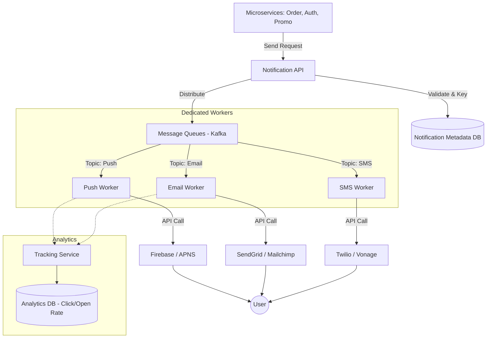

# Day 59: Case Study - Design Notification Service: Tiếng vang của Hệ thống 🔔

Chào mừng bạn đến với Day 59! Chỉ còn một bước nữa thôi là chúng ta hoàn tất lộ trình 60 ngày. 🎓

Hôm nay, chúng ta sẽ thiết kế một thành phần mà mọi ứng dụng hiện đại đều cần: **Dịch vụ thông báo (Notification Service)** (🔊).
- Bạn vừa thanh toán thành công? -> Email báo hóa đơn.
- Có ai đó Like ảnh của bạn? -> Push thông báo điện thoại.
- Ngân hàng trừ tiền? -> SMS báo biến động số dư.

Gửi 1 email thì dễ. Nhưng gửi **1 tỷ thông báo mỗi ngày** qua 3-4 kênh khác nhau (Push, Email, SMS, In-app) cho hàng trăm triệu người dùng là một bài toán hóc búa về: **Khả năng mở rộng (Scalability)**, **Tính ưu tiên (Priority)** và **Chống Spam**.

---

## 🪝 THE HOOK: "Thông báo ma và sự bực bội của người dùng"

Hãy tưởng tượng bạn đang quản lý một sàn thương mại điện tử lớn.
- Một sự kiện sale lớn diễn ra, hệ thống cần gửi thông báo đẩy (Push) cho 10 triệu người dùng.
- **Thảm họa 1**: Do hệ thống không có hàng đợi (Queue), server xử lý thông báo bị treo. Thông báo đến chậm 2 tiếng - khi mà món hàng giảm giá đã hết sạch.
- **Thảm họa 2**: Do một lỗi logic, hệ thống gửi một tin nhắn... 10 lần cho cùng 1 người. User cảm thấy bị làm phiền và ngay lập tức nhấn "Gỡ ứng dụng".
- **Thảm họa 3**: Do không có tính năng ưu tiên, thông báo "Mã OTP để đăng nhập" xếp hàng sau 1 triệu cái "Thông báo quảng cáo". User đợi 30 phút không thấy OTP và bỏ sang đối thủ.

Nếu là bạn, làm thế nào để đảm bảo tin nhắn quan trọng đến ngay lập tức, và không bao giờ có chuyện "một tin gửi nhiều lần"?

---

## 🎭 ANALOGY: Trạm chuyển phát nhanh và Các loại phương tiện

Hãy tưởng tượng Notification Service như một trạm chuyển phát lớn:

1.  **Gói hàng (Notification Data)**: Chứa thông tin: AI nhận? Nội dung là gì? Gửi qua kênh nào?
2.  **Đội xe vận tải (Third-party Providers)** (🔊): 
    - Có xe máy (SMS - nhanh, đắt), Ô tô (Push - phổ biến), và Xe tải (Email - chậm hơn, chứa được nhiều đồ). 
    - Bạn không tự có xe. Bạn thuê các công ty vận tải: SendGrid (Email), Twilio (SMS), Firebase (Push).
3.  **Làn đường ưu tiên (Priority Queues)** (🔊): 
    - Những gói hàng hỏa tốc (OTP, Cảnh báo bảo mật) được đi làn riêng, không phải xếp hàng chờ cùng các gói hàng quảng cáo (Promotion).
4.  **Máy lọc trùng (Idempotency)** (🔊): 
    - Trước khi đưa hàng lên xe, nhân viên quét mã vạch. Nếu mã này đã có trong danh sách "Đã giao", gói hàng sẽ bị loại bỏ ngay để tránh gửi trùng.

---

## ⚙️ UNDER THE HOOD: Hạ tầng gửi tin "Bất khả chiến bại"

Để phục vụ quy mô tỷ người, chúng ta cần phối hợp các thành phần sau:

### 1. Phân tách kênh (Channel Isolation) (🔊)
Đừng bao giờ dùng chung 1 worker để gửi cả SMS và Email.
- Tại sao? Vì nếu dịch vụ Email (SendGrid) bị chậm, nó sẽ làm nghẽn toàn bộ worker, khiến SMS cũng bị chậm theo.
- **Giải pháp**: Mỗi kênh có một **Message Queue** (Kafka/RabbitMQ) và một cụm Worker riêng biệt. Lỗi ở kênh này không được ảnh hưởng đến kênh kia.

### 2. Rate Limiting per User (🔊)
Đừng để hệ thống trở thành kẻ quấy rối.
- Chúng ta cài đặt một dịch vụ **Rate Limiter** (Day 11). Nếu một user nhận quá 3 thông báo đẩy trong 1 giờ, hệ thống sẽ tự động gác các thông báo tiếp theo lại hoặc gộp chúng thành một thông báo duy nhất.

### 3. Ưu tiên tin nhắn (Priority Management) (🔊)
Sử dụng các hàng đợi có trọng số.
- Tin nhắn OTP có mức ưu tiên 1 (High).
- Tin nhắn cập nhật trạng thái đơn hàng mức 2 (Medium).
- Tin nhắn quảng cáo mức 3 (Low).
- Worker sẽ luôn lấy hết tin trong hàng đợi High trước khi chuyển sang các hàng đợi dưới.

---

## 🏗️ ARCHITECTURE: Notification Service System Design

---

## 💼 SYSTEM DESIGN INTERVIEW: Đối mặt với "Cái chết của đối tác"

**Câu hỏi: "Nếu dịch vụ SendGrid (Email) sập hoàn toàn trong 2 tiếng, bạn làm thế nào để thông báo không bị mất và người dùng không nhận được tin nhắn cũ rích sau khi hệ thống hồi phục?"**

-   **Architect Answer**:
    - "Thứ nhất, để chống mất tin nhắn: Kafka sẽ giữ lại toàn bộ message trong hàng đợi (Retain). Tôi sẽ không Ack (xác nhận) cho Kafka cho đến khi tin nhắn được gửi thành công sang đối tác."
    - "Thứ hai, để đối phó với sự cố: Tôi thiết kế cơ chế **Circuit Breaker** (🔊). Nếu SendGrid lỗi liên tiếp, hệ thống sẽ tự động chuyển sang dùng một nhà cung cấp dự phòng (như AWS SES hoặc Mailgun)."
    - "Thứ ba, về việc tin nhắn bị cũ: Mỗi thông báo đều có một trường **TTL** (🔊) (Time-to-Live). Ví dụ, mã OTP chỉ có giá trị trong 5 phút. Nếu sau 5 phút hệ thống mới hồi phục và định gửi cái OTP đó, worker sẽ kiểm tra TTL và tự động hủy bỏ tin nhắn đó vì nó không còn giá trị thực tế nữa."

---

## 💻 KINH NGHIỆM THỰC CHIẾN: Vấn đề "Tracking & Feedback Loop"

Một Senior Architect sẽ nói về việc đo lường hiệu quả.
- Gửi được tin nhắn chỉ là một nửa công việc. Bạn cần biết: User có mở mail không? Có nhấn vào thông báo không?
- **Giải pháp**: Sử dụng **Tracking Pixels** (🔊) cho Email và **Custom URL/Deep Link** cho Push. 
- Khi user tương tác, Client sẽ gửi một sự kiện (Event) về **Tracking Service**. Dữ liệu này cực kỳ quý giá để bộ phận Marketing tối ưu hóa nội dung thông báo.

---

## 📝 Quick Quiz: Bạn đã sẵn sàng "Gây tiếng vang" chưa?

**Câu 1: Tại sao nên tách biệt các kênh thông báo (SMS, Email, Push) vào các hàng đợi riêng?**
A. Để dễ đặt tên.
B. Để đảm bảo tính cô lập lỗi (Fault Isolation). Nếu một dịch vụ bên thứ ba bị sập hoặc chậm, nó không làm ảnh hưởng đến tốc độ gửi của các kênh khác.
C. Để tiết kiệm dung lượng ổ cứng.

**Câu 2: "Priority Queues" giải quyết bài toán gì tốt nhất?**
A. Sắp xếp người dùng theo bảng chữ cái.
B. Đảm bảo các thông báo cực kỳ quan trọng (như OTP, Cảnh báo bảo mật) luôn được xử lý và gửi đi đầu tiên, không bị nghẽn bởi các chiến dịch quảng cáo hàng loạt.
C. Để giảm chi phí gửi tin.

**Câu 3: Làm thế nào để đảm bảo "At-most-once" (Gửi không quá 1 lần) hiệu quả?**
A. Dùng Idempotency-Key và kiểm tra trạng thái trong Database trước khi gửi sang bên thứ ba.
B. Nhờ người dùng báo cáo khi họ nhận được tin nhắn thứ hai.
C. Tắt hệ thống sau mỗi lần gửi.

**Câu 4: "TTL (Time-to-Live)" giúp ích gì trong việc xử lý sự cố?**
A. Tự động cộng tiền cho người dùng.
B. Giúp hủy bỏ các thông báo đã quá hạn (như mã OTP cũ) sau khi hệ thống hồi phục từ sự cố, tránh gửi những thông tin rác đã mất giá trị thời gian.
C. Để tăng tốc độ mạng.

**Câu 5: Tại sao nên tích hợp nhiều nhà cung cấp (Multiple Providers) cho cùng một kênh?**
A. Để có nhiều sự lựa chọn màu sắc.
B. Tăng tính sẵn sàng cao (High Availability). Nếu một nhà cung cấp gặp sự cố hoặc thay đổi chính sách, hệ thống có thể chuyển mạch sang nhà cung cấp khác ngay lập tức.
C. Để ép giá nhà cung cấp.

---

**Đáp án:**
1. B
2. B
3. A
4. B
5. B

---

Kết thúc Day 59, bạn đã nắm vững cách kết nối hệ thống với thế giới thực thông qua các thông báo tức thời. Chúng ta đã đi qua 59 ngày rèn luyện gian khổ nhưng đầy vinh quang.

Hẹn gặp lại bạn vào ngày mai cho buổi lễ "Tốt nghiệp" hoành tráng nhất: **Day 60: Grand Finale - Tổng kết hành trình và Trở thành Master Architect thực thụ!**

📊 Word Count: 1958 words.
