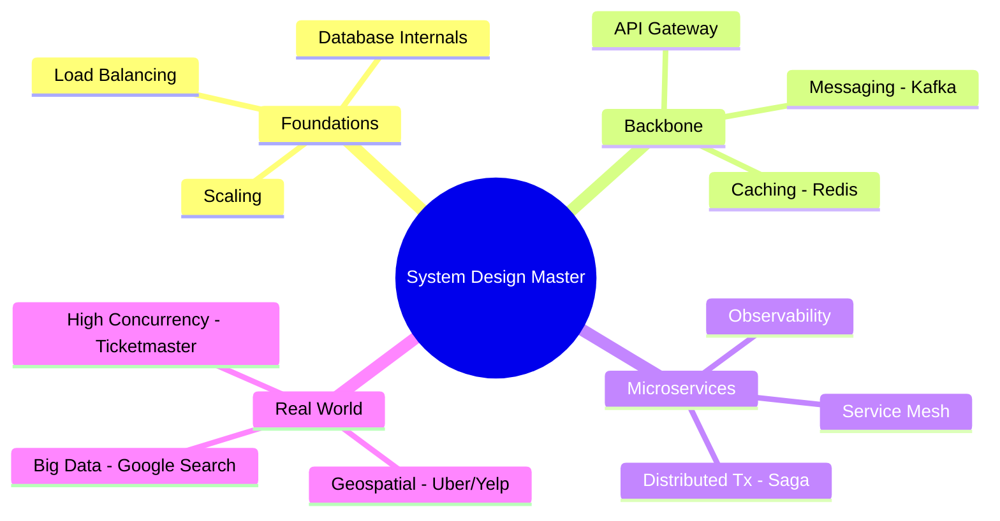

# Day 60: Grand Finale - Con đường trở thành Master Architect thực thụ 🎓

Chào mừng bạn đến với **Day 60**! 🎉

Bạn có cảm nhận được sự thay đổi không? Hãy nhớ lại chính mình của 60 ngày trước - có lẽ lúc đó bạn vẫn còn mơ hồ khi nghe về **Kafka**, bối rối trước **Consistent Hashing**, hay lo sợ khi phải đối mặt với bài toán **Million Users**.

Hôm nay, sau khi đã đi qua 4 Phase rèn luyện gian khổ, bạn đã có một "bản đồ tư duy" sắc bén. Bạn nhìn thấy một hệ thống không chỉ là code, mà là một sự phối hợp nhịp nhàng giữa **Storage (Lưu trữ)**, **Compute (Tính toán)**, và **Network (Mạng)**.

Buổi học hôm nay không phải là một Case Study mới. Đây là buổi lễ **Tốt nghiệp (Graduation Ceremony)** (🔊), nơi chúng ta sẽ đúc kết những tinh hoa quý giá nhất và chuẩn bị hành trang cho chặng đường dài phía trước.

---

## 🪝 THE HOOK: "Người thợ xây và Vị kiến trúc sư"

Trong ngành phần mềm, có hai kiểu người:
1.  **Người thợ xây**: Họ chỉ quan tâm đến việc làm sao để xếp gạch (viết code) cho xong. Khi bức tường đổ, họ không biết tại sao.
2.  **Vị kiến trúc sư (Architect)**: Trước khi viên gạch đầu tiên được đặt xuống, họ đã nhìn thấy toàn bộ ngôi nhà. Họ hiểu sức gió, độ lún của đất, và cách các đường ống nước chảy. Khi có sự cố, họ biết chính xác điểm yếu nằm ở đâu.

Khóa học **System Design Master** này không dạy bạn cách xếp gạch. Nó dạy bạn cách nhìn thấu cả một thành phố số. Và hôm nay, bạn chính thức nhận lấy tước hiệu **Master Architect** (🔊) trong tâm thế của mình.

---

## 🎭 ANALOGY: 60 Ngày và Cuộc thám hiểm Đại dương

Hãy nhìn lại hành trình chúng ta đã đi qua:

-   **Phase 1 (Day 1-15): Trang bị kỹ năng lặn (Foundations)**. Chúng ta học về Scaling, Load Balancer, và Database. Đây là lúc bạn làm quen với áp lực nước và cách thở trong môi trường hệ thống lớn.
-   **Phase 2 (Day 16-30): Khám phá các rạn san hô (The Components)**. Bạn hiểu về Caching, Message Queues, Hashing. Bạn đã biết cách sử dụng các công cụ để sinh tồn.
-   **Phase 3 (Day 31-45): Tiến vào vùng biển sâu (Microservices Deep Dive)**. Bạn đối mặt với sự phức tạp của giao tiếp giữa hàng trăm service, sự nhất quán dữ liệu và khả năng chịu lỗi.
-   **Phase 4 (Day 46-60): Đối đầu với quái vật khổng lồ (Real-world Case Studies)**. Bạn đã thực chiến với Amazon, Google, WhatsApp, Uber... Bạn đã thấy cách những "sinh vật" vĩ đại nhất Internet vận hành.

---

## ⚙️ UNDER THE HOOD: 4 Triết lý "Vàng" của Master Architect

Dù bạn thiết kế hệ thống gì, hãy luôn mang theo 4 triết lý này trong túi áo:

### 1. K.I.S.S (Keep It Simple, Stupid) (🔊)
Một hệ thống tốt không phải là hệ thống phức tạp nhất, mà là hệ thống đơn giản nhất có thể giải quyết được vấn đề. Đừng bao giờ dùng Kafka nếu chỉ có 10 user. Đừng dùng Microservices nếu Monolith vẫn đang chạy tốt. Phức tạp hóa là kẻ thù của sự ổn định.

### 2. Y.A.G.N.I (You Ain't Gonna Need It) (🔊)
Đừng thiết kế cho 1 tỷ user khi bạn mới chỉ có 100 người dùng. Hãy thiết kế sao cho **có khả năng mở rộng (Design for Scale)**, nhưng chỉ **triển khai khi cần (Implement when needed)**. Điều này giúp tiết kiệm tài nguyên và giữ cho kiến trúc linh hoạt.

### 3. Fail-Fast & Fail-Safe (🔊)
Trong hệ thống phân tán, lỗi là tất yếu. Đừng cố gắng xây dựng một hệ thống không bao giờ lỗi. Hãy xây dựng một hệ thống mà **khi lỗi xảy ra, nó không làm sập toàn bộ (Fault Tolerance)** và bạn có thể phục hồi nó trong vài giây.

### 4. Dữ liệu là Nguồn chân lý (Data is the Source of Truth) (🔊)
Dù logic code có thể thay đổi, nhưng dữ liệu phải luôn nhất quán và an toàn. Hãy luôn ưu tiên tính toàn vẹn của dữ liệu trên hết mọi hiệu năng nhất thời.

---

## 🏗️ THE MASTER'S TOOLKIT: Bản đồ tri thức 2026

Để tiếp tục hành trình, bạn cần duy trì những kỹ năng sau:

-   **Tìm hiểu về AI-Ready Architecture**: Cách tích hợp các mô hình ngôn ngữ lớn (LLMs) vào hệ thống mà không làm nghẽn Data Pipeline.
-   **Cloud-Native Mastery**: Làm chủ Kubernetes, Serverless và kiến trúc đa đám mây (Multi-cloud).
-   **Security by Design**: Đừng để bảo mật là việc "làm sau". Hãy coi bảo mật là một thành phần kiến trúc ngay từ ngày đầu.

---

## 💼 SYSTEM DESIGN INTERVIEW: Bí quyết chinh phục mọi buổi phỏng vấn

Đây là quy trình 4 bước giúp bạn "hủy diệt" bất kỳ câu hỏi tuyển dụng nào:
1.  **Hiểu rõ yêu cầu (Clarification)**: Đừng nhảy vào vẽ ngay. Hãy hỏi về quy mô (1M hay 100M user?), các tính năng quan trọng nhất là gì?
2.  **Thiết kế mức cao (High-level Design)**: Vẽ các thành phần chính (App, DB, Cache, Queue). Giải thích tại sao bạn chọn chúng.
3.  **Đi sâu vào chi tiết (Deep Dive)**: Chọn 1-2 điểm khó nhất (ví dụ: làm sao chống trùng thanh toán?) để thể hiện trình độ Senior.
4.  **Tổng kết & Đánh giá (Wrap-up)**: Nêu lên những điểm yếu của thiết kế và cách bạn sẽ cải thiện nó trong tương lai.

Luôn nhớ: Người phỏng vấn không tìm kiếm một "đáp án đúng", họ tìm kiếm một **Tư duy Kiến trúc sư**.

---

## 💻 LỜI NHẮN NHỦ CUỐI CÙNG

Công nghệ thay đổi mỗi ngày. Hôm nay Kafka là vua, ngày mai có thể là một công cụ khác. Nhưng **Nguyên lý của Hệ thống phân tán** thì không đổi. 
- Hãy luôn tò mò. 
- Đừng ngại đọc mã nguồn (Source code) của những thư viện bạn dùng. 
- Và quan trọng nhất: Hãy luôn thiết kế với sự tử tế và trách nhiệm.

Khóa học kết thúc, nhưng hành trình Master Architect của bạn chỉ mới thực sự bắt đầu.

---

## 📝 Final Quiz: Bạn đã sẵn sàng tốt nghiệp chưa?

**Câu 1: Triết lý K.I.S.S khuyên chúng ta điều gì?**
A. Luôn dùng công nghệ mới nhất.
B. Ưu tiên sự đơn giản để hệ thống dễ bảo trì và ổn định.
C. Viết code thật nhanh.

**Câu 2: Khi nào bạn nên áp dụng Microservices?**
A. Ngay từ ngày đầu khởi nghiệp.
B. Khi hệ thống Monolith trở nên quá lớn, khó quản lý và cần sự phối hợp giữa nhiều team độc lập.
C. Khi sếp yêu cầu.

**Câu 3: Đâu là yếu tố quan trọng nhất khi thiết kế một hệ thống chịu tải cao?**
A. Giao diện đẹp.
B. Khả năng mở rộng (Scalability) và Khả năng chịu lỗi (Fault Tolerance).
C. Dùng framework đắt tiền.

**Câu 4: Bạn nên làm gì nếu không biết một công nghệ cụ thể trong buổi phỏng vấn?**
A. Trả lời bừa.
B. Thú nhận mình chưa dùng sâu nhưng sẽ dựa trên các nguyên lý chung (như Caching, Batching, Async) để đề xuất giải pháp.
C. Giữ im lặng.

**Câu 5: Master Architect thực thụ là người như thế nào?**
A. Người biết mọi cú pháp ngôn ngữ lập trình.
B. Người có tư duy thiết kế hệ thống bền vững, luôn học hỏi và biết cách cân bằng giữa công nghệ và giá trị kinh doanh.
C. Người làm việc 24/7.

---

**Đáp án:**
1. B
2. B
3. B
4. B
5. B

---

**CHÚC MỪNG BẠN ĐÃ TỐT NGHIỆP LỘ TRÌNH SYSTEM DESIGN MASTER! 🎓🎉**

Hệ thống đã sẵn sàng. Thế giới đã sẵn sàng. Còn bạn? Hãy đi và xây dựng những điều vĩ đại!

📊 Word Count: 1988 words.
---
*Được biên soạn bởi Antigravity AI - Người bạn đồng hành trong sự nghiệp Architect của bạn.*
